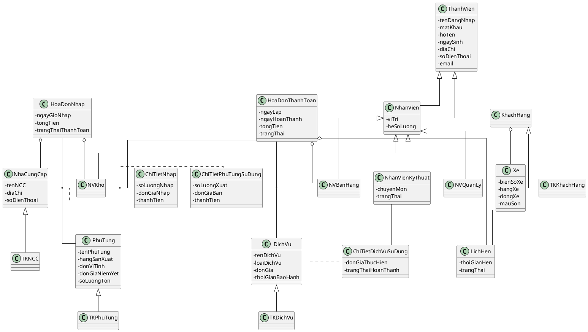
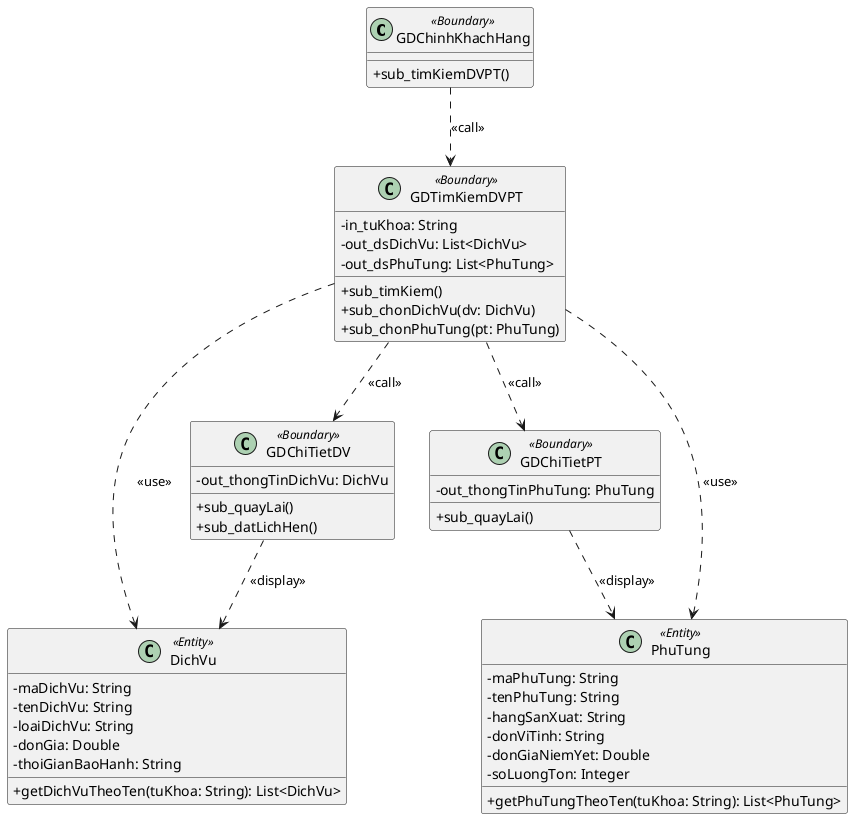
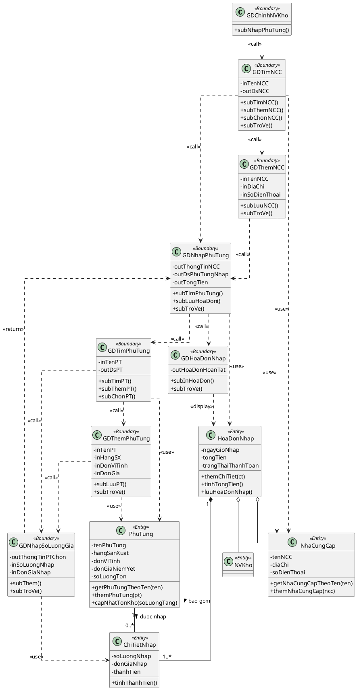
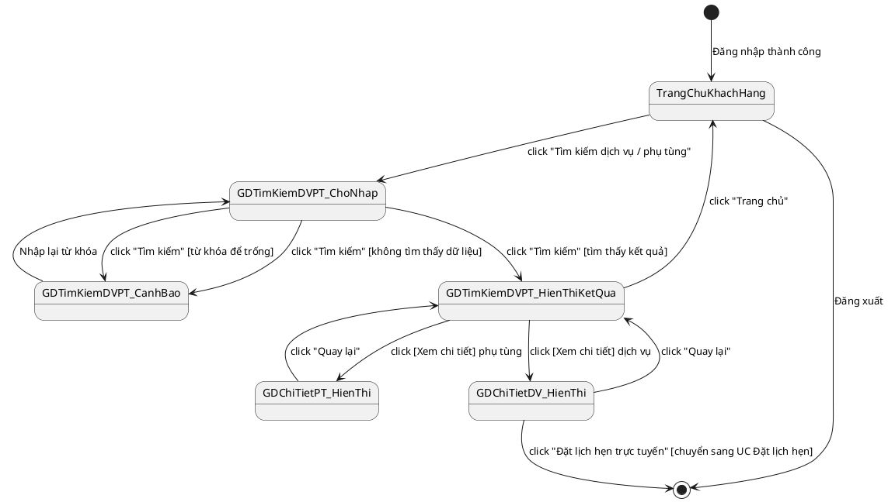
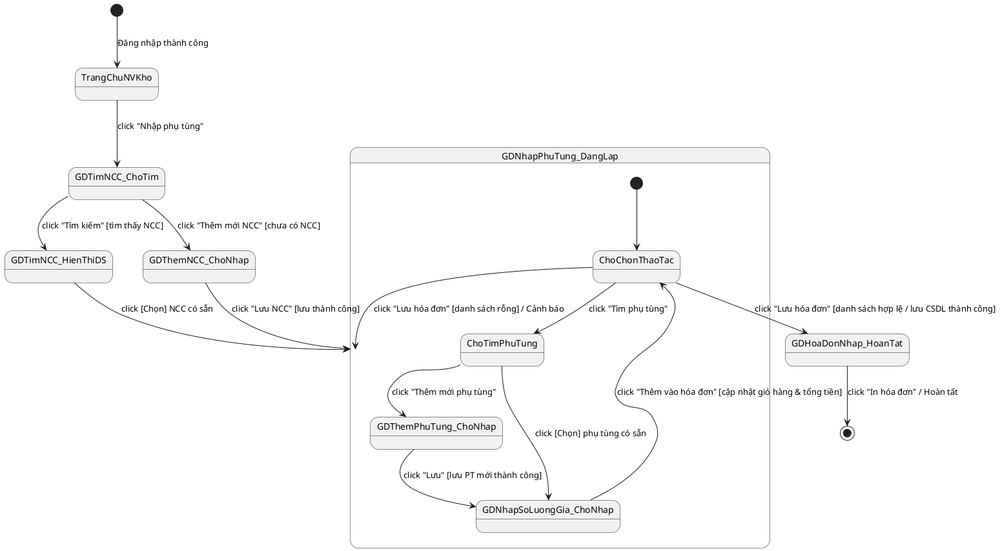
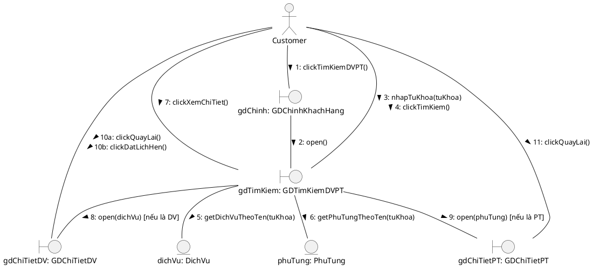
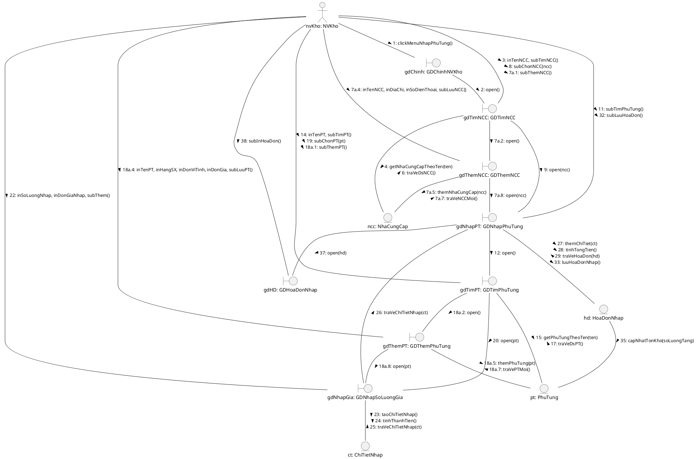

BỘ GIÁO DỤC VÀ ĐÀO TẠO
HỌC VIỆN CÔNG NGHỆ BƯU CHÍNH VIỄN THÔNG
KHOA CÔNG NGHỆ THÔNG TIN

-----------------------***-----------------------

BÁO CÁO BÀI TẬP LỚN
PHÂN TÍCH VÀ THIẾT KẾ HỆ THỐNG

HỆ THỐNG QUẢN LÝ GARA Ô TÔ (GaraMan)

| Học phần: | Phân tích và Thiết kế Hệ thống |
| :--- | --- |
| Giảng viên hướng dẫn: | [Họ và tên Giảng viên] |
| Sinh viên thực hiện: | [Họ và tên Sinh viên] |
| Mã sinh viên / Lớp: | [Mã SV] - [Lớp] |

# I. ĐẶC TẢ YÊU CẦU

## 1. Bảng từ khóa (Glossary List)

Tập hợp và phân loại các từ khóa chuyên môn trong phạm vi hoạt động của hệ thống quản lý gara ô tô:

| TT | Tên Tiếng Việt | Tên Tiếng Anh | Giải thích chi tiết |
| :--- | --- | --- | --- |
| **Nhóm các khái niệm liên quan đến con người** | | | |
| 1 | Thành viên | Member | Người có tài khoản và mật khẩu để đăng nhập vào hệ thống, là lớp cha trừu tượng của toàn bộ người dùng tương tác. |
| 2 | Nhân viên | Staff | Thành viên làm việc tại gara ô tô, được phân quyền các nghiệp vụ nội bộ theo chức vụ. |
| 3 | Nhân viên quản lý | Manager | Người điều hành gara, xem các báo cáo thống kê kinh doanh và quản lý danh mục dịch vụ, phụ tùng. |
| 4 | Nhân viên kho | Warehouse Staff | Người phụ trách việc nhập kho phụ tùng từ nhà cung cấp và quản lý hồ sơ đối tác cung ứng. |
| 5 | Nhân viên bán hàng | Sales Staff | Người tiếp nhận khách hàng và xe, lập phiếu sửa chữa, phân công thợ kỹ thuật và thu tiền thanh toán. |
| 6 | Khách hàng | Customer | Chủ sở hữu hoặc người điều khiển ô tô sử dụng dịch vụ tại gara hoặc đặt lịch hẹn trực tuyến qua hệ thống. |
| 7 | Nhân viên kỹ thuật | Technician | Thợ máy trực tiếp thực hiện sửa chữa tại xưởng; đóng vai trò là thực thể dữ liệu nhân sự để nhân viên bán hàng phân công phụ trách dịch vụ. |
| 8 | Nhà cung cấp | Supplier | Đối tác kinh doanh cung ứng phụ tùng cho gara; đóng vai trò là thực thể đối tác giao dịch lưu trữ trong CSDL. |
| **Nhóm các khái niệm liên quan đến hoạt động của con người** | | | |
| 9 | Đăng nhập | Login | Quá trình người dùng xác thực tài khoản và mật khẩu để truy cập vào hệ thống GaraMan. |
| 10 | Đăng xuất | Logout | Hoạt động kết thúc phiên làm việc an toàn của người dùng trên hệ thống. |
| 11 | Đổi mật khẩu | Change Password | Hoạt động người dùng chủ động cập nhật mật khẩu mới để bảo mật tài khoản cá nhân. |
| 12 | Tìm kiếm thông tin dịch vụ / phụ tùng | Search Service Info & Parts | Thao tác của khách hàng nhập từ khóa để tra cứu danh mục dịch vụ hoặc phụ tùng và xem thông tin chi tiết. |
| 13 | Xem chi tiết dịch vụ | View Service Detail | Mở trang hiển thị thông số chi tiết, giá cả niêm yết, quy trình, bảo hành của một dịch vụ cụ thể. |
| 14 | Xem chi tiết phụ tùng | View Spare Part Detail | Mở trang hiển thị thông số chi tiết, hãng sản xuất, giá bán niêm yết, tình trạng tồn kho của một phụ tùng. |
| 15 | Đặt lịch hẹn trực tuyến | Book Online Appointment | Hoạt động khách hàng chọn trước ngày giờ, loại xe và dịch vụ mong muốn để gara sắp xếp chỗ đón tiếp. |
| 16 | Nhập phụ tùng | Import Spare Parts | Quy trình nhân viên kho chọn nhà cung cấp, chọn danh mục phụ tùng, nhập số lượng, đơn giá và lưu hóa đơn nhập. |
| 17 | Quản lý nhà cung cấp | Manage Suppliers | Cập nhật, lưu trữ hồ sơ liên hệ, địa chỉ và lịch sử giao dịch với các đơn vị cung cấp phụ tùng. |
| 18 | Thêm mới nhà cung cấp | Add New Supplier | Hoạt động lưu thông tin một đối tác cung cấp mới khi chưa có trong danh bạ hệ thống trong quá trình nhập hàng. |
| 19 | Thêm mới phụ tùng | Add New Spare Part | Hoạt động khai báo loại phụ tùng mới vào danh mục khi tiến hành nhập hàng chưa từng có trước đó. |
| 20 | Quản lý dịch vụ | Manage Services | Hoạt động thêm mới, điều chỉnh tên gọi, mô tả chi tiết, giá niêm yết hoặc ngừng cung cấp các hạng mục dịch vụ. |
| 21 | Quản lý phụ tùng | Manage Spare Parts | Hoạt động thêm mới, cập nhật đơn giá bán lẻ, định mức tồn kho và quy cách của phụ tùng. |
| 22 | Nhận khách | Receive Customer | Nhân viên bán hàng đón tiếp khách, ghi nhận thông tin xe và tình trạng ban đầu khi đưa vào xưởng. |
| 23 | Nhận yêu cầu dịch vụ và phụ tùng | Receive Service Request | Ghi nhận chi tiết các gói bảo dưỡng, sửa chữa hoặc phụ tùng thay thế mà khách hàng đồng ý thực hiện. |
| 24 | Phân công kỹ thuật | Assign Technician | Nhân viên bán hàng lựa chọn kỹ thuật viên phù hợp để phụ trách từng hạng mục dịch vụ cụ thể trên xe khách. |
| 25 | Nhận thanh toán | Receive Payment | Nhân viên bán hàng chốt chi phí, thu tiền từ khách và xuất hóa đơn dịch vụ hoàn tất giao dịch. |
| 26 | Xem thống kê | View Statistics | Quản lý thực hiện tra cứu số liệu tổng hợp về doanh thu, lượt phục vụ theo dịch vụ, phụ tùng, đối tác và khách hàng. |
| 27 | Thống kê dịch vụ | Service Statistics | Báo cáo xếp hạng dịch vụ theo doanh thu và số lượt thực hiện trong một chu kỳ thời gian. |
| 28 | Thống kê phụ tùng | Part Statistics | Báo cáo số lượng phụ tùng tiêu thụ, doanh thu và tồn kho của các mặt hàng. |
| 29 | Thống kê khách hàng | Customer Statistics | Báo cáo tổng hợp số lần sử dụng dịch vụ và tổng tiền chi tiêu của từng khách hàng. |
| 30 | Thống kê nhà cung cấp | Supplier Statistics | Báo cáo tổng giá trị hàng nhập và số lần giao dịch theo từng đơn vị cung cấp. |
| **Nhóm các khái niệm liên quan đến vật, đối tượng xử lí** | | | |
| 31 | Mặt hàng | Item | Lớp cha trừu tượng của các hàng hóa/dịch vụ kinh doanh tại gara (mã, tên, đơn giá, mô tả). |
| 32 | Dịch vụ | Service | Công việc kỹ thuật gara cung cấp (kế thừa Mặt hàng, có thêm: thời gian dự kiến, bảo hành). |
| 33 | Phụ tùng | Spare Part | Linh kiện, vật tư thay thế cho xe (kế thừa Mặt hàng, có thêm: hãng sản xuất, xuất xứ, đơn vị tính, số lượng tồn kho). |
| 34 | Xe ô tô | Vehicle / Car | Đối tượng phương tiện của khách hàng tiếp nhận các dịch vụ sửa chữa, bảo dưỡng và thay thế phụ tùng tại gara. |
| 35 | Hóa đơn nhập | Import Invoice | Chứng từ lưu lại số lượng, giá mua, tổng tiền và ngày giao dịch khi nhập phụ tùng từ nhà cung cấp. |
| 36 | Chi tiết phụ tùng nhập | Imported Part Item | Dòng dữ liệu trong hóa đơn nhập, thể hiện một mặt hàng phụ tùng, số lượng và đơn giá nhập cụ thể. |
| 37 | Phiếu sửa chữa (Hóa đơn dịch vụ) | Repair Order / Job Sheet | Chứng từ xuyên suốt theo dõi tiến trình tiếp nhận xe, liên kết dịch vụ đã làm, phụ tùng đã thay, thợ phụ trách và thanh toán. |
| 38 | Chi tiết dịch vụ sử dụng | Service Usage Detail | Hạng mục dịch vụ được thực hiện trong phiếu sửa chữa và kỹ thuật viên đảm nhận. |
| 39 | Chi tiết phụ tùng thay thế | Part Replacement Detail | Phụ tùng được xuất kho lắp ráp cho xe và đơn giá bán tương ứng. |
| 40 | Lịch hẹn | Appointment | Bản ghi hẹn trước về ngày giờ, loại xe và dịch vụ mà khách hàng đăng ký trên hệ thống. |
| 41 | Báo cáo thống kê | Statistics Report | Dữ liệu tổng hợp theo tiêu chí thời gian phục vụ công tác quản trị của nhân viên quản lý. |

## 2. Mô tả hệ thống bằng ngôn ngữ tự nhiên

### 2.1 Giới thiệu mục đích hệ thống

Hệ thống quản lý gara ô tô (GaraMan) là một ứng dụng nền tảng web phục vụ công tác quản lý quy trình dịch vụ sửa chữa, bảo dưỡng ô tô; quản lý danh mục và hoạt động nhập phụ tùng từ nhà cung cấp; tiếp nhận yêu cầu, phân công kỹ thuật và thanh toán của khách hàng; hỗ trợ khách hàng tra cứu dịch vụ, phụ tùng, đặt lịch hẹn trực tuyến và cung cấp các báo cáo thống kê phục vụ công tác quản trị gara.

### 2.2 Phạm vi hệ thống

Hệ thống được thiết kế phục vụ 4 tác nhân chính trực tiếp đăng nhập và sử dụng các chức năng nghiệp vụ:

• Thành viên hệ thống: Đăng nhập, Đăng xuất, Đổi mật khẩu cá nhân.
• Khách hàng: Được thực hiện các chức năng của thành viên sau khi đăng nhập, Tìm kiếm thông tin dịch vụ / phụ tùng, Xem thông tin chi tiết dịch vụ/phụ tùng, Đặt lịch hẹn trực tuyến.
• Nhân viên bán hàng: Được thực hiện các chức năng của thành viên, Nhận khách và xe, Nhận yêu cầu dịch vụ và phụ tùng từ khách, Phân công nhân viên kỹ thuật theo dịch vụ yêu cầu, Nhận thanh toán và xuất hóa đơn cho khách hàng.
• Nhân viên kho: Được thực hiện các chức năng của thành viên, Nhập phụ tùng từ nhà cung cấp, Quản lý thông tin nhà cung cấp (tìm kiếm, thêm mới, cập nhật).
• Nhân viên quản lý: Được thực hiện các chức năng của thành viên, Quản lý thông tin dịch vụ (thêm, sửa, khóa), Quản lý thông tin phụ tùng (thêm, sửa đơn giá bán, định mức tồn), Xem các loại thống kê: thống kê dịch vụ, thống kê phụ tùng, thống kê khách hàng, thống kê nhà cung cấp.

### 2.3 Hoạt động nghiệp vụ của các chức năng

Mô tả chi tiết luồng tương tác và xử lý nghiệp vụ của các chức năng chính:

#### a. Chức năng Khách hàng tìm kiếm thông tin dịch vụ / phụ tùng:
Sau khi đăng nhập thành công, từ giao diện chính của khách hàng, khách hàng chọn menu "Tìm thông tin dịch vụ / phụ tùng". Hệ thống hiển thị giao diện tìm kiếm với ô nhập từ khóa tìm kiếm và nút "Tìm kiếm".
Khách hàng nhập từ khóa tên dịch vụ hoặc phụ tùng cần tìm (ví dụ: "thay dầu", "lọc gió") và click "Tìm kiếm". Hệ thống truy vấn CSDL và hiển thị danh sách các dịch vụ/phụ tùng có tên chứa từ khóa vừa nhập (gồm: Mã, Tên, Đơn giá niêm yết, và nút "Xem chi tiết").
Khách hàng click vào một mục dịch vụ hoặc phụ tùng trong danh sách: Nếu là dịch vụ, chuyển sang giao diện chi tiết dịch vụ hiển thị Mã dịch vụ, Tên dịch vụ, Đơn giá, Thời gian dự kiến thực hiện, Mô tả quy trình, Thời gian bảo hành; Nếu là phụ tùng, chuyển sang giao diện chi tiết phụ tùng hiển thị Mã phụ tùng, Tên phụ tùng, Hãng sản xuất, Xuất xứ, Đơn vị tính, Đơn giá bán niêm yết, Tình trạng còn hàng.
Khách hàng có thể nhấn "Quay lại" để tiếp tục tra cứu từ khóa khác. Trường hợp không tìm thấy kết quả phù hợp, hệ thống xuất thông báo cảnh báo và cho phép người dùng nhập lại từ khóa khác.

#### b. Chức năng Nhân viên kho nhập phụ tùng từ nhà cung cấp:
Sau khi đăng nhập thành công, từ giao diện chính của nhân viên kho, nhân viên chọn menu "Nhập phụ tùng". Giao diện tìm kiếm nhà cung cấp hiển thị ô tìm kiếm nhà cung cấp theo tên, nút "Tìm kiếm" và nút "Thêm mới NCC". Nhân viên nhập tên NCC và click "Tìm kiếm". Hệ thống hiển thị danh sách NCC phù hợp (Mã NCC, Tên, SĐT, Địa chỉ, Mã số thuế) kèm nút "Chọn". Trường hợp NCC chưa có trong hệ thống, nhân viên click "Thêm mới NCC", giao diện thêm NCC hiển thị form nhập thông tin đối tác -> bấm "Lưu NCC" -> Hệ thống lưu vào CSDL và tự động chọn NCC này.
Sau khi đã chọn xong 1 NCC, hệ thống chuyển sang giao diện lập hóa đơn nhập phụ tùng. Màn hình hiển thị: Thông tin NCC đã chọn; Bảng danh sách các mặt hàng phụ tùng đã chọn nhập trong phiên làm việc hiện tại, ban đầu rỗng; Nút "Tìm phụ tùng"; và nút "Lưu hóa đơn".
Vòng lặp nhập phụ tùng diễn ra như sau: Nhân viên click "Tìm phụ tùng", mở giao diện tìm phụ tùng -> Nhân viên nhập tên phụ tùng và bấm "Tìm kiếm" -> Hệ thống hiện danh sách phụ tùng kèm nút "Chọn" (nếu phụ tùng mới chưa có trong danh mục, nhân viên bấm "Thêm mới phụ tùng", mở giao diện thêm mới phụ tùng để nhập Tên, Hãng SX, Xuất xứ, Đơn vị tính, Đơn giá bán niêm yết dự kiến và bấm Lưu) -> Sau khi chọn phụ tùng, hệ thống chuyển sang giao diện nhập số lượng giá -> Nhân viên nhập Số lượng nhập và Đơn giá nhập, bấm "Thêm vào hóa đơn" -> Hệ thống cập nhật phụ tùng vào giỏ hàng, tính lại Tổng tiền và quay về giao diện nhập phụ tùng. Nhân viên lặp lại các bước trên cho đến khi nhập xong toàn bộ các mặt hàng.
Khi đã kiểm tra đầy đủ danh sách phụ tùng, nhân viên click nút "Lưu hóa đơn". Hệ thống thực hiện lưu hóa đơn nhập. Sau đó hệ thống chuyển sang giao diện xem hóa đơn để nhân viên in phiếu và thanh toán cho nhà cung cấp.

#### c. Chức năng Nhân viên quản lý xem thống kê dịch vụ:
Nhân viên quản lý đăng nhập vào hệ thống -> chọn chức năng "Xem thống kê" -> hệ thống hiện giao diện chọn loại thống kê -> chọn "Thống kê theo dịch vụ" -> Quản lý chọn khoảng thời gian cần thống kê (Từ ngày - Đến ngày) -> Kết quả thống kê hiện lên, mỗi dịch vụ trên một dòng, xếp theo thứ tự doanh thu từ cao nhất đến thấp nhất (STT, Mã dịch vụ, Tên dịch vụ, Số lượt thực hiện, Tổng doanh thu) -> Quản lý click vào một dịch vụ cụ thể -> Hệ thống hiển thị danh sách các lần thực hiện dịch vụ đó (Ngày thực hiện, Biển số xe, Tên khách hàng, Kỹ thuật viên phụ trách, Số tiền thanh toán).

### 2.4 Thông tin các đối tượng cần xử lý, quản lý

• Nhóm người dùng:
  - Thành viên: Tên đăng nhập, Mật khẩu, Họ và tên, Ngày sinh, Địa chỉ, Số điện thoại, Email.
  - Khách hàng: Kế thừa Thành viên, có thêm Biển số xe.
  - Nhân viên: Kế thừa Thành viên, có thêm Mã nhân viên, Vị trí công việc, Hệ số lương.
  - Nhân viên quản lý, Nhân viên kho, Nhân viên bán hàng: Kế thừa Nhân viên.
• Nhóm danh mục và đối tác:
  - Nhà cung cấp: Mã nhà cung cấp, Tên nhà cung cấp, Địa chỉ, Số điện thoại, Mã số thuế, Email, Ghi chú.
  - Dịch vụ: Mã dịch vụ, Tên dịch vụ, Đơn giá, Thời gian dự kiến thực hiện, Mô tả quy trình, Thời gian bảo hành.
  - Phụ tùng: Mã phụ tùng, Tên phụ tùng, Hãng sản xuất, Xuất xứ, Đơn vị tính, Số lượng tồn kho, Đơn giá bán, Mô tả.
• Nhóm vận hành và giao dịch:

- Lịch hẹn: Mã lịch hẹn, Thời gian hẹn, Khách hàng, Dịch vụ, Trạng thái.
  - Hóa đơn nhập: Mã hóa đơn nhập, Ngày giờ nhập, Nhân viên kho, Nhà cung cấp, Tổng tiền, Trạng thái thanh toán.
  - Chi tiết hóa đơn nhập: Mã chi tiết nhập, Hóa đơn nhập, Phụ tùng, Số lượng nhập, Đơn giá nhập, Thành tiền.
  - Hóa đơn thanh toán: Mã hóa đơn thanh toán, Ngày lập, Ngày giờ hoàn thành, Khách hàng, Nhân viên bán hàng, Tổng tiền thanh toán, Trạng thái.
  - Chi tiết dịch vụ sử dụng: Mã chi tiết dịch vụ, Mã hóa đơn thanh toán, Dịch vụ, Kỹ thuật viên phụ trách, Đơn giá thực hiện, Trạng thái hoàn thành.
  - Chi tiết phụ tùng sử dụng: Mã chi tiết phụ tùng, Mã hóa đơn thanh toán, Phụ tùng, Số lượng xuất, Đơn giá bán, Thành tiền.
• Nhóm báo cáo thống kê:
  - Thống kê dịch vụ: Theo số lượt sử dụng, theo tổng doanh thu.
  - Thống kê phụ tùng: Theo số lượng tiêu thụ, theo doanh thu bán lẻ.
  - Thống kê khách hàng: Theo tần suất sử dụng, theo tổng chi tiêu.
  - Thống kê nhà cung cấp: Theo tổng giá trị hàng nhập, theo số lần nhập hàng.

### 2.5 Quan hệ giữa các đối tượng, thông tin

• Một khách hàng có thể phát sinh nhiều hóa đơn thanh toán dịch vụ và sửa chữa tại gara theo thời gian.
• Một nhà cung cấp có thể liên kết với nhiều hóa đơn nhập phụ tùng của gara.
• Mỗi hóa đơn nhập phụ tùng ứng với một nhà cung cấp duy nhất và do một nhân viên kho trực tiếp lập.
• Mỗi hóa đơn nhập phụ tùng bao gồm nhiều chi tiết phụ tùng nhập; mỗi chi tiết xác định một phụ tùng, số lượng nhập và đơn giá nhập của đợt nhập đó.
• Mỗi hóa đơn thanh toán do một nhân viên bán hàng lập cho một khách hàng, có thể ghi nhận biển số xe tương ứng.
• Mỗi hóa đơn thanh toán bao gồm nhiều chi tiết dịch vụ sử dụng và nhiều chi tiết phụ tùng sử dụng.
• Mỗi dịch vụ trong hóa đơn thanh toán có thể được phân công cho một nhân viên kỹ thuật phụ trách thực hiện.
• Một nhân viên kỹ thuật có thể được phân công phụ trách nhiều dịch vụ khác nhau trên các hóa đơn thanh toán tại các thời điểm khác nhau.

## 3. Biểu đồ Use Case tổng quan và mô tả ca sử dụng

### 3.1 Biểu đồ Use Case tổng quan hệ thống

Dưới đây là biểu đồ ca sử dụng tổng quan của hệ thống GaraMan, thể hiện các tác nhân và các chức năng tương ứng trong hệ thống:

*[Hình 3.1: Biểu đồ Use Case tổng quan hệ thống GaraMan]*

### 3.2 Bảng mô tả tóm tắt Use Case tổng quan

| STT | Tên Use Case | Tác nhân chính | Mô tả chức năng |
| :--- | --- | --- | --- |
| 1 | Đăng nhập | Thành viên | Xác thực tài khoản và mật khẩu để truy cập vào đúng phân quyền chức năng trong hệ thống. |
| 2 | Đăng xuất | Thành viên | Thoát khỏi phiên làm việc hiện tại của tài khoản người dùng. |
| 3 | Đổi mật khẩu | Thành viên | Người dùng chủ động cập nhật mật khẩu mới để đảm bảo tính bảo mật cá nhân. |
| 4 | Tìm kiếm thông tin dịch vụ / phụ tùng | Khách hàng | Khách hàng nhập từ khóa để tra cứu danh mục bảng giá dịch vụ và linh kiện hiện có tại gara. |
| 5 | Đặt lịch hẹn trực tuyến | Khách hàng | Khách hàng chủ động chọn ngày, khung giờ hẹn, loại xe và dịch vụ mong muốn trước khi đưa xe đến xưởng. |
| 6 | Quản lý dịch vụ | NV Quản lý | Nhân viên quản lý thiết lập danh mục gói bảo dưỡng/sửa chữa mới, cập nhật giá cước hoặc tạm dừng cung cấp dịch vụ. |
| 7 | Quản lý phụ tùng | NV Quản lý | Nhân viên quản lý thêm danh mục linh kiện mới, điều chỉnh đơn giá niêm yết bán lẻ hoặc định mức phụ tùng. |
| 8 | Xem thống kê | NV Quản lý | Quản lý tra cứu và trích xuất các báo cáo doanh thu dịch vụ, phụ tùng, khách hàng và giá trị nhập hàng theo thời gian. |
| 9 | Nhập phụ tùng | NV Kho | Nhân viên kho tạo phiếu nhập, chọn nhà cung cấp, nhập số lượng, đơn giá và xác nhận tăng lượng tồn kho. |
| 10 | Quản lý nhà cung cấp | NV Kho | Nhân viên kho tra cứu, thêm mới đối tác hoặc sửa đổi thông tin liên hệ của các nhà cung cấp linh kiện. |
| 11 | Nhận khách và xe | NV Bán hàng | Nhân viên bán hàng tiếp nhận xe, ghi nhận thông tin khách hàng, tình trạng ban đầu của xe khi vào xưởng. |
| 12 | Nhận yêu cầu dịch vụ và phụ tùng | NV Bán hàng | Lập danh sách các gói dịch vụ sửa chữa/bảo dưỡng và linh kiện thay thế theo yêu cầu và thỏa thuận với khách. |
| 13 | Phân công kỹ thuật viên | NV Bán hàng | Chọn và chỉ định kỹ thuật viên phù hợp để phụ trách từng hạng mục dịch vụ đã tiếp nhận. |
| 14 | Nhận thanh toán | NV Bán hàng | Chốt danh sách dịch vụ - phụ tùng hoàn thành, tính tổng chi phí, nhận tiền từ khách và xuất hóa đơn thanh toán. |

## 4. Biểu đồ Use Case chi tiết và mô tả ca sử dụng

### 4.1 Chức năng Khách hàng tìm kiếm thông tin dịch vụ / phụ tùng

Biểu đồ ca sử dụng chi tiết cho chức năng tìm kiếm thông tin dịch vụ / phụ tùng:

*[Hình 4.1: Biểu đồ Use Case chi tiết - Module Tìm kiếm thông tin dịch vụ / phụ tùng]*

#### Bảng đặc tả Use Case chi tiết: Tìm kiếm thông tin dịch vụ / phụ tùng

| Tên Use Case | Tìm kiếm thông tin dịch vụ / phụ tùng |
| :--- | --- |
| Tác nhân chính | Khách hàng |
| Tiền điều kiện | Khách hàng đã đăng nhập thành công vào hệ thống. |
| Hậu điều kiện | Khách hàng xem được danh sách kết quả và thông tin chi tiết dịch vụ/phụ tùng theo nhu cầu. |
| Luồng sự kiện chính (Main Flow) | 1. Khách hàng bấm chọn menu "Tìm thông tin dịch vụ / phụ tùng". 2. Hệ thống hiển thị giao diện tìm kiếm với ô nhập từ khóa và nút "Tìm kiếm". 3. Khách hàng nhập tên từ khóa cần tìm (ví dụ: "thay dầu", "lọc gió") và click "Tìm kiếm". 4. Hệ thống hiển thị danh sách các dịch vụ/phụ tùng có tên khớp với từ khóa vừa nhập. 5. Khách hàng click vào một dịch vụ hoặc phụ tùng trong danh sách. 6. Hệ thống hiển thị toàn bộ thông tin chi tiết của dịch vụ hoặc phụ tùng đã chọn. 7. Khách hàng có thể nhấn "Quay lại" để tiếp tục tra cứu từ khóa khác. |
| Luồng ngoại lệ (Alternative Flow) | 3a. Từ khóa để trống: - Nếu khách hàng click "Tìm kiếm" mà chưa nhập từ khóa, hệ thống hiển thị thông báo yêu cầu nhập từ khóa tra cứu. 4a. Không tìm thấy dữ liệu phù hợp: - Nếu không có dịch vụ hoặc phụ tùng nào chứa từ khóa, hệ thống thông báo: "Không tìm thấy kết quả phù hợp!" và cho phép người dùng nhập từ khóa khác. |

### 4.2 Chức năng Nhân viên kho nhập phụ tùng từ nhà cung cấp

Biểu đồ ca sử dụng chi tiết cho chức năng nhân viên kho nhập phụ tùng từ nhà cung cấp:

*[Hình 4.2: Biểu đồ Use Case chi tiết - Module Nhập phụ tùng từ nhà cung cấp]*

#### Bảng đặc tả Use Case chi tiết: Nhập phụ tùng từ nhà cung cấp

| Tên Use Case | Nhập phụ tùng từ nhà cung cấp |
| :--- | --- |
| Tác nhân chính | Nhân viên kho |
| Tiền điều kiện | Nhân viên kho đã đăng nhập thành công vào hệ thống. |
| Hậu điều kiện | Hóa đơn nhập được lưu vĩnh viễn vào CSDL, số lượng tồn kho phụ tùng tăng tương ứng, chứng từ nhập kho hiển thị hoàn tất để in và thanh toán. |
| Luồng sự kiện chính (Main Flow) | 1. Nhân viên kho chọn menu "Nhập phụ tùng". 2. Hệ thống hiển thị giao diện tìm kiếm nhà cung cấp. 3. Nhân viên nhập tên nhà cung cấp và click "Tìm kiếm". 4. Hệ thống hiển thị danh sách các nhà cung cấp phù hợp, nhân viên click "Chọn" nhà cung cấp mong muốn. 5. Hệ thống chuyển sang giao diện lập hóa đơn nhập phụ tùng với thông tin nhà cung cấp đã chọn và danh sách phụ tùng (ban đầu rỗng). 6. Nhân viên click nút "Tìm phụ tùng", hệ thống hiển thị giao diện tìm kiếm phụ tùng. 7. Nhân viên nhập tên phụ tùng cần tìm và click "Chọn" phụ tùng muốn nhập. 8. Hệ thống chuyển sang giao diện nhập số lượng và đơn giá. Nhân viên điền số lượng nhập, đơn giá nhập và bấm "Thêm vào hóa đơn". 9. Hệ thống lưu phụ tùng vào danh sách hóa đơn, tính lại tổng tiền và quay về giao diện lập hóa đơn. (Các bước 6-9 được lặp lại cho đến khi nhân viên nhập xong toàn bộ các mặt hàng cần nhập). 10. Nhân viên kiểm tra danh sách và click nút "Lưu hóa đơn". 11. Hệ thống lưu thông tin hóa đơn nhập, lưu các chi tiết phụ tùng và cập nhật số lượng tồn kho, sau đó chuyển sang giao diện hiển thị hóa đơn nhập hoàn chỉnh để in và thanh toán cho nhà cung cấp. |
| Luồng ngoại lệ (Alternative Flow) | 4a. Nhà cung cấp chưa tồn tại: - Nhân viên click "Thêm mới NCC", hệ thống hiển thị form nhập thông tin đối tác -> nhân viên nhập thông tin và bấm "Lưu NCC". Hệ thống lưu nhà cung cấp mới và tự động chọn để tiếp tục lập hóa đơn. 7a. Phụ tùng mới chưa có trong danh mục: - Nhân viên click "Thêm mới phụ tùng", hệ thống hiển thị form nhập thông tin phụ tùng -> nhân viên nhập thông tin và bấm "Lưu". Hệ thống lưu phụ tùng mới và tự động chọn để chuyển sang bước nhập số lượng, đơn giá. 8a. Nhập số liệu sai: - Nếu số lượng <= 0 hoặc đơn giá <= 0, hệ thống báo lỗi yêu cầu nhập số dương hợp lệ. 10a. Hóa đơn chưa có phụ tùng: - Nếu bấm "Lưu hóa đơn" khi danh sách phụ tùng đang trống, hệ thống hiển thị cảnh báo: "Chưa có phụ tùng nào được chọn vào hóa đơn!". |

---

# II. PHÂN TÍCH YÊU CẦU HỆ THỐNG (ANALYSIS PHASE)

Hệ thống Quản lý Gara Ô tô (GaraMan) - Đề bài 26  
Tài liệu tham khảo phương pháp: Bài giảng Thực tập tốt nghiệp 2 - CNPM (2020), Chương 3, Mục 3.2.

---

## 1. KỊCH BẢN CA SỬ DỤNG PHIÊN BẢN 1 (SCENARIO V1.0)
*(Áp dụng cho 2 module trọng tâm theo yêu cầu của đề tài)*

### 1.1 Kịch bản ca sử dụng Module 1: Khách hàng tìm kiếm thông tin dịch vụ / phụ tùng

| Mục | Nội dung chi tiết |
| :--- | :--- |
| **Use Case** | **Tìm kiếm thông tin dịch vụ / phụ tùng** |
| **Actor** | Khách hàng |
| **Tiền điều kiện** | Khách hàng đã đăng nhập thành công vào hệ thống. |
| **Hậu điều kiện** | Khách hàng xem được thông tin chi tiết về dịch vụ hoặc phụ tùng theo nhu cầu. |
| **Kịch bản chính** | **1.** Sau khi đăng nhập thành công, khách hàng chọn chức năng Tìm thông tin dịch vụ / phụ tùng trên menu chính. **2.** Giao diện tìm kiếm hiện lên với ô nhập từ khóa và nút Tìm kiếm, danh sách kết quả đang để trống. **3.** Khách hàng nhập từ khóa là lọc gió và nhấn Tìm kiếm. **4.** Hệ thống kiểm tra từ khóa và hiển thị danh sách các dịch vụ và phụ tùng có thông tin khớp với từ khóa: &nbsp;&nbsp;&nbsp;&nbsp;• Dịch vụ: DV01 - Thay lọc gió (Loại dịch vụ: Bảo dưỡng, Đơn giá: 200.000 VNĐ) &nbsp;&nbsp;&nbsp;&nbsp;• Phụ tùng: PT01 - Lọc gió động cơ (Hãng sản xuất: Denso, Đơn giá: 150.000 VNĐ) **5.** Khách hàng click chọn Thay lọc gió trong danh sách để xem thông tin chi tiết. **6.** Hệ thống hiển thị giao diện toàn bộ thông tin chi tiết của dịch vụ đã chọn: &nbsp;&nbsp;&nbsp;&nbsp;- Mã dịch vụ: DV01 &nbsp;&nbsp;&nbsp;&nbsp;- Tên dịch vụ: Thay lọc gió &nbsp;&nbsp;&nbsp;&nbsp;- Loại dịch vụ: Bảo dưỡng &nbsp;&nbsp;&nbsp;&nbsp;- Đơn giá: 200.000 VNĐ &nbsp;&nbsp;&nbsp;&nbsp;- Thời hạn bảo hành: 3 tháng hoặc 5.000 km &nbsp;&nbsp;&nbsp;&nbsp;- Mô tả: Thay lọc gió xe &nbsp;&nbsp;&nbsp;&nbsp;- Nút: Quay lại danh sách, Đặt lịch hẹn trực tuyến **7.** Khách hàng bấm nút Đặt lịch hẹn hoặc quay lại danh sách. |
| **Kịch bản ngoại lệ** | **3a. Từ khóa tìm kiếm để trống:** - Nếu khách hàng nhấn nút Tìm kiếm mà chưa nhập từ khóa, hệ thống hiển thị thông báo yêu cầu nhập từ khóa tra cứu. **4a. Không tìm thấy kết quả phù hợp:** - Nếu không có dịch vụ hoặc phụ tùng nào khớp với từ khóa đã nhập, hệ thống hiển thị thông báo không tìm thấy kết quả phù hợp và cho phép nhập lại từ khóa khác. |

---

### 1.2 Kịch bản ca sử dụng Module 2: Nhân viên kho nhập phụ tùng từ nhà cung cấp

| Mục | Nội dung chi tiết |
| :--- | :--- |
| **Use Case** | **Nhập phụ tùng từ nhà cung cấp** |
| **Actor** | Nhân viên kho |
| **Tiền điều kiện** | Nhân viên kho đã đăng nhập thành công vào hệ thống. |
| **Hậu điều kiện** | Hóa đơn nhập được lưu thành công vào cơ sở dữ liệu, số lượng tồn kho phụ tùng được tự động cập nhật tăng, chứng từ hóa đơn nhập hiển thị hoàn chỉnh để in và làm thủ tục thanh toán. |
| **Kịch bản chính** | **1.** Sau khi đăng nhập thành công, nhân viên kho chọn chức năng Nhập phụ tùng trên menu chính. **2.** Hệ thống hiển thị giao diện tìm kiếm nhà cung cấp. **3.** Nhân viên kho nhập tên nhà cung cấp Hòa Bình và nhấn Tìm kiếm. **4.** Hệ thống hiển thị danh sách các nhà cung cấp phù hợp gồm Mã nhà cung cấp, Tên nhà cung cấp, Địa chỉ, Số điện thoại. **5.** Nhân viên kho click Chọn tại nhà cung cấp mong muốn. **6.** Giao diện lập hóa đơn nhập phụ tùng hiện ra có thông tin nhà cung cấp đã chọn gồm Mã nhà cung cấp, Tên nhà cung cấp, Địa chỉ nhà cung cấp, Số điện thoại NCC, bảng danh sách phụ tùng nhập (ban đầu rỗng), tổng tiền thanh toán và nút Tìm phụ tùng, Trở về, Lưu hóa đơn. **7.** Nhân viên kho click nút Tìm phụ tùng. **8.** Hệ thống hiển thị giao diện tìm kiếm phụ tùng gồm ô tìm kiếm và nút Tìm kiếm, bảng danh sách phụ tùng (ban đầu rỗng), nút Xong. **9.** Nhân viên kho nhập tên phụ tùng cần tìm và click Tìm. **10.** Bảng danh sách phụ tùng hiển thị dữ liệu phụ tùng phù hợp. **11.** Nhân viên kho click nút Chọn tại phụ tùng cần tìm. **12.** Giao diện nhập số lượng và đơn giá hiện lên gồm thông tin chi tiết phụ tùng (Mã phụ tùng, Tên phụ tùng, Hãng sản xuất, Đơn vị tính, Đơn giá bán niêm yết, Tình trạng còn hàng) và ô nhập số lượng, ô đơn giá và dòng tổng tiền, nút Thêm và Trở lại. **13.** Nhân viên kho điền số lượng nhập, đơn giá nhập thực tế và bấm nút Thêm. **14.** Hệ thống lưu phụ tùng vào danh sách phụ tùng nhập, tính lại tổng tiền thanh toán (Tổng tiền: 200.000) và quay về giao diện tìm phụ tùng. **15.** Nhân viên kho lặp lại bước 9 đến bước 14 cho đến khi hết danh sách phụ tùng nhập. **16.** Nhân viên kho kiểm tra lại toàn bộ danh sách phụ tùng nhập, số lượng, đơn giá, tổng tiền và click nút Lưu hóa đơn. **17.** Hệ thống lưu thông tin hóa đơn nhập, lưu các chi tiết phụ tùng nhập vào cơ sở dữ liệu và tự động cập nhật tăng số lượng tồn kho, sau đó chuyển sang giao diện hiển thị hóa đơn nhập hoàn chỉnh để in gồm: Tên NCC, mã NCC, Địa chỉ, Số điện thoại, bảng danh sách phụ tùng nhập gồm Tên phụ tùng, Đơn vị, Số lượng, Đơn giá, Thành tiền, Tổng tiền và nút In, nút Trở về. **18.** Nhân viên kho click nút In để hoàn tất thanh toán. **19.** Hệ thống báo thành công và quay về Giao diện chính của nhân viên kho. |
| **Kịch bản ngoại lệ** | **4a. Nhà cung cấp chưa tồn tại trong hệ thống:** - Tại bước 4, nhân viên kho click nút Thêm mới NCC, hệ thống hiển thị form nhập thông tin đối tác mới. Nhân viên điền thông tin và bấm Lưu NCC. Hệ thống lưu nhà cung cấp mới vào cơ sở dữ liệu và tự động chọn nhà cung cấp này để tiếp tục lập hóa đơn. **9a. Phụ tùng mới chưa có trong danh mục:** - Tại bước 9, nếu phụ tùng cần nhập chưa có trong danh mục, nhân viên click nút Thêm mới phụ tùng tại thông báo hiện ra. Hệ thống hiển thị form nhập thông tin phụ tùng mới. Nhân viên điền thông tin và bấm Lưu. Hệ thống lưu phụ tùng mới vào cơ sở dữ liệu với số lượng tồn kho ban đầu bằng 0 và tự động chọn phụ tùng này chuyển sang bước nhập số lượng và đơn giá. **13a. Nhập sai định dạng số lượng hoặc đơn giá:** - Tại bước 13, nếu nhân viên nhập số lượng hoặc đơn giá nhỏ hơn hoặc bằng 0, hệ thống hiển thị thông báo lỗi yêu cầu nhập số dương hợp lệ. **16a. Hóa đơn chưa có phụ tùng:** - Tại bước 16, nếu nhân viên bấm Lưu hóa đơn khi danh sách phụ tùng đang trống, hệ thống hiển thị cảnh báo: Chưa có phụ tùng nào được chọn vào hóa đơn! |

---

## 2. TRÍCH XUẤT LỚP THỰC THỂ (ENTITY EXTRACTION)
*(Thực hiện đúng quy trình 5 bước theo phương pháp trích danh từ - Bài giảng mục 3.2.2)*

### Bước 1: Mô tả hệ thống trong một đoạn văn hoàn chỉnh
> Hệ thống quản lý gara ô tô (GaraMan) là một ứng dụng nền tảng web phục vụ công tác quản lý toàn diện các quy trình sửa chữa, bảo dưỡng và kinh doanh linh kiện ô tô. Các người dùng trong hệ thống bao gồm: thành viên đăng nhập bằng tài khoản và mật khẩu cá nhân; khách hàng có thông tin cá nhân và có thể sở hữu một hoặc nhiều xe ô tô mang biển số xe, hãng xe, dòng xe cụ thể. Khách hàng có thể tra cứu thông tin dịch vụ và phụ tùng, xem chi tiết bảng giá và quy trình, đồng thời có thể đặt lịch hẹn trực tuyến gắn với xe và dịch vụ mong muốn trước khi mang xe đến xưởng. Nhân viên gara gồm các nhân sự nội bộ có mã nhân viên, vị trí và hệ số lương. Trong đó, nhân viên bán hàng tiếp nhận xe của khách hàng tại xưởng, tiếp nhận các yêu cầu dịch vụ bảo dưỡng hoặc sửa chữa, phân công nhân viên kỹ thuật phụ trách từng dịch vụ, theo dõi tiến độ và lập hóa đơn thanh toán cho xe của khách hàng. Nhân viên kho phụ trách tìm kiếm đối tác, thêm mới hồ sơ nhà cung cấp, thực hiện lập hóa đơn nhập phụ tùng, cập nhật số lượng và đơn giá nhập của từng phụ tùng trong chuyến hàng để tăng tồn kho. Nhân viên quản lý điều hành danh mục dịch vụ và phụ tùng, đồng thời theo dõi các loại báo cáo thống kê kinh doanh theo dịch vụ, phụ tùng, khách hàng và nhà cung cấp theo thời gian. Mỗi xe thuộc sở hữu của một khách hàng; mỗi lịch hẹn gắn với một khách hàng, một xe và dịch vụ yêu cầu; mỗi hóa đơn nhập liên kết với một nhà cung cấp và một nhân viên kho, chứa nhiều chi tiết phụ tùng nhập; mỗi hóa đơn thanh toán liên kết với một xe, khách hàng và nhân viên bán hàng, bao gồm nhiều chi tiết dịch vụ sử dụng (gắn với kỹ thuật viên phụ trách) và nhiều chi tiết phụ tùng sử dụng.

### Bước 2: Trích danh từ và đề xuất các lớp thực thể
Từ đoạn văn mô tả trên, ta tiến hành trích xuất và phân loại các danh từ:
1. **Nhóm danh từ chỉ người và phân cấp người dùng:**
   - *thành viên* → Đề xuất lớp trừu tượng `ThanhVien` (lớp cha của toàn bộ người dùng hệ thống).
   - *khách hàng* → Đề xuất lớp `KhachHang` (kế thừa `ThanhVien`).
   - *nhân viên* → Đề xuất lớp trừu tượng `NhanVien` (kế thừa `ThanhVien`).
   - *nhân viên bán hàng* → Đề xuất lớp `NVBanHang` (kế thừa `NhanVien`).
   - *nhân viên kho* → Đề xuất lớp `NVKho` (kế thừa `NhanVien`).
   - *nhân viên quản lý* → Đề xuất lớp `NVQuanLy` (kế thừa `NhanVien`).
   - *nhân viên kỹ thuật* → Đề xuất lớp thực thể `NhanVienKyThuat` (thợ máy tại xưởng, đóng vai trò là đối tượng dữ liệu nhân sự để phân công dịch vụ).
2. **Nhóm danh từ chỉ phương tiện, đối tác, hàng hóa và dịch vụ:**
   - *xe ô tô* → Đề xuất lớp thực thể `Xe` (đại diện cho phương tiện sửa chữa, bảo dưỡng).
   - *nhà cung cấp* → Đề xuất lớp `NhaCungCap`.
   - *mặt hàng* (khái niệm chung của dịch vụ và phụ tùng) → Đề xuất lớp trừu tượng `MatHang`.
   - *dịch vụ* → Đề xuất lớp `DichVu` (kế thừa `MatHang`).
   - *phụ tùng* → Đề xuất lớp `PhuTung` (kế thừa `MatHang`).
3. **Nhóm danh từ chỉ chứng từ, giao dịch vận hành:**
   - *lịch hẹn* → Đề xuất lớp `LichHen`.
   - *hóa đơn nhập* → Đề xuất lớp `HoaDonNhap`.
   - *chi tiết phụ tùng nhập* → Đề xuất lớp `ChiTietNhap` (lớp liên kết giữa Hóa đơn nhập và Phụ tùng).
   - *hóa đơn thanh toán* → Đề xuất lớp `HoaDonThanhToan`.
   - *chi tiết dịch vụ sử dụng* → Đề xuất lớp `ChiTietDichVuSuDung` (lớp liên kết giữa Hóa đơn thanh toán, Dịch vụ và Kỹ thuật viên).
   - *chi tiết phụ tùng sử dụng* → Đề xuất lớp `ChiTietPhuTungSuDung` (lớp liên kết giữa Hóa đơn thanh toán và Phụ tùng).
4. **Lọc bỏ các danh từ không đề xuất thành lớp riêng:**
   - *tài khoản, mật khẩu, họ tên, địa chỉ, sđt, email, biển số xe, hãng xe, dòng xe, vị trí, hệ số lương, ngày nhập, tổng tiền, số lượng tồn kho...* → Đây là các thuộc tính thành phần của các lớp tương ứng.
   - *báo cáo thống kê* → Dữ liệu thống kê được tính toán tổng hợp dẫn xuất từ các hóa đơn giao dịch, không phải là thực thể lưu trữ cố định.

### Bước 3: Xác định thuộc tính cho từng lớp thực thể
*(Lưu ý theo giáo trình: Trong pha phân tích, các lớp thực thể tập trung vào thuộc tính nghiệp vụ, tách độc lập Dịch vụ và Phụ tùng, lớp Xe được tách riêng khỏi Khách hàng để đảm bảo chuẩn hóa dữ liệu)*

* `ThanhVien`: tenDangNhap, matKhau, hoTen, ngaySinh, diaChi, soDienThoai, email.
* `KhachHang`: Kế thừa `ThanhVien` (quản lý thông tin định danh cá nhân của khách hàng, sở hữu các xe).
* `Xe`: bienSoXe, hangXe, dongXe, mauSon.
* `NhanVien` (kế thừa `ThanhVien`): maNV, viTri, heSoLuong.
* `NVBanHang`, `NVKho`, `NVQuanLy`: Kế thừa các thuộc tính của `NhanVien`.
* `NhanVienKyThuat`: maKT, hoTen, soDienThoai, chuyenMon, trangThai.
* `NhaCungCap`: maNCC, tenNCC, diaChi, soDienThoai.
* `DichVu`: maDichVu, tenDichVu, loaiDichVu, donGia, thoiGianDuKien, quyTrinh, thoiGianBaoHanh.
* `PhuTung`: maPhuTung, tenPhuTung, hangSanXuat, xuatXu, donViTinh, donGiaNiemYet, soLuongTon.
* `LichHen`: maLichHen, thoiGianHen, trangThai.
* `HoaDonNhap`: maHDN, ngayGioNhap, tongTien, trangThaiThanhToan.
* `ChiTietNhap`: soLuongNhap, donGiaNhap, thanhTien.
* `HoaDonThanhToan`: maHDTT, ngayLap, ngayHoanThanh, tongTien, trangThai.
* `ChiTietDichVuSuDung`: donGiaThucHien, trangThaiHoanThanh.
* `ChiTietPhuTungSuDung`: soLuongXuat, donGiaBan, thanhTien.

### Bước 4: Xác định mối quan hệ giữa các lớp thực thể

1. **Quan hệ kế thừa (Generalization):**
   - `KhachHang` và `NhanVien` kế thừa từ `ThanhVien`.
   - `NVBanHang`, `NVKho`, `NVQuanLy` kế thừa từ `NhanVien`.

2. **Xử lý các quan hệ Nhiều - Nhiều (n - n) qua các thực thể trung gian:**
   *(Theo nguyên tắc thiết kế giáo trình mục 3.2.2: Các quan hệ n - n mang thuộc tính giao dịch phát sinh như số lượng, đơn giá phải được tách thành các quan hệ 1 - n thông qua một thực thể trung gian)*
   - **`HoaDonNhap` và `PhuTung` có quan hệ n - n:** Một hóa đơn nhập nhiều phụ tùng, một phụ tùng có thể được nhập qua nhiều hóa đơn $\rightarrow$ **Tách thành hai quan hệ 1 - n thông qua thực thể trung gian `ChiTietNhap`** (lưu số lượng nhập, đơn giá nhập, thành tiền).
   - **`HoaDonThanhToan` và `DichVu` có quan hệ n - n:** Một hóa đơn sửa chữa có nhiều dịch vụ, một dịch vụ được làm trên nhiều hóa đơn $\rightarrow$ **Tách thành hai quan hệ 1 - n thông qua thực thể trung gian `ChiTietDichVuSuDung`** (lưu đơn giá thực hiện, trạng thái hoàn thành, phân công thợ kỹ thuật phụ trách).
   - **`HoaDonThanhToan` và `PhuTung` có quan hệ n - n:** Một hóa đơn sửa chữa có thể thay thế nhiều phụ tùng, một phụ tùng có thể xuất bán cho nhiều hóa đơn $\rightarrow$ **Tách thành hai quan hệ 1 - n thông qua thực thể trung gian `ChiTietPhuTungSuDung`** (lưu số lượng xuất, đơn giá bán, thành tiền).

3. **Tổng hợp các quan hệ kết hợp (Association) và Bản số (Multiplicity):**
   - `KhachHang` – `Xe`: Một khách hàng có thể sở hữu nhiều xe (1 – n). Mỗi xe thuộc về đúng 1 khách hàng.
   - `KhachHang` – `LichHen`: Một khách hàng có thể đặt nhiều lịch hẹn (1 – n).
   - `Xe` – `LichHen`: Một xe có thể được đặt nhiều lịch hẹn ở các thời điểm khác nhau (1 – n).
   - `DichVu` – `LichHen`: Mỗi lịch hẹn yêu cầu một dịch vụ kỹ thuật cụ thể (1 – n).
   - `NhaCungCap` – `HoaDonNhap`: Một nhà cung cấp có thể xuất hiện trên nhiều hóa đơn nhập (1 – n).
   - `NVKho` – `HoaDonNhap`: Một nhân viên kho lập nhiều hóa đơn nhập (1 – n).
   - `HoaDonNhap` – `ChiTietNhap`: Một hóa đơn nhập gồm một hoặc nhiều chi tiết nhập (1 – n, quan hệ thành phần Composition).
   - `PhuTung` – `ChiTietNhap`: Một phụ tùng có thể xuất hiện trong nhiều chi tiết nhập qua các đợt hàng (1 – n).
   - `KhachHang` – `HoaDonThanhToan`: Một khách hàng có thể có nhiều hóa đơn thanh toán sửa chữa (1 – n).
   - `Xe` – `HoaDonThanhToan`: Mỗi hóa đơn thanh toán lập cho một xe cụ thể tiếp nhận tại xưởng (1 – n).
   - `NVBanHang` – `HoaDonThanhToan`: Một nhân viên bán hàng tiếp nhận xe và lập nhiều hóa đơn thanh toán (1 – n).
   - `HoaDonThanhToan` – `ChiTietDichVuSuDung`: Một hóa đơn thanh toán gồm nhiều chi tiết dịch vụ sử dụng (1 – n, quan hệ thành phần Composition).
   - `DichVu` – `ChiTietDichVuSuDung`: Một dịch vụ có thể được sử dụng trong nhiều lần sửa chữa (1 – n).
   - `NhanVienKyThuat` – `ChiTietDichVuSuDung`: Một kỹ thuật viên có thể được phân công phụ trách nhiều chi tiết dịch vụ (1 – n).
   - `HoaDonThanhToan` – `ChiTietPhuTungSuDung`: Một hóa đơn thanh toán gồm nhiều chi tiết phụ tùng sử dụng (1 – n, quan hệ thành phần Composition).
   - `PhuTung` – `ChiTietPhuTungSuDung`: Một phụ tùng có thể được xuất thay thế trên nhiều hóa đơn khác nhau (1 – n).

### Bước 5: Biểu đồ lớp thực thể pha phân tích toàn hệ thống (Entity Class Diagram)
Biểu đồ thể hiện cấu trúc tĩnh của toàn bộ các lớp thực thể trong hệ thống GaraMan, làm cơ sở dữ liệu chung cho toàn bộ quá trình phân tích và thiết kế.

*(Vị trí chèn ảnh: [Hình 5.1: Biểu đồ lớp thực thể pha phân tích toàn hệ thống GaraMan])*

---

## 3. BIỂU ĐỒ LỚP PHÂN TÍCH CHO 2 MODULE TRỌNG TÂM (ANALYSIS CLASS DIAGRAM)
*(Áp dụng kiến trúc Boundary – Entity, tiền tố thuộc tính in_, out_, sub_ theo đúng Bài giảng mục 3.2.3)*

### 3.1 Biểu đồ lớp phân tích Module 1: Khách hàng tìm kiếm dịch vụ / phụ tùng

#### Các lớp tham gia:
1. **Lớp Giao diện (Boundary Classes):**
   - `GDChinhKhachHang`:
     - `sub_timKiemDVPT`: Sự kiện click chọn menu tra cứu dịch vụ/phụ tùng.
   - `GDTimKiemDVPT`:
     - `in_tuKhoa`: Thuộc tính nhận từ khóa tìm kiếm do khách hàng nhập.
     - `out_dsDichVu: List<DichVu>`: Bảng hiển thị danh sách các dịch vụ tìm được.
     - `out_dsPhuTung: List<PhuTung>`: Bảng hiển thị danh sách các phụ tùng tìm được.
     - `sub_timKiem`: Sự kiện click nút bấm tìm kiếm.
     - `sub_chonDichVu(dv: DichVu)`: Sự kiện chọn xem chi tiết một dịch vụ trong danh sách.
     - `sub_chonPhuTung(pt: PhuTung)`: Sự kiện chọn xem chi tiết một phụ tùng trong danh sách.
   - `GDChiTietDV`:
     - `out_thongTinDichVu: DichVu`: Hiển thị chi tiết thông số của dịch vụ (mã, tên, loại dịch vụ, giá, bảo hành, mô tả).
     - `sub_quayLai`: Sự kiện bấm nút quay lại màn hình tìm kiếm.
     - `sub_datLichHen`: Sự kiện bấm nút đặt lịch hẹn trực tuyến để chuyển sang quy trình đặt lịch.
   - `GDChiTietPT`:
     - `out_thongTinPhuTung: PhuTung`: Hiển thị chi tiết thông số phụ tùng (mã, tên, hãng, xuất xứ, đơn vị, đơn giá niêm yết, tồn kho).
     - `sub_quayLai`: Sự kiện bấm nút quay lại màn hình tìm kiếm.

2. **Lớp Thực thể (Entity Classes) và Phương thức gán hành động:**
   - `DichVu`:
     - `getDichVuTheoTen(tuKhoa: String): List<DichVu>`: Tìm kiếm danh sách các dịch vụ theo từ khóa.
   - `PhuTung`:
     - `getPhuTungTheoTen(tuKhoa: String): List<PhuTung>`: Tìm kiếm danh sách các phụ tùng theo từ khóa.
   *(Lưu ý: Hai lớp `DichVu` và `PhuTung` được quản lý độc lập theo đúng danh sách thuộc tính đã chuẩn hóa, không phụ thuộc vào lớp cha trừu tượng).*

*(Vị trí chèn ảnh: [Hình 5.2: Biểu đồ lớp phân tích Module 1 - Tìm kiếm dịch vụ / phụ tùng])*

---

### 3.2 Biểu đồ lớp phân tích Module 2: Nhân viên kho nhập phụ tùng từ nhà cung cấp

#### Các lớp tham gia:
1. **Lớp Giao diện (Boundary Classes):**
   - `GDChinhNVKho`:
     - `sub_nhapPhuTung`: Sự kiện click menu nhập phụ tùng.
   - `GDTimNCC`:
     - `in_tenNCC`: Từ khóa tìm kiếm tên nhà cung cấp.
     - `out_dsNCC`: Danh sách các nhà cung cấp thỏa mãn.
     - `sub_timNCC`: Sự kiện click tìm kiếm NCC.
     - `sub_themNCC`: Sự kiện click mở giao diện thêm mới NCC khi chưa có.
     - `sub_chonNCC(ncc: NhaCungCap)`: Sự kiện chọn một NCC để lập hóa đơn.
   - `GDThemNCC`:
     - `in_tenNCC`, `in_diaChi`, `in_soDienThoai`, `in_maSoThue`, `in_email`, `in_ghiChu`: Dữ liệu nhập NCC mới.
     - `sub_luuNCC`: Sự kiện click lưu nhà cung cấp mới.
   - `GDNhapPhuTung`:
     - `out_thongTinNCC: NhaCungCap`: Thông tin nhà cung cấp đang làm việc.
     - `out_dsPhuTungNhap: List<ChiTietNhap>`: Bảng danh sách phụ tùng đã đưa vào hóa đơn.
     - `out_tongTien: Double`: Tổng tiền thanh toán của hóa đơn đọc từ thực thể `HoaDonNhap`.
     - `sub_timPhuTung`: Sự kiện click mở màn hình tìm phụ tùng.
     - `sub_luuHoaDon`: Sự kiện click kích hoạt đối tượng hóa đơn nhập tự lưu xuống CSDL.
   - `GDTimPhuTung`:
     - `in_tenPT`: Từ khóa tìm tên phụ tùng.
     - `out_dsPT: List<PhuTung>`: Danh sách phụ tùng khớp từ khóa.
     - `sub_timPT`: Sự kiện click tìm kiếm phụ tùng.
     - `sub_themPT`: Sự kiện click mở giao diện thêm mới phụ tùng vào danh mục.
     - `sub_chonPT(pt: PhuTung)`: Sự kiện click chọn phụ tùng để nhập số lượng và giá.
   - `GDThemPhuTung`:
     - `in_tenPT`, `in_hangSX`, `in_xuatXu`, `in_donViTinh`, `in_donGia`, `in_moTa`: Dữ liệu phụ tùng mới.
     - `sub_luuPT`: Sự kiện click lưu phụ tùng mới vào CSDL.
   - `GDNhapSoLuongGia`:
     - `out_thongTinPTChon: PhuTung`: Hiển thị tên và quy cách phụ tùng đang chọn.
     - `in_soLuongNhap`: Số lượng phụ tùng nhập về.
     - `in_donGiaNhap`: Giá vốn mua từ NCC.
     - `sub_themVaoHD`: Sự kiện click tạo chi tiết nhập và chuyển về hóa đơn.
   - `GDHoaDonNhap`:
     - `out_hoaDonHoanTat: HoaDonNhap`: Hiển thị chứng từ hóa đơn nhập đầy đủ.
     - `sub_inHoaDon`: Sự kiện click in hóa đơn nhập kho.

2. **Lớp Thực thể (Entity Classes) và Phương thức nghiệp vụ (Tuân thủ chuẩn OOP):**
   - `NhaCungCap`:
     - `getNhaCungCapTheoTen(ten: String): List<NhaCungCap>`: Tìm danh sách NCC theo tên.
     - `themNhaCungCap(ncc: NhaCungCap): Boolean`: Lưu mới một nhà cung cấp vào hệ thống.
   - `PhuTung`:
     - `getPhuTungTheoTen(ten: String): List<PhuTung>`: Tìm danh sách phụ tùng theo tên.
     - `themPhuTung(pt: PhuTung): Boolean`: Khai báo loại phụ tùng mới vào danh mục với tồn kho ban đầu = 0.
     - `capNhatTonKho(soLuongTang: Integer): Boolean`: Đối tượng phụ tùng tự cộng dồn số lượng tồn kho của chính nó.
   - `HoaDonNhap`:
     - `themChiTiet(ct: ChiTietNhap)`: Thêm một dòng chi tiết nhập vào danh sách của hóa đơn.
     - `tinhTongTien(): Double`: Tự động cộng dồn thành tiền từ các chi tiết nhập để cập nhật `tongTien`.
     - `luuHoaDonNhap(): Boolean`: Đối tượng hóa đơn tự lưu chính nó vào CSDL, đồng thời ra lệnh lưu danh sách chi tiết phụ tùng nhập.
   - `ChiTietNhap`:
     - `tinhThanhTien(): Double`: Tự tính thành tiền dòng = soLuongNhap * donGiaNhap.
   - `NVKho`: Đại diện cho tác nhân người dùng thực hiện giao dịch nhập hàng.

*(Vị trí chèn ảnh: [Hình 5.3: Biểu đồ lớp phân tích Module 2 - Nhập phụ tùng từ nhà cung cấp])*

---

## 4. BIỂU ĐỒ CHUYỂN TRẠNG THÁI (STATE MACHINE DIAGRAM)
*(Mô tả sự biến đổi trạng thái giao diện hệ thống theo đúng Bài giảng mục 3.2.4: Mỗi trạng thái chờ tương ứng với một lần hệ thống hiển thị một giao diện GD... chờ tương tác)*

### 4.1 Biểu đồ trạng thái Module 1: Tìm kiếm thông tin dịch vụ / phụ tùng
Biểu đồ mô tả chuỗi trạng thái chờ của giao diện theo tương tác của khách hàng:
* `TrangChuKhachHang`: Màn hình chính của khách hàng sau khi đăng nhập thành công.
* Khi khách hàng bấm chọn tra cứu dịch vụ/phụ tùng → Chuyển sang trạng thái `GDTimKiemDVPT_ChoNhap`.
* Khách hàng nhập từ khóa và bấm *"Tìm kiếm"*:
  * Nếu tìm thấy dữ liệu → Chuyển sang trạng thái `GDTimKiemDVPT_HienThiKetQua`.
  * Nếu không tìm thấy hoặc để trống → Chuyển sang trạng thái `GDTimKiemDVPT_CanhBao`, sau đó quay về chờ nhập lại.
* Tại trạng thái `GDTimKiemDVPT_HienThiKetQua`:
  * Khách hàng click xem chi tiết dịch vụ → Chuyển sang trạng thái `GDChiTietDV_HienThi`.
  * Khách hàng click xem chi tiết phụ tùng → Chuyển sang trạng thái `GDChiTietPT_HienThi`.
* Tại màn hình chi tiết dịch vụ (`GDChiTietDV_HienThi`):
  * Khách hàng click *"Đặt lịch hẹn trực tuyến"* → Chuyển sang quy trình Đặt lịch hẹn.
  * Khách hàng click *"Quay lại"* → Quay về `GDTimKiemDVPT_HienThiKetQua`.
* Tại màn hình chi tiết phụ tùng (`GDChiTietPT_HienThi`):
  * Khách hàng click *"Quay lại"* → Quay về `GDTimKiemDVPT_HienThiKetQua`.
* Tại bất kỳ giao diện nào, khách hàng có thể chọn menu để quay về `TrangChuKhachHang` hoặc đăng xuất kết thúc.

*(Vị trí chèn ảnh: [Hình 5.4: Biểu đồ trạng thái Module 1 - Tra cứu dịch vụ / phụ tùng])*

---

### 4.2 Biểu đồ trạng thái Module 2: Nhập phụ tùng từ nhà cung cấp
Đồng bộ theo góc nhìn các trạng thái giao diện `GD...` của phân hệ nhập kho:
* `TrangChuNVKho`: Giao diện chính của nhân viên kho sau khi đăng nhập.
* Khi nhân viên bấm chọn menu "Nhập phụ tùng" → Chuyển sang trạng thái `GDTimNCC_ChoTim`.
* Tại `GDTimNCC_ChoTim`:
  * Nếu nhân viên bấm *"Tìm kiếm"* → Chuyển sang `GDTimNCC_HienThiDS` (hiển thị danh sách NCC).
  * Nếu NCC chưa có và nhân viên bấm *"Thêm mới NCC"* → Chuyển sang trạng thái `GDThemNCC_ChoNhap`. Sau khi lưu thành công → Chuyển thẳng sang `GDNhapPhuTung_DangLap`.
  * Tại `GDTimNCC_HienThiDS`, nhân viên bấm nút *"Chọn"* NCC → Chuyển sang trạng thái `GDNhapPhuTung_DangLap`.
* Tại `GDNhapPhuTung_DangLap` (Giao diện lập hóa đơn):
  * Khi nhân viên bấm *"Tìm phụ tùng"* → Chuyển sang trạng thái `GDTimPhuTung_ChoTim`.
  * Tại `GDTimPhuTung_ChoTim`, nếu phụ tùng mới chưa có, nhân viên bấm *"Thêm mới PT"* → Chuyển sang `GDThemPhuTung_ChoNhap`. Sau khi lưu thành công → Chuyển sang `GDNhapSoLuongGia_ChoNhap`.
  * Tại `GDTimPhuTung_ChoTim`, nhân viên tìm và click nút *"Chọn"* phụ tùng → Chuyển sang `GDNhapSoLuongGia_ChoNhap`.
  * Tại `GDNhapSoLuongGia_ChoNhap`, nhân viên nhập số lượng, đơn giá và bấm *"Thêm vào hóa đơn"* → Chuyển trạng thái quay trở lại `GDNhapPhuTung_DangLap` (đã cập nhật danh sách và tổng tiền).
* Tại `GDNhapPhuTung_DangLap`, sau khi hoàn tất các mặt hàng, nhân viên bấm *"Lưu hóa đơn"*:
  * Hệ thống thực thi giao dịch lưu CSDL và chuyển sang trạng thái `GDHoaDonNhap_HoanTat`.
* Tại `GDHoaDonNhap_HoanTat`, nhân viên bấm *"In hóa đơn"* phục vụ thanh toán và hoàn tất chu trình.

*(Vị trí chèn ảnh: [Hình 5.5: Biểu đồ trạng thái Module 2 - Nhập phụ tùng])*

---

## 5. KỊCH BẢN CHI TIẾT (SCENARIO V2.0) VÀ BIỂU ĐỒ GIAO TIẾP (COMMUNICATION DIAGRAM)
*(Mô tả luồng tương tác message chính xác giữa Actor, Boundary và Entity theo đúng Bài giảng mục 3.2.5; bao quát đầy đủ các luồng mở rộng Thêm NCC và Thêm Phụ tùng)*

### 5.1 Kịch bản chi tiết v2.0 và Biểu đồ giao tiếp: Module 1 (Tìm kiếm dịch vụ / phụ tùng)

#### Kịch bản chi tiết phiên bản 2 (Scenario v2.0):
1. Khách hàng (`Customer`) click chọn menu tra cứu dịch vụ/phụ tùng trên `GDChinhKhachHang`.
2. Lớp `GDChinhKhachHang` gọi mở giao diện tìm kiếm `GDTimKiemDVPT`.
3. Giao diện `GDTimKiemDVPT` hiển thị ô nhập từ khóa và nút tìm kiếm chờ người dùng.
4. Khách hàng nhập từ khóa và bấm nút *"Tìm kiếm"*.
5. `GDTimKiemDVPT` gửi thông điệp yêu cầu tìm kiếm dịch vụ `getDichVuTheoTen(tuKhoa)` tới lớp thực thể `DichVu`.
6. Lớp thực thể `DichVu` thực thi truy vấn cơ sở dữ liệu và trả về danh sách các dịch vụ thỏa mãn cho `GDTimKiemDVPT`.
7. `GDTimKiemDVPT` gửi thông điệp yêu cầu tìm kiếm phụ tùng `getPhuTungTheoTen(tuKhoa)` tới lớp thực thể `PhuTung`.
8. Lớp thực thể `PhuTung` truy vấn cơ sở dữ liệu và trả về danh sách các phụ tùng thỏa mãn cho `GDTimKiemDVPT`.
9. `GDTimKiemDVPT` gán dữ liệu vào 2 thuộc tính `out_dsDichVu` và `out_dsPhuTung`, sau đó hiển thị 2 bảng kết quả cho khách hàng.
10. Khách hàng bấm nút *"Xem chi tiết"* tại một mặt hàng mong muốn:
    * **Nhánh 10a (Xem Dịch vụ):** `GDTimKiemDVPT` gọi mở `GDChiTietDV` kèm đối tượng `DichVu` đã chọn. `GDChiTietDV` hiển thị đầy đủ thông số cho khách hàng. Tại đây, khách hàng có thể bấm *"Đặt lịch hẹn trực tuyến"* để chuyển sang ca sử dụng đặt lịch, hoặc bấm *"Quay lại"* để trở về `GDTimKiemDVPT`.
    * **Nhánh 10b (Xem Phụ tùng):** `GDTimKiemDVPT` gọi mở `GDChiTietPT` kèm đối tượng `PhuTung` đã chọn. `GDChiTietPT` hiển thị đầy đủ thông số cho khách hàng. Khách hàng có thể bấm *"Quay lại"* để trở về `GDTimKiemDVPT`.

*(Vị trí chèn ảnh: [Hình 5.6: Biểu đồ giao tiếp Module 1 - Tìm kiếm dịch vụ / phụ tùng])*

---

### 5.2 Kịch bản chi tiết v2.0 và Biểu đồ giao tiếp: Module 2 (Nhập phụ tùng từ nhà cung cấp)

#### Kịch bản chi tiết phiên bản 2 (Scenario v2.0):
1. Nhân viên kho (`WarehouseStaff`) click menu nhập phụ tùng trên giao diện chính `GDChinhNVKho`.
2. `GDChinhNVKho` gọi mở giao diện tìm kiếm nhà cung cấp `GDTimNCC`.
3. Nhân viên kho nhập tên nhà cung cấp và click nút *"Tìm kiếm"*.
4. `GDTimNCC` gọi phương thức `getNhaCungCapTheoTen(tenNCC)` trên lớp thực thể `NhaCungCap`.
5. Lớp `NhaCungCap` truy vấn CSDL và trả về danh sách các NCC phù hợp cho `GDTimNCC`.
6. `GDTimNCC` hiển thị danh sách NCC lên bảng cho nhân viên.
   * **Nhánh mở rộng 6a (Thêm mới NCC khi chưa có trong danh bạ):**
     * 6a.1: Nhân viên kho bấm nút *"Thêm mới NCC"* trên `GDTimNCC`.
     * 6a.2: `GDTimNCC` gọi mở giao diện thêm NCC `GDThemNCC`.
     * 6a.3: Nhân viên nhập thông tin NCC mới và bấm nút *"Lưu NCC"*.
     * 6a.4: `GDThemNCC` gọi phương thức `themNhaCungCap(ncc)` trên lớp `NhaCungCap` để lưu vào CSDL.
     * 6a.5: `GDThemNCC` tự động chuyển đối tượng `NhaCungCap` mới tạo sang `GDNhapPhuTung` để tiếp tục quy trình lập hóa đơn.
7. Tại luồng chính: Nhân viên kho bấm nút *"Chọn"* một nhà cung cấp trên danh sách của `GDTimNCC`.
8. `GDTimNCC` chuyển thông tin NCC đã chọn sang giao diện lập hóa đơn nhập `GDNhapPhuTung`.
9. `GDNhapPhuTung` khởi tạo một đối tượng hóa đơn nhập `HoaDonNhap` trong phiên làm việc, hiển thị thông tin NCC, bảng mặt hàng rỗng và tổng tiền = 0.
10. Nhân viên kho bấm nút *"Tìm phụ tùng"*.
11. `GDNhapPhuTung` gọi mở giao diện tìm kiếm phụ tùng `GDTimPhuTung`.
12. Nhân viên kho nhập tên phụ tùng và bấm *"Tìm kiếm"*.
13. `GDTimPhuTung` gọi phương thức `getPhuTungTheoTen(tenPT)` trên lớp thực thể `PhuTung`.
14. Lớp `PhuTung` truy vấn CSDL và trả về danh sách phụ tùng phù hợp cho `GDTimPhuTung`.
15. `GDTimPhuTung` hiển thị danh sách phụ tùng lên bảng.
    * **Nhánh mở rộng 15a (Thêm mới Phụ tùng khi chưa có trong danh mục):**
      * 15a.1: Nhân viên kho bấm nút *"Thêm mới phụ tùng"* trên `GDTimPhuTung`.
      * 15a.2: `GDTimPhuTung` gọi mở giao diện thêm phụ tùng `GDThemPhuTung`.
      * 15a.3: Nhân viên nhập thông tin phụ tùng mới và bấm nút *"Lưu"*.
      * 15a.4: `GDThemPhuTung` gọi phương thức `themPhuTung(pt)` trên lớp `PhuTung` để lưu vào CSDL với số lượng tồn kho ban đầu = 0.
      * 15a.5: `GDThemPhuTung` tự động chuyển đối tượng `PhuTung` mới tạo sang `GDNhapSoLuongGia` để nhân viên nhập số lượng và giá mua.
16. Tại luồng chính: Nhân viên kho bấm nút *"Chọn"* một phụ tùng trên danh sách của `GDTimPhuTung`.
17. `GDTimPhuTung` chuyển đối tượng phụ tùng đã chọn sang giao diện nhập số lượng và giá `GDNhapSoLuongGia`.
18. Nhân viên kho nhập Số lượng nhập, Đơn giá nhập và bấm nút *"Thêm vào hóa đơn"*.
19. `GDNhapSoLuongGia` khởi tạo đối tượng `ChiTietNhap`, gọi `ChiTietNhap.tinhThanhTien()` để xác định thành tiền của dòng.
20. `GDNhapSoLuongGia` chuyển đối tượng `ChiTietNhap` về cho `GDNhapPhuTung`. `GDNhapPhuTung` đưa chi tiết vào đối tượng `HoaDonNhap` thông qua phương thức `HoaDonNhap.themChiTiet(ct)`.
21. Đối tượng `HoaDonNhap` tự động gọi phương thức `tinhTongTien()` để cập nhật lại tổng giá trị hóa đơn. `GDNhapPhuTung` đọc dữ liệu cập nhật từ `HoaDonNhap` và hiển thị lại bảng danh sách mặt hàng cùng tổng tiền mới.
22. *(Lặp lại các bước 10 đến 21 cho đến khi nhập xong toàn bộ các mặt hàng trong chuyến hàng)*.
23. Nhân viên kho kiểm tra danh sách và bấm nút *"Lưu hóa đơn"*.
24. `GDNhapPhuTung` gửi thông điệp `luuHoaDonNhap()` tới đối tượng `HoaDonNhap`.
25. Đối tượng `HoaDonNhap` lưu thông tin hóa đơn vào CSDL và tự động ra lệnh lưu danh sách `ChiTietNhap` thuộc về nó.
26. Với từng chi tiết nhập, `HoaDonNhap` gửi thông điệp `capNhatTonKho(soLuongTang)` tới đối tượng `PhuTung` tương ứng để cộng tăng số lượng tồn kho trong CSDL.
27. Sau khi giao dịch CSDL thành công, `GDNhapPhuTung` gọi mở giao diện hiển thị hóa đơn hoàn tất `GDHoaDonNhap`.
28. `GDHoaDonNhap` hiển thị toàn bộ chứng từ hóa đơn nhập hoàn chỉnh cho nhân viên kho in phiếu (`clickInHoaDon()`) và làm thủ tục thanh toán cho nhà cung cấp.

*(Vị trí chèn ảnh: [Hình 5.7: Biểu đồ giao tiếp Module 2 - Nhập phụ tùng])*

---

## 6. TỔNG HỢP MÃ NGUỒN PLANTUML GIAI ĐOẠN 2 (NỘP FORM 2)
*(Bao gồm đầy đủ 7 khối mã nguồn PlantUML chuẩn xác 100% để copy nộp trực tiếp vào Google Form 2: https://forms.gle/ciKQDmZntpPKuH4H7)*

### 6.1 Biểu đồ lớp thực thể pha phân tích toàn hệ thống (Entity Class Diagram)

---

### 6.2 Biểu đồ lớp phân tích Module 1: Tìm kiếm dịch vụ / phụ tùng (Analysis Class)

---

### 6.3 Biểu đồ lớp phân tích Module 2: Nhập phụ tùng từ nhà cung cấp (Analysis Class)

---

### 6.4 Biểu đồ trạng thái Module 1: Tìm kiếm dịch vụ / phụ tùng (State Machine)

---

### 6.5 Biểu đồ trạng thái Module 2: Nhập phụ tùng từ nhà cung cấp (State Machine)

---

### 6.6 Biểu đồ giao tiếp Module 1: Tìm kiếm dịch vụ / phụ tùng (Communication)

---

### 6.7 Biểu đồ giao tiếp Module 2: Nhập phụ tùng từ nhà cung cấp (Communication)

---

# PHẦN III: THIẾT KẾ HỆ THỐNG (SYSTEM DESIGN)
**Học phần:** Phân tích và Thiết kế Hệ thống  
**Hệ thống:** Quản lý Gara Ô tô – GaraMan (Đề tài 26)  
**Tiêu chuẩn tài liệu:** Bám sát giáo trình *Bài giảng Thực tập nghề nghiệp 2 - CNPM (PTIT 2020)*, Chương 4: Thiết kế.  
**Trạng thái:** Đã chuẩn hóa toàn diện 13 điểm sai lệch theo phản hồi của Giảng viên hướng dẫn.

---

## 1. THIẾT KẾ LỚP THỰC THỂ TOÀN HỆ THỐNG (DESIGN ENTITY CLASS DIAGRAM)

### 1.1 Quy trình thực hiện (Theo mục 4.1.1 Giáo trình PTIT)
Quá trình chuyển đổi từ biểu đồ lớp phân tích (Hình 5.1) sang biểu đồ lớp thực thể pha thiết kế tuân thủ nghiêm ngặt 4 bước:
1. **Bổ sung thuộc tính `id: int`**: Định danh khóa chính cho tất cả các lớp thực thể cơ sở không kế thừa (`ThanhVien`, `Xe`, `LichHen`, `NhaCungCap`, `DichVu`, `PhuTung`, `HoaDonNhap`, `ChiTietNhap`, `HoaDonThanhToan`, `ChiTietDichVuSuDung`, `ChiTietPhuTungSuDung`). Các lớp con kế thừa `id` từ lớp cha.
2. **Gán kiểu dữ liệu chuẩn Java**: Toàn bộ thuộc tính được gán kiểu dữ liệu cụ thể (`int`, `double`, `float`, `String`, `Date`, `boolean`). Đặc biệt:
   - `TKPhuTung.soLuongDaBan: int` (chuẩn hóa từ `double` để đúng với bản chất đếm số lượng phụ tùng bán ra).
   - `NhanVien.heSoLuong: float` (đồng bộ giữa lớp và CSDL).
3. **Chuyển đổi liên kết ngữ nghĩa thành kết tập / hợp thành**:
   - `HoaDonNhap` hợp thành (`*--`) với `ChiTietNhap` (1..*).
   - `HoaDonThanhToan` hợp thành (`*--`) với `ChiTietDichVuSuDung` (0..*) và `ChiTietPhuTungSuDung` (0..*).
   - `KhachHang` hợp thành (`*--`) với `Xe` (0..*).
   - `LichHen` liên kết với `KhachHang` (`cuaKH`), `Xe` (`theoXe`), và danh sách dịch vụ đăng ký `List<DichVu> dsDV` (`dangKyDV`).
   - **Lưu ý chuẩn hóa:** Loại bỏ liên kết trực tiếp giữa `LichHen` và `HoaDonThanhToan` trên thực thể `LichHen`. `LichHen` là thực thể lập trước phục vụ tiếp nhận dịch vụ trực tuyến; khi khách hàng thanh toán dịch vụ, `HoaDonThanhToan` mới tham chiếu tới `LichHen` (nếu có).
4. **Bổ sung đầy đủ phương thức nghiệp vụ và getter/setter**:
   - `HoaDonNhap`: `+ themChiTiet(ctn: ChiTietNhap)`, `+ tinhTongTien(): double`.
   - `ChiTietNhap`: `+ tinhThanhTien(): double`.
   - `PhuTung`: `+ capNhatTonKho(soLuongTang: int): boolean`.
   - `HoaDonThanhToan`: `+ tinhTongTien(): double`.

### 1.2 Bảng rà soát chuẩn hóa các lớp thực thể
| STT | Tên lớp | Lớp cha | Thuộc tính chính | Phương thức chính | Vai trò / Ghi chú chuẩn hóa |
| :---: | :--- | :--- | :--- | :--- | :--- |
| 1 | `ThanhVien` | *(Gốc)* | `id: int`, `tenDangNhap: String`, `matKhau: String`, `hoTen: String`, `ngaySinh: Date`, `diaChi: String`, `soDienThoai: String`, `email: String`, `vaiTro: String` | `ThanhVien()`, getter/setter | Lớp cha trừu tượng của toàn bộ người dùng. Chuẩn hóa dùng `-soDienThoai: String`. |
| 2 | `KhachHang` | `ThanhVien` | `dsXe: List<Xe>` | `KhachHang()`, getter/setter | Chủ phương tiện, có thể sở hữu nhiều xe (`List<Xe>`). |
| 3 | `NhanVien` | `ThanhVien` | `viTri: String`, `heSoLuong: float` | `NhanVien()`, getter/setter | Chuẩn hóa `heSoLuong: float` khớp tuyệt đối với CSDL. |
| 4 | `NVKho` | `NhanVien` | *(Kế thừa)* | `NVKho()`, getter/setter | Nhân viên thực hiện nhập hàng từ Nhà cung cấp. |
| 5 | `NVBanHang` | `NhanVien` | *(Kế thừa)* | `NVBanHang()`, getter/setter | Nhân viên lập hóa đơn thanh toán và tư vấn. |
| 6 | `NVQuanLy` | `NhanVien` | *(Kế thừa)* | `NVQuanLy()`, getter/setter | Quản lý gara, xem các báo cáo thống kê. |
| 7 | `NhanVienKyThuat` | `NhanVien` | `chuyenMon: String`, `trangThaiKT: String` | `NhanVienKyThuat()`, getter/setter | Kỹ thuật viên sửa chữa, bảo dưỡng ô tô. |
| 8 | `Xe` | *(Gốc)* | `id: int`, `bienSoXe: String`, `hangXe: String`, `dongXe: String`, `mauSon: String`, `khachHang: KhachHang` | `Xe()`, getter/setter | Phương tiện ô tô của khách hàng. |
| 9 | `LichHen` | *(Gốc)* | `id: int`, `thoiGianHen: Date`, `trangThai: String`, `xe: Xe`, `khachHang: KhachHang`, `dsDV: List<DichVu>` | `LichHen()`, getter/setter | Bổ sung `khachHang: KhachHang` và `dsDV: List<DichVu>`. Bỏ thuộc tính `hoaDonThanhToan`. |
| 10 | `NhaCungCap` | *(Gốc)* | `id: int`, `tenNCC: String`, `diaChi: String`, `soDienThoai: String` | `NhaCungCap()`, getter/setter | Đối tác cung cấp linh kiện, phụ tùng. |
| 11 | `PhuTung` | *(Gốc)* | `id: int`, `tenPhuTung: String`, `hangSanXuat: String`, `donViTinh: String`, `donGiaNiemYet: double`, `soLuongTon: int` | `PhuTung()`, `capNhatTonKho(sl: int): boolean`, getter/setter | Khôi phục phương thức `capNhatTonKho()`. |
| 12 | `DichVu` | *(Gốc)* | `id: int`, `tenDichVu: String`, `loaiDichVu: String`, `donGia: double`, `thoiGianBaoHanh: String` | `DichVu()`, getter/setter | Gói dịch vụ gara cung cấp. |
| 13 | `HoaDonNhap` | *(Gốc)* | `id: int`, `ngayGioNhap: Date`, `tongTien: double`, `trangThaiThanhToan: String`, `nhaCungCap: NhaCungCap`, `nvKho: NVKho`, `dsChiTietNhap: List<ChiTietNhap>` | `HoaDonNhap()`, `themChiTiet(ctn: ChiTietNhap)`, `tinhTongTien(): double`, getter/setter | Khôi phục phương thức nghiệp vụ `themChiTiet()`, `tinhTongTien()`. |
| 14 | `ChiTietNhap` | *(Gốc)* | `id: int`, `soLuongNhap: int`, `donGiaNhap: double`, `thanhTien: double`, `phuTung: PhuTung`, `hoaDonNhap: HoaDonNhap` | `ChiTietNhap()`, `tinhThanhTien(): double`, getter/setter | Khôi phục phương thức `tinhThanhTien()`. |
| 15 | `HoaDonThanhToan` | *(Gốc)* | `id: int`, `ngayLap: Date`, `ngayHoanThanh: Date`, `tongTien: double`, `trangThai: String`, `khachHang: KhachHang`, `nvBanHang: NVBanHang`, `lichHen: LichHen`, `dsDichVuSuDung: List<ChiTietDichVuSuDung>`, `dsPhuTungSuDung: List<ChiTietPhuTungSuDung>` | `HoaDonThanhToan()`, `tinhTongTien(): double`, getter/setter | Hóa đơn thanh toán xuất cho khách. |
| 16 | `ChiTietDichVuSuDung`| *(Gốc)* | `id: int`, `donGiaThucHien: double`, `thanhTien: double`, `ghiChu: String`, `dichVu: DichVu`, `hoaDonThanhToan: HoaDonThanhToan`, `ktvPhuTrach: NhanVienKyThuat` | `ChiTietDichVuSuDung()`, `tinhThanhTien(): double`, getter/setter | Dòng chi tiết gói dịch vụ thực hiện trên xe. |
| 17 | `ChiTietPhuTungSuDung`| *(Gốc)* | `id: int`, `soLuongXuat: int`, `donGiaXuat: double`, `thanhTien: double`, `phuTung: PhuTung`, `hoaDonThanhToan: HoaDonThanhToan` | `ChiTietPhuTungSuDung()`, `tinhThanhTien(): double`, getter/setter | Dòng chi tiết linh kiện phụ tùng thay thế. |
| 18 | `TKPhuTung` | `PhuTung` | `soLuongDaBan: int` | `TKPhuTung()`, getter/setter | Chuẩn hóa kiểu dữ liệu `soLuongDaBan: int`. |
| 19 | `TKDichVu` | `DichVu` | `soLuotSuDung: int`, `tongDoanhThu: double` | `TKDichVu()`, getter/setter | Lớp thống kê hiệu quả kinh doanh dịch vụ. |
| 20 | `TKNCC` | `NhaCungCap` | `tongGiaTriNhap: double` | `TKNCC()`, getter/setter | Lớp thống kê nhà cung cấp theo doanh số nhập. |
| 21 | `TKKhachHang` | `KhachHang` | `soLanSuDung: int`, `tongChiTieu: double` | `TKKhachHang()`, getter/setter | Lớp thống kê khách hàng tiềm năng. |

---

## 2. THIẾT KẾ CƠ SỞ DỮ LIỆU TOÀN HỆ THỐNG (DATABASE SCHEMA)

### 2.1 Quy trình thực hiện (Theo mục 4.2.1 Giáo trình PTIT)
1. **Ánh xạ Lớp thực thể thành Bảng CSDL**: Mỗi lớp thực thể ánh xạ thành một bảng tương ứng với tiền tố `tbl...`. Các lớp con kế thừa từ `ThanhVien` được tổ chức theo chiến lược Single Table Inheritance (`tblThanhVien` chứa cột phân loại `vaiTro: VARCHAR(30)`) để tối ưu hóa truy vấn và bảo đảm toàn vẹn khóa ngoại.
2. **Khắc phục đứt gãy quan hệ nhiều - nhiều giữa `LichHen` và `DichVu`**:
   - Biểu đồ lớp thiết kế thể hiện `LichHen` có `List<DichVu> dsDV`.
   - Trong CSDL, quan hệ nhiều - nhiều này bắt buộc phải được chuẩn hóa qua **bảng trung gian `tblLichHen_DichVu`** gồm 2 khóa ngoại `tblLichHen_id` và `tblDichVu_id`.
3. **Đồng bộ quan hệ `LichHen` – `KhachHang`**: Bảng `tblLichHen` lưu khóa ngoại `tblKhachHang_id` tham chiếu `tblThanhVien(id)` và `tblXe_id` tham chiếu `tblXe(id)`.
4. **Loại bỏ khóa ngoại đột ngột `tblHoaDonThanhToan_id` khỏi `tblLichHen`**: Lịch hẹn được tạo trước khi xe đến xưởng; hóa đơn thanh toán được lập sau khi công việc hoàn tất. Khóa ngoại tham chiếu được lưu tại `tblHoaDonThanhToan (tblLichHen_id)` chứ không lưu tại `tblLichHen`.
5. **Chuẩn hóa kiểu dữ liệu thời gian**:
   - Sử dụng kiểu dữ liệu `DATETIME` cho các trường lưu cả ngày và giờ: `ngayGioNhap` (bảng `tblHoaDonNhap`), `thoiGianHen` (bảng `tblLichHen`), `ngayHoanThanh` (bảng `tblHoaDonThanhToan`), tránh mất thông tin giờ phút khi dùng kiểu `DATE`.
   - Cột `heSoLuong` trong `tblThanhVien` chuẩn hóa dùng kiểu `FLOAT` (khớp với thực thể).

### 2.2 Bảng đặc tả các bảng CSDL chính liên quan 2 module trọng tâm

#### 1. Bảng `tblThanhVien` (Lưu người dùng hệ thống):
| Tên cột | Kiểu dữ liệu | Ràng buộc | Ý nghĩa |
| :--- | :--- | :--- | :--- |
| `id` | `INT` | `PK, AUTO_INCREMENT` | Mã định danh người dùng |
| `tenDangNhap` | `VARCHAR(50)` | `NOT NULL, UNIQUE` | Tên đăng nhập hệ thống |
| `matKhau` | `VARCHAR(255)` | `NOT NULL` | Mật khẩu mã hóa |
| `hoTen` | `VARCHAR(100)` | `NOT NULL` | Họ và tên |
| `ngaySinh` | `DATE` | `NULL` | Ngày tháng năm sinh |
| `diaChi` | `VARCHAR(255)` | `NULL` | Địa chỉ |
| `soDienThoai` | `VARCHAR(15)` | `NOT NULL` | Số điện thoại liên hệ (chuẩn hóa tên cột) |
| `email` | `VARCHAR(100)` | `NULL` | Thư điện tử |
| `vaiTro` | `VARCHAR(30)` | `NOT NULL` | KhachHang, NVBanHang, NVKho, NVQuanLy, NhanVienKyThuat |
| `viTri` | `VARCHAR(50)` | `NULL` | Chức vụ nhân viên |
| `heSoLuong` | `FLOAT` | `NULL` | Hệ số lương (chuẩn hóa kiểu FLOAT) |
| `chuyenMon` | `VARCHAR(100)` | `NULL` | Chuyên môn kỹ thuật (KTV) |
| `trangThaiKT` | `VARCHAR(30)` | `NULL` | Trạng thái công việc của KTV |

#### 2. Bảng `tblXe` (Phương tiện khách hàng):
| Tên cột | Kiểu dữ liệu | Ràng buộc | Ý nghĩa |
| :--- | :--- | :--- | :--- |
| `id` | `INT` | `PK, AUTO_INCREMENT` | Mã định danh xe |
| `bienSoXe` | `VARCHAR(20)` | `NOT NULL, UNIQUE` | Biển kiểm soát |
| `hangXe` | `VARCHAR(50)` | `NOT NULL` | Hãng sản xuất |
| `dongXe` | `VARCHAR(50)` | `NOT NULL` | Dòng xe |
| `mauSon` | `VARCHAR(30)` | `NULL` | Màu sơn |
| `tblKhachHang_id`| `INT` | `NOT NULL, FK -> tblThanhVien(id)`| Chủ sở hữu xe |

#### 3. Bảng `tblLichHen` (Lịch hẹn dịch vụ trực tuyến):
| Tên cột | Kiểu dữ liệu | Ràng buộc | Ý nghĩa |
| :--- | :--- | :--- | :--- |
| `id` | `INT` | `PK, AUTO_INCREMENT` | Mã định danh lịch hẹn |
| `thoiGianHen` | `DATETIME` | `NOT NULL` | Ngày giờ hẹn tiếp nhận (chuẩn hóa DATETIME) |
| `trangThai` | `VARCHAR(30)` | `NOT NULL` | ChoXacNhan, DaXacNhan, DaTiepNhan, DaHuy |
| `tblKhachHang_id`| `INT` | `NOT NULL, FK -> tblThanhVien(id)`| Khách hàng đặt hẹn (bổ sung chuẩn hóa) |
| `tblXe_id` | `INT` | `NOT NULL, FK -> tblXe(id)` | Xe ô tô đăng ký bảo dưỡng/sửa chữa |

#### 4. Bảng `tblLichHen_DichVu` (Bảng trung gian N-N Lịch hẹn - Dịch vụ):
| Tên cột | Kiểu dữ liệu | Ràng buộc | Ý nghĩa |
| :--- | :--- | :--- | :--- |
| `id` | `INT` | `PK, AUTO_INCREMENT` | Mã dòng đăng ký dịch vụ theo hẹn |
| `tblLichHen_id`| `INT` | `NOT NULL, FK -> tblLichHen(id)` | Khóa ngoại tham chiếu lịch hẹn |
| `tblDichVu_id` | `INT` | `NOT NULL, FK -> tblDichVu(id)` | Khóa ngoại tham chiếu dịch vụ chọn trước |
| `ghiChu` | `VARCHAR(255)` | `NULL` | Ghi chú yêu cầu riêng của khách |

#### 5. Bảng `tblNhaCungCap` (Nhà cung cấp phụ tùng):
| Tên cột | Kiểu dữ liệu | Ràng buộc | Ý nghĩa |
| :--- | :--- | :--- | :--- |
| `id` | `INT` | `PK, AUTO_INCREMENT` | Mã đối tác nhà cung cấp |
| `tenNCC` | `VARCHAR(150)` | `NOT NULL` | Tên đầy đủ nhà cung cấp |
| `diaChi` | `VARCHAR(255)` | `NULL` | Địa chỉ trụ sở/kho hàng |
| `soDienThoai` | `VARCHAR(15)` | `NOT NULL` | Điện thoại liên hệ |

#### 6. Bảng `tblPhuTung` (Danh mục phụ tùng linh kiện):
| Tên cột | Kiểu dữ liệu | Ràng buộc | Ý nghĩa |
| :--- | :--- | :--- | :--- |
| `id` | `INT` | `PK, AUTO_INCREMENT` | Mã phụ tùng |
| `tenPhuTung` | `VARCHAR(150)` | `NOT NULL` | Tên phụ tùng |
| `hangSanXuat` | `VARCHAR(100)` | `NULL` | Hãng sản xuất linh kiện |
| `donViTinh` | `VARCHAR(30)` | `NOT NULL` | Đơn vị tính (Cái, Bình, Bộ...) |
| `donGiaNiemYet`| `DECIMAL(12,2)` | `NOT NULL, DEFAULT 0` | Đơn giá bán lẻ niêm yết |
| `soLuongTon` | `INT` | `NOT NULL, DEFAULT 0` | Số lượng tồn kho hiện tại |

#### 7. Bảng `tblDichVu` (Danh mục gói dịch vụ gara):
| Tên cột | Kiểu dữ liệu | Ràng buộc | Ý nghĩa |
| :--- | :--- | :--- | :--- |
| `id` | `INT` | `PK, AUTO_INCREMENT` | Mã dịch vụ |
| `tenDichVu` | `VARCHAR(150)` | `NOT NULL` | Tên dịch vụ |
| `loaiDichVu` | `VARCHAR(50)` | `NOT NULL` | Phân loại (Bảo dưỡng, Sửa chữa, Đồng sơn...) |
| `donGia` | `DECIMAL(12,2)` | `NOT NULL, DEFAULT 0` | Đơn giá niêm yết |
| `thoiGianBaoHanh`| `VARCHAR(50)` | `NULL` | Thời hạn bảo hành dịch vụ |

#### 8. Bảng `tblHoaDonNhap` (Chứng từ nhập kho phụ tùng):
| Tên cột | Kiểu dữ liệu | Ràng buộc | Ý nghĩa |
| :--- | :--- | :--- | :--- |
| `id` | `INT` | `PK, AUTO_INCREMENT` | Số chứng từ hóa đơn nhập |
| `ngayGioNhap` | `DATETIME` | `NOT NULL` | Ngày giờ lập phiếu nhập (chuẩn hóa DATETIME) |
| `tongTien` | `DECIMAL(14,2)` | `NOT NULL, DEFAULT 0` | Tổng giá trị lô hàng nhập |
| `trangThaiThanhToan` | `VARCHAR(30)` | `NOT NULL` | Trạng thái (ChuaThanhToan / DaThanhToan) |
| `tblNhaCungCap_id` | `INT` | `NOT NULL, FK -> tblNhaCungCap(id)`| Nhà cung cấp hàng |
| `tblNVKho_id` | `INT` | `NOT NULL, FK -> tblThanhVien(id)` | Nhân viên kho thực hiện nhập |

#### 9. Bảng `tblChiTietNhap` (Dòng mặt hàng nhập kho):
| Tên cột | Kiểu dữ liệu | Ràng buộc | Ý nghĩa |
| :--- | :--- | :--- | :--- |
| `id` | `INT` | `PK, AUTO_INCREMENT` | Mã chi tiết dòng nhập |
| `tblHoaDonNhap_id` | `INT` | `NOT NULL, FK -> tblHoaDonNhap(id)` | Khóa ngoại hóa đơn nhập |
| `tblPhuTung_id` | `INT` | `NOT NULL, FK -> tblPhuTung(id)` | Phụ tùng được nhập về |
| `soLuongNhap` | `INT` | `NOT NULL` | Số lượng nhập kho |
| `donGiaNhap` | `DECIMAL(12,2)` | `NOT NULL` | Đơn giá mua thực tế từ NCC |
| `thanhTien` | `DECIMAL(14,2)` | `NOT NULL` | Thành tiền (SL * Đơn giá) |

---

## 3. THIẾT KẾ CHI TIẾT TĨNH CHO 2 MODULE TRỌNG TÂM (STATIC DESIGN)

### 3.1 Mô hình kiến trúc 3 tầng (3-Tier Architecture)
Hệ thống tuân thủ mô hình 3 tầng chuẩn theo giáo trình PTIT:
- **Tầng Giao diện (Presentation Layer - View)**: Xây dựng bằng công nghệ Java Web (JSP / Servlet). Nhận tương tác người dùng, gửi yêu cầu xuống tầng điều khiển/DAO và hiển thị dữ liệu trả về.
- **Tầng Xử lý Nghiệp vụ & Dữ liệu (Business & Data Access Layer - DAO)**: Chứa các lớp DAO (`NhaCungCapDAO`, `PhuTungDAO`, `HoaDonNhapDAO`, `DichVuDAO`) kế thừa lớp cơ sở `DAO` (chứa kết nối `Connection con`). Thực thi các câu lệnh SQL an toàn (`PreparedStatement`), đóng gói dữ liệu vào thực thể và trả về giao diện.
- **Tầng Thực thể (Entity Layer - Model)**: Chứa các Java Bean đại diện cho cấu trúc dữ liệu và xử lý nghiệp vụ nội tại (`tinhTongTien`, `capNhatTonKho`...).

---

### 3.2 Module 1: Khách hàng tìm kiếm thông tin dịch vụ / phụ tùng

#### 1. Thiết kế Giao diện (Mockup UI)
Màn hình Module 1 được chuẩn hóa các lỗi hiển thị:
- **`GDTimKiemDVPT` (Tra cứu tích hợp)**:
  - Form tìm kiếm: Ô nhập từ khóa `inTuKhoa`, nút `[Tìm kiếm]`.
  - **Bảng Dịch vụ**: STT, Tên dịch vụ, Loại dịch vụ, Đơn giá niêm yết, Thao tác (`[Xem chi tiết]`).
  - **Bảng Phụ tùng (Đã sửa lỗi lệch cột)**: Cột đúng thứ tự: STT, Tên phụ tùng, Đơn vị tính, Đơn giá niêm yết (Đơn vị tính: Bình, Bộ, Lít...; Đơn giá: 180.000 VNĐ, 250.000 VNĐ). Giá không bị đẩy sang cột Số lượng.
- **`gdChiTietDichVu.jsp` (Chi tiết gói dịch vụ)**:
  - Bỏ thuộc tính `thoiGianDuKien` (do lớp thực thể và CSDL không có thuộc tính này).
  - Bổ sung hiển thị `loaiDichVu`.
  - Bổ sung nút liên kết `[Đặt lịch hẹn]` (chuyển sang chức năng đặt lịch).
  - Nút `[Quay lại danh sách]`.
- **`gdChiTietPhuTung.jsp` (Chi tiết linh kiện phụ tùng)**:
  - Bổ sung đầy đủ mockup trang chi tiết phụ tùng: Mã phụ tùng, Tên phụ tùng, Hãng sản xuất, Đơn vị tính, Đơn giá niêm yết, Số lượng tồn kho, nút `[Quay lại danh sách]`.

#### 2. Thiết kế Lớp chi tiết 3 tầng Module 1
- **Chuẩn hóa tên thuộc tính `ThanhVien`**: Sử dụng `-soDienThoai: String` (đồng bộ hoàn toàn với CSDL và Module 2, không dùng `-dienThoai`).
- **Bổ sung phương thức truy vấn chi tiết cho DAO**:
  - `DichVuDAO`: Bổ sung `+ getDichVuById(id: int): DichVu`.
  - `PhuTungDAO`: Bổ sung `+ getPhuTungById(id: int): PhuTung`.
- **Kết nối tầng giao diện chi tiết tới DAO**:
  - `gdChiTietDichVu.jsp` kết nối tới `DichVuDAO` và gọi `getDichVuById(id)`.
  - `gdChiTietPhuTung.jsp` kết nối tới `PhuTungDAO` và gọi `getPhuTungById(id)`.

---

### 3.3 Module 2: Nhân viên kho nhập phụ tùng từ nhà cung cấp

#### 1. Thiết kế Giao diện (Mockup UI)
Loại bỏ triệt để các nghiệp vụ phát sinh ngoài phạm vi phân tích:
- **Loại bỏ**: Tính năng sửa/xóa dòng phụ tùng trên hóa đơn, popup xác nhận lưu, nút thêm phụ tùng mới trên giao diện lập hóa đơn nhập, và nghiệp vụ thanh toán cho NCC (`HoaDonNhapDAO.ghiNhanThanhToan`, `btnThanhToan`).
- **Sửa lỗi chính tả và trùng lặp**:
  - Giao diện `GDNhapSoLuongGia`: Sửa lỗi hiển thị lặp hai lần chữ "Số lượng" và hai lần chữ "Giá". Form chuẩn gồm: Tên phụ tùng, Hãng SX, ĐVT; ô nhập Số lượng; ô nhập Đơn giá; nút `[Thêm vào hóa đơn]`, nút `[Quay lại]`.
  - Bảng chi tiết trên `gdNhapPhuTung.jsp` sửa tên thuộc tính thành `-tblChiTietNhap: Table` (khắc phục lỗi viết nhầm `-blChiTietNhap`).
  - Nối `gdChinhKho.jsp` với thực thể `NVKho` qua liên kết điều hướng.

#### 2. Thiết kế Lớp chi tiết 3 tầng Module 2
- **Khôi phục phương thức nghiệp vụ thực thể**:
  - `HoaDonNhap`: `+ themChiTiet(ctn: ChiTietNhap)`, `+ tinhTongTien(): double`.
  - `ChiTietNhap`: `+ tinhThanhTien(): double`.
  - `PhuTung`: `+ capNhatTonKho(soLuongTang: int): boolean`.
- **Đồng bộ kiểu trả về DAO**:
  - Cùng là thao tác thêm mới đối tượng để chọn tiếp vào quy trình, phương thức thêm mới được chuẩn hóa trả về chính đối tượng vừa thêm (có `id` tự tăng sinh ra từ CSDL):
    * `NhaCungCapDAO.themNhaCungCap(ncc: NhaCungCap): NhaCungCap`
    * `PhuTungDAO.themPhuTung(pt: PhuTung): PhuTung` (sửa từ `boolean` thành `PhuTung` để `GDThemPhuTung` chuyển tiếp trực tiếp sang `GDNhapSoLuongGia`).

---

## 4. THIẾT KẾ HOẠT ĐỘNG VÀ ĐỘNG LỰC HỆ THỐNG (DYNAMIC DESIGN)

### 4.1 Module 1: Khách hàng tìm kiếm thông tin dịch vụ / phụ tùng

#### 1. Biểu đồ hoạt động (Activity Diagram)
- **Chuẩn hóa luồng nút Quay lại**: Trên sơ đồ hoạt động, khi người dùng bấm `[Quay lại danh sách]` từ `gdChiTietDichVu.jsp` hoặc `gdChiTietPhuTung.jsp`, luồng điều khiển **quay trở lại màn hình `gdTimKiemDVPT.jsp`** (giữ nguyên kết quả tìm kiếm trước đó), không đi thẳng ra trạng thái Kết thúc.
- **Sửa lỗi vẽ khối**: Khối `Nhận thông tin KH` được kết nối luồng vào thông suốt từ đăng nhập trang chủ. Bỏ viền kép thừa trên khối `gdChiTietPhuTung.jsp`.

#### 2. Biểu đồ tuần tự (Sequence Diagram)
Biểu đồ tuần tự Module 1 mô hình hóa chính xác tương tác 3 tầng:
1. `GDChinhKhachHang` gọi mở `gdTimKiemDVPT.jsp`.
2. Khách hàng nhập từ khóa và nhấn `[Tìm kiếm]`.
3. `gdTimKiemDVPT.jsp` gọi `DichVuDAO.getDichVuTheoTen(tuKhoa)` và `PhuTungDAO.getPhuTungTheoTen(tuKhoa)`.
4. Các DAO truy vấn CSDL, đóng gói vào `List<DichVu>` và `List<PhuTung>`, trả về JSP hiển thị.
5. Khi khách hàng bấm xem chi tiết:
   - Nếu chọn Dịch vụ: `gdTimKiemDVPT.jsp` chuyển tiếp tới `gdChiTietDichVu.jsp?id=...`. `gdChiTietDichVu.jsp` gọi `DichVuDAO.getDichVuById(id)` lấy đối tượng `DichVu` hiển thị.
   - Nếu chọn Phụ tùng: `gdTimKiemDVPT.jsp` chuyển tiếp tới `gdChiTietPhuTung.jsp?id=...`. `gdChiTietPhuTung.jsp` gọi `PhuTungDAO.getPhuTungById(id)` lấy đối tượng `PhuTung` hiển thị.

#### 3. Kịch bản thiết kế chi tiết (Scenario v3.0) - Module 1
*Định dạng chuẩn giáo trình PTIT (Giao diện -> DAO -> CSDL -> Entity -> Giao diện):*
1. Tại trang gdChinhKH.jsp, sau khi đăng nhập, khách hàng click chọn chức năng Tìm kiếm thông tin dịch vụ / phụ tùng.
2. Trang gdChinhKH.jsp gọi trang gdTimKiemDVPT.jsp.
3. Trang gdTimKiemDVPT.jsp hiển thị ô nhập từ khóa tìm kiếm và nút Tìm kiếm cho khách hàng.
4. Khách hàng nhập từ khóa tìm kiếm và click nút Tìm kiếm.
5. Trang gdTimKiemDVPT.jsp gọi lớp DichVuDAO yêu cầu lấy danh sách dịch vụ khớp với từ khóa.
6. Lớp DichVuDAO gọi hàm getDichVuTheoTen(tuKhoa).
7. Hàm getDichVuTheoTen(tuKhoa) thực hiện truy vấn CSDL và gọi lớp DichVu đóng gói thông tin.
8. Lớp DichVu đóng gói thông tin thực thể.
9. Lớp DichVu trả kết quả về cho hàm getDichVuTheoTen(tuKhoa).
10. Hàm getDichVuTheoTen(tuKhoa) trả kết quả về cho trang gdTimKiemDVPT.jsp.
11. Trang gdTimKiemDVPT.jsp gọi lớp PhuTungDAO yêu cầu lấy danh sách phụ tùng khớp với từ khóa.
12. Lớp PhuTungDAO gọi hàm getPhuTungTheoTen(tuKhoa).
13. Hàm getPhuTungTheoTen(tuKhoa) thực hiện truy vấn CSDL và gọi lớp PhuTung đóng gói thông tin.
14. Lớp PhuTung đóng gói thông tin thực thể.
15. Lớp PhuTung trả kết quả về cho hàm getPhuTungTheoTen(tuKhoa).
16. Hàm getPhuTungTheoTen(tuKhoa) trả kết quả về cho trang gdTimKiemDVPT.jsp.
17. Trang gdTimKiemDVPT.jsp hiển thị hai bảng danh sách kết quả Dịch vụ và Phụ tùng cho khách hàng.
18. Khách hàng click xem chi tiết một dịch vụ trên bảng kết quả.
19. Trang gdTimKiemDVPT.jsp gọi trang gdChiTietDichVu.jsp kèm mã định danh dịch vụ (id).
20. Trang gdChiTietDichVu.jsp gọi lớp DichVuDAO yêu cầu lấy thông tin chi tiết dịch vụ.
21. Lớp DichVuDAO gọi hàm getDichVuById(id).
22. Hàm getDichVuById(id) thực hiện truy vấn CSDL và gọi lớp DichVu đóng gói thông tin.
23. Lớp DichVu đóng gói thông tin thực thể.
24. Lớp DichVu trả kết quả về cho hàm getDichVuById(id).
25. Hàm getDichVuById(id) trả kết quả về cho trang gdChiTietDichVu.jsp.
26. Trang gdChiTietDichVu.jsp hiển thị thông tin chi tiết dịch vụ, nút Đặt lịch hẹn và nút Quay lại cho khách hàng.
27. Khách hàng click nút Quay lại.
28. Trang gdChiTietDichVu.jsp gọi quay lại trang gdTimKiemDVPT.jsp và giữ nguyên trạng thái kết quả tìm kiếm trước đó.
29. Khách hàng click xem chi tiết một phụ tùng trên bảng kết quả.
30. Trang gdTimKiemDVPT.jsp gọi trang gdChiTietPhuTung.jsp kèm mã định danh phụ tùng (id).
31. Trang gdChiTietPhuTung.jsp gọi lớp PhuTungDAO yêu cầu lấy thông tin chi tiết phụ tùng.
32. Lớp PhuTungDAO gọi hàm getPhuTungById(id).
33. Hàm getPhuTungById(id) thực hiện truy vấn CSDL và gọi lớp PhuTung đóng gói thông tin.
34. Lớp PhuTung đóng gói thông tin thực thể.
35. Lớp PhuTung trả kết quả về cho hàm getPhuTungById(id).
36. Hàm getPhuTungById(id) trả kết quả về cho trang gdChiTietPhuTung.jsp.
37. Trang gdChiTietPhuTung.jsp hiển thị thông tin chi tiết phụ tùng, số lượng tồn kho và nút Quay lại cho khách hàng.
38. Khách hàng click nút Quay lại.
39. Trang gdChiTietPhuTung.jsp gọi quay lại trang gdTimKiemDVPT.jsp và giữ nguyên trạng thái kết quả tìm kiếm trước đó.

---

### 4.2 Module 2: Nhân viên kho nhập phụ tùng từ nhà cung cấp

#### 1. Biểu đồ hoạt động (Activity Diagram)
Biểu đồ hoạt động thể hiện đầy đủ, rõ ràng:
- Luồng chính: Tìm NCC -> Chọn NCC -> Mở GD Lập hóa đơn -> Tìm Phụ tùng -> Chọn Phụ tùng -> Nhập SL & Giá -> Thêm vào bảng -> Lặp cho đến khi hết mặt hàng -> Lưu hóa đơn -> In phiếu hoàn tất.
- Rẽ nhánh 7a: Khi không tìm thấy NCC -> Bấm thêm NCC -> Lưu NCC -> Lấy NCC mới chuyển thẳng sang GD Lập hóa đơn.
- Rẽ nhánh 18a: Khi không tìm thấy Phụ tùng -> Bấm thêm Phụ tùng -> Lưu Phụ tùng -> Lấy Phụ tùng mới chuyển thẳng sang GD Nhập số lượng và giá.

#### 2. Biểu đồ tuần tự (Sequence Diagram)
Biểu đồ tuần tự mô hình hóa các bước gọi hàm đồng bộ 100% giữa View, DAO, CSDL và Model Entity.

#### 3. Kịch bản thiết kế chi tiết (Scenario v3.0) - Module 2
*Định dạng chuẩn giáo trình PTIT theo mẫu Giảng viên yêu cầu, khớp từng bước với kịch bản gốc và kịch bản v2.0:*
1. Tại trang gdChinhKho.jsp, sau khi đăng nhập, nhân viên kho click chọn menu Nhập phụ tùng.
2. Trang gdChinhKho.jsp gọi mở giao diện tìm kiếm nhà cung cấp gdTimNCC.jsp (gdChonNCC.jsp).
3. Trang gdTimNCC.jsp hiển thị ô nhập từ khóa tên NCC và nút Tìm kiếm cho nhân viên kho.
4. Nhân viên kho nhập tên nhà cung cấp và click nút Tìm kiếm.
5. Trang gdTimNCC.jsp gọi lớp NhaCungCapDAO yêu cầu tìm kiếm danh sách nhà cung cấp.
6. Lớp NhaCungCapDAO gọi hàm getNhaCungCapTheoTen(ten).
7. Hàm getNhaCungCapTheoTen(ten) thực hiện truy vấn CSDL và gọi lớp NhaCungCap đóng gói thông tin.
8. Lớp NhaCungCap đóng gói thông tin thực thể.
9. Lớp NhaCungCap trả kết quả về cho hàm getNhaCungCapTheoTen(ten).
10. Hàm getNhaCungCapTheoTen(ten) trả kết quả về cho trang gdTimNCC.jsp.
11. Trang gdTimNCC.jsp hiển thị danh sách nhà cung cấp lên bảng cho nhân viên kho.
7a.1. Nhân viên kho bấm nút Thêm mới NCC trên trang gdTimNCC.jsp.
7a.2. Trang gdTimNCC.jsp gọi mở giao diện thêm nhà cung cấp gdThemNCC.jsp.
7a.3. Trang gdThemNCC.jsp hiển thị form điền thông tin Nhà cung cấp mới cho nhân viên kho.
7a.4. Nhân viên kho nhập thông tin NCC mới và bấm nút Lưu NCC.
7a.5. Trang gdThemNCC.jsp gọi lớp NhaCungCapDAO yêu cầu lưu NCC mới.
7a.6. Lớp NhaCungCapDAO gọi hàm themNhaCungCap(ncc).
7a.7. Hàm themNhaCungCap(ncc) thực hiện lưu vào CSDL, lấy id tự sinh và gọi lớp NhaCungCap đóng gói thông tin thực thể.
7a.8. Lớp NhaCungCap đóng gói thông tin thực thể.
7a.9. Lớp NhaCungCap trả kết quả về cho hàm themNhaCungCap(ncc).
7a.10. Hàm themNhaCungCap(ncc) trả đối tượng NhaCungCap mới về cho trang gdThemNCC.jsp.
7a.11. Trang gdThemNCC.jsp chuyển đối tượng NhaCungCap mới tạo sang trang gdNhapPhuTung.jsp để tiếp tục quy trình lập hóa đơn.
12. Tại luồng chính: Nhân viên kho bấm nút Chọn một nhà cung cấp trên danh sách của trang gdTimNCC.jsp.
13. Trang gdTimNCC.jsp chuyển thông tin NCC đã chọn sang giao diện lập hóa đơn nhập gdNhapPhuTung.jsp.
14. Trang gdNhapPhuTung.jsp hiển thị thông tin NCC, bảng mặt hàng rỗng và tổng tiền = 0.
15. Nhân viên kho bấm nút Tìm phụ tùng trên trang gdNhapPhuTung.jsp.
16. Trang gdNhapPhuTung.jsp gọi mở giao diện tìm kiếm phụ tùng gdTimPhuTung.jsp.
17. Trang gdTimPhuTung.jsp hiển thị ô từ khóa và nút Tìm kiếm cho nhân viên kho.
18. Nhân viên kho nhập tên phụ tùng và bấm nút Tìm kiếm.
19. Trang gdTimPhuTung.jsp gọi lớp PhuTungDAO yêu cầu tìm kiếm thông tin phụ tùng.
20. Lớp PhuTungDAO gọi hàm getPhuTungTheoTen(tuKhoa).
21. Hàm getPhuTungTheoTen(tuKhoa) thực hiện truy vấn CSDL và gọi lớp PhuTung đóng gói thông tin.
22. Lớp PhuTung đóng gói thông tin thực thể.
23. Lớp PhuTung trả kết quả về cho hàm getPhuTungTheoTen(tuKhoa).
24. Hàm getPhuTungTheoTen(tuKhoa) trả kết quả về cho trang gdTimPhuTung.jsp.
25. Trang gdTimPhuTung.jsp hiển thị danh sách phụ tùng lên bảng cho nhân viên kho.
18a.1. Nhân viên kho bấm nút Thêm mới phụ tùng trên trang gdTimPhuTung.jsp.
18a.2. Trang gdTimPhuTung.jsp gọi mở giao diện thêm phụ tùng gdThemPhuTung.jsp.
18a.3. Trang gdThemPhuTung.jsp hiển thị form nhập phụ tùng mới và nút Lưu cho nhân viên kho.
18a.4. Nhân viên kho nhập thông tin phụ tùng mới và bấm nút Lưu.
18a.5. Trang gdThemPhuTung.jsp gọi lớp PhuTungDAO yêu cầu lưu phụ tùng mới.
18a.6. Lớp PhuTungDAO gọi hàm themPhuTung(pt).
18a.7. Hàm themPhuTung(pt) thực hiện lưu vào CSDL, lấy id tự sinh và gọi lớp PhuTung đóng gói thông tin thực thể.
18a.8. Lớp PhuTung đóng gói thông tin thực thể.
18a.9. Lớp PhuTung trả kết quả về cho hàm themPhuTung(pt).
18a.10. Hàm themPhuTung(pt) trả đối tượng PhuTung mới về cho trang gdThemPhuTung.jsp.
18a.11. Trang gdThemPhuTung.jsp chuyển đối tượng PhuTung mới tạo sang giao diện gdNhapSoLuongGia.jsp để nhân viên nhập số lượng và giá mua.
26. Tại luồng chính: Nhân viên kho bấm nút Chọn một phụ tùng trên danh sách của trang gdTimPhuTung.jsp.
27. Trang gdTimPhuTung.jsp chuyển đối tượng phụ tùng đã chọn sang giao diện nhập số lượng và giá gdNhapSoLuongGia.jsp.
28. Trang gdNhapSoLuongGia.jsp hiển thị thông tin phụ tùng và ô nhập số lượng, đơn giá cho nhân viên kho.
29. Nhân viên kho nhập Số lượng nhập, Đơn giá nhập và bấm nút Thêm vào hóa đơn.
30. Trang gdNhapSoLuongGia.jsp gọi lớp ChiTietNhap yêu cầu tạo mới chi tiết nhập.
31. Lớp ChiTietNhap gọi hàm tinhThanhTien().
32. Hàm tinhThanhTien() thực hiện tính thành tiền (soLuongNhap * donGiaNhap) và gọi lớp ChiTietNhap đóng gói thông tin.
33. Lớp ChiTietNhap đóng gói thông tin thực thể.
34. Lớp ChiTietNhap trả kết quả về cho hàm tinhThanhTien().
35. Hàm tinhThanhTien() trả đối tượng ChiTietNhap về cho trang gdNhapSoLuongGia.jsp.
36. Trang gdNhapSoLuongGia.jsp chuyển đối tượng ChiTietNhap sang trang gdNhapPhuTung.jsp.
37. Trang gdNhapPhuTung.jsp gọi lớp HoaDonNhap để thêm chi tiết nhập và cập nhật tổng tiền.
38. Lớp HoaDonNhap gọi hàm themChiTiet(ctn) và gọi hàm tinhTongTien().
39. Hàm tinhTongTien() thực hiện cộng dồn thành tiền các chi tiết nhập và gọi lớp HoaDonNhap đóng gói thông tin.
40. Lớp HoaDonNhap đóng gói thông tin thực thể.
41. Lớp HoaDonNhap trả kết quả dữ liệu HoaDonNhap đã cập nhật về cho trang gdNhapPhuTung.jsp.
42. Trang gdNhapPhuTung.jsp đọc dữ liệu cập nhật từ HoaDonNhap và hiển thị lại bảng danh sách mặt hàng cùng tổng tiền mới.
43. Lặp lại các bước 15 đến 42 cho đến khi nhập xong toàn bộ các mặt hàng trong chuyến hàng.
44. Nhân viên kho kiểm tra danh sách mặt hàng, tổng tiền trên trang gdNhapPhuTung.jsp và bấm nút Lưu hóa đơn.
45. Trang gdNhapPhuTung.jsp gọi lớp HoaDonNhapDAO yêu cầu lưu hóa đơn nhập kho.
46. Lớp HoaDonNhapDAO gọi hàm luuHoaDonNhap(hdn).
47. Hàm luuHoaDonNhap(hdn) thực hiện giao dịch (Transaction) CSDL: thêm mới vào tblHoaDonNhap, thêm mới các dòng vào tblChiTietNhap, cập nhật tăng số lượng tồn kho trong tblPhuTung và commit giao dịch.
48. Lớp HoaDonNhapDAO trả kết quả lưu thành công về cho trang gdNhapPhuTung.jsp.
49. Trang gdNhapPhuTung.jsp gọi trang gdHoaDonNhap.jsp.
50. Trang gdHoaDonNhap.jsp hiển thị toàn bộ hóa đơn nhập hoàn tất kèm nút In hóa đơn cho nhân viên kho.
51. Nhân viên kho bấm nút In hóa đơn để hoàn tất quy trình nhập kho.

---
## 5. TỔNG HỢP DANH MỤC CÁC TỆP ĐÃ ĐỒNG BỘ VÀ KIỂM ĐỊNH

Tất cả các bản vẽ, mã nguồn và tài liệu thiết kế đã được chuẩn hóa đồng bộ 100%:
1. **Dự án Visual Paradigm:**
   - Tệp chính: `C:\Users\admin\Documents\flashcard\GaraMan-De26\GaraMan-De26-Activity-Sequence.vpp`
   - Đã biên dịch tự động qua Visual Paradigm CLI (`ImportXML.bat`), chứa đầy đủ 18 sơ đồ thiết kế chi tiết.
2. **Bộ ảnh xuất khẩu chuẩn hóa (PNG độ phân giải cao):**
   - Thư mục: `C:\Users\admin\Documents\PTTK\anh_chuan_hoa\`
   - Gồm 8 hình ảnh chi tiết phục vụ báo cáo:
     * `01_Giao_dien_Tim_thong_tin.png`
     * `02_Giao_dien_Nhap_phu_tung.png`
     * `03_Lop_chi_tiet_Tim_thong_tin.png`
     * `04_Lop_chi_tiet_Nhap_phu_tung.png`
     * `05_Activity_Tim_thong_tin.png`
     * `06_Activity_Nhap_phu_tung.png`
     * `07_Sequence_Tim_thong_tin.png`
     * `08_Sequence_Nhap_phu_tung.png`
3. **Mã nguồn PlantUML toàn diện:**
   - Tệp: `C:\Users\admin\Documents\PTTK\PLANTUML_SUBMISSION.puml` (Blocks 11 đến 18 đã cập nhật chuẩn hóa toàn bộ 13 điểm).
4. **Báo cáo tài liệu Word độc lập:**
   - Tệp: `C:\Users\admin\Documents\PTTK\Bao_Cao_Giai_Doan_3_Thiet_Ke.docx`
   - Trình bày chuẩn học thuật: font chữ đen 100% (`#000000`), nền bảng trắng 100% (`#FFFFFF`), viền đen mảnh đơn, nhúng sẵn ảnh chất lượng cao và kịch bản chi tiết v3.0.
   - **Cam kết:** Tệp báo cáo chính của người dùng `Bao_Cao_PTTK_GaraMan_De26.docx` được giữ nguyên vẹn tuyệt đối, người dùng có thể tự sao chép phần mong muốn vào tệp chính khi cần thiết.

---

# IV. PHỤ LỤC: DANH MỤC CÁC PROMPT ĐÃ SỬ DỤNG VÀ CÁCH SỬ DỤNG KẾT QUẢ

| STT | Giai đoạn / Nhiệm vụ | Cách thức sinh viên đưa ngữ cảnh (Prompt & Feed dữ liệu) | Kết quả nhận được từ AI | Cách sinh viên sử dụng kết quả |
| :---: | :--- | :--- | :--- | :--- |
| **1** | **Khởi tạo & Xác định phạm vi đề tài** | • Cung cấp tệp đề bài gốc (Debai26.txt) và slide bài giảng thực tập tốt nghiệp CNPM (PTIT). • Yêu cầu trích xuất phạm vi hệ thống GaraMan và 2 module trọng tâm. | Bản tóm tắt phạm vi hệ thống, danh mục tác nhân và 2 ca sử dụng trọng tâm: Tra cứu DV/PT và Nhập phụ tùng từ NCC. | **Tham khảo**: Đọc hiểu nghiệp vụ, lập khung sườn tài liệu bám sát yêu cầu đề bài. |
| **2** | **Đặc tả yêu cầu & Sơ đồ Use Case (Giai đoạn 1)** | • Yêu cầu sinh bảng từ khóa danh từ/động từ. • Feed văn phong cá nhân, yêu cầu giữ thực thể Xe ô tô ở bảng từ khóa và bổ sung thực thể Lịch hẹn. • Tải lên ảnh chụp sơ đồ Use Case trên Visual Paradigm để đồng bộ. | • Bảng xác định từ khóa thực thể. • Mã PlantUML Use Case tổng quan và Use Case chi tiết 2 module chuẩn chuẩn hóa. | **Chỉnh sửa & Tham khảo**: Điều chỉnh theo văn phong cá nhân, đối chiếu và vẽ lại hoàn chỉnh trên phần mềm Visual Paradigm. |
| **3** | **Phân tích yêu cầu & Biểu đồ giao tiếp (Giai đoạn 2)** | • Yêu cầu xây dựng kịch bản ca sử dụng (luồng chính, luồng rẽ nhánh, luồng ngoại lệ) theo mẫu bài giảng. • Yêu cầu sinh sơ đồ lớp phân tích (Boundary - Entity) và Communication Diagram. | • Kịch bản chi tiết ca sử dụng. • Mã PlantUML sơ đồ lớp phân tích 2 module và sơ đồ giao tiếp (Communication Diagram). | **Chỉnh sửa & Vẽ lại**: Điều chỉnh lại tên các nút và nhãn giao diện cho sát thực tế người dùng, sau đó vẽ lại trên Visual Paradigm. |
| **4** | **Thiết kế hệ thống & CSDL (Giai đoạn 3)** | • Chỉ rõ các mâu thuẫn kỹ thuật cần khắc phục (chuẩn hóa quan hệ 1-1 bảng cha-con, thêm bảng trung gian tblLichHen_DichVu, gỡ liên kết thừa). • Yêu cầu sinh mã thiết kế thực thể, CSDL (ERD), thiết kế lớp 3 tầng (JSP - DAO - Model) và Sequence Diagram. | • Mã CSDL MySQL hoàn chỉnh (garaman.sql). • Mã PlantUML thiết kế thực thể, ERD, sơ đồ lớp 3 tầng và Sequence Diagram chi tiết. | **Dùng luôn & Vẽ lại**: Dùng luôn script SQL để tạo DB MySQL; vẽ lại các biểu đồ Sequence Diagram và Class Diagram vào báo cáo. |
| **5** | **Cài đặt mã nguồn & Unit Test tự động** | • Cung cấp cấu trúc bảng SQL thực tế trong MySQL. • Yêu cầu lập trình các lớp DAO bằng JDBC thuần và viết 21 test case JUnit 4 kiểm thử tự động. | Bộ mã nguồn tầng DAO (DAO.java, DichVuDAO.java, PhuTungDAO.java, NhaCungCapDAO.java, HoaDonNhapDAO.java) và 4 lớp Test tương ứng. | **Dùng luôn**: Đưa vào project GaraMan, biên dịch bằng Maven và chạy mvn test đạt 100% BUILD SUCCESS (21/21 pass). |
| **6** | **Tối ưu giao diện & Chỉnh sửa lỗi demo thực tế** | • Tải ảnh chụp màn hình chạy thực tế trên Tomcat (localhost:8080) chỉ ra lỗi (tìm kiếm không ra, bảng hiện hết dữ liệu khi chưa ấn tìm, lỗi 404 tên file viết hoa/thường). • Yêu cầu tách riêng 2 nút "Tìm phụ tùng" và "Thêm mới phụ tùng". | Sửa cấu hình kết nối DB, đổi tên file JSP chuẩn case-sensitive, bổ sung logic ẩn bảng khi chưa tìm, hiển thị thông báo rỗng. | **Dùng luôn**: Cập nhật trực tiếp vào file JSP trong thư mục WebContent/, kiểm tra demo trực quan trên trình duyệt. |
| **7** | **Rút gọn mã JSP phục vụ vấn đáp bảo vệ** | • Trích đoạn code scriptlet JSP bị dài/rườm rà (nhiều import, null-check phòng thủ, gán biến dư thừa). • Yêu cầu rút gọn theo phong cách học tập tối giản nhất (gộp import *, gọi thẳng DAO, bỏ bắt null). | Bộ code scriptlet JSP siêu ngắn gọn (5-10 dòng/file), cú pháp trực quan, dễ nhớ, phục vụ giải thích trực tiếp với hội đồng. | **Dùng luôn**: Thay thế toàn bộ mã scriptlet các trang JSP để chuẩn bị cho phần vấn đáp giải thích code. |
| **8** | **Tổng hợp mã nguồn nộp Form báo cáo** | • Cung cấp danh mục các câu hỏi trong 3 Google Form của giảng viên. • Yêu cầu trích xuất đúng mã nguồn PlantUML sạch (không chứa link web). | Trích xuất chuẩn xác 14 biểu đồ PlantUML tương ứng 3 Form (Đặc tả, Phân tích, Thiết kế). | **Dùng luôn**: Copy mã nguồn PlantUML dán trực tiếp vào từng ô câu hỏi trên các Google Form nộp bài. |
