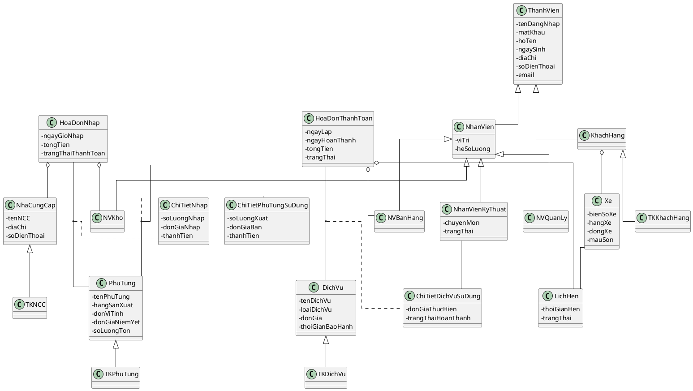
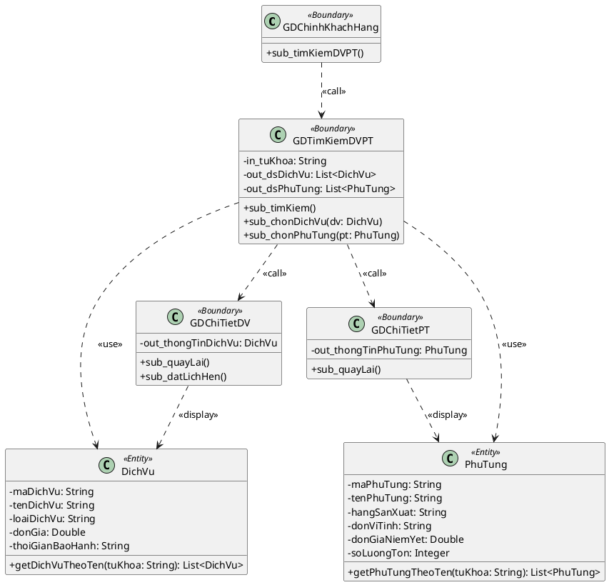
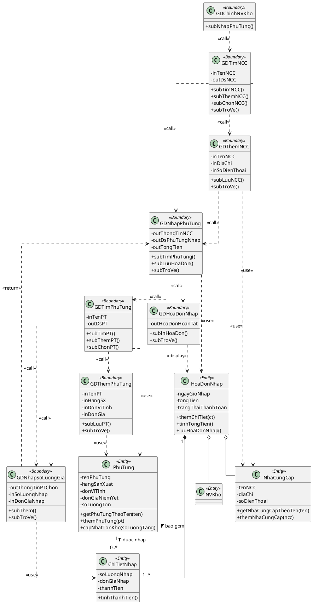
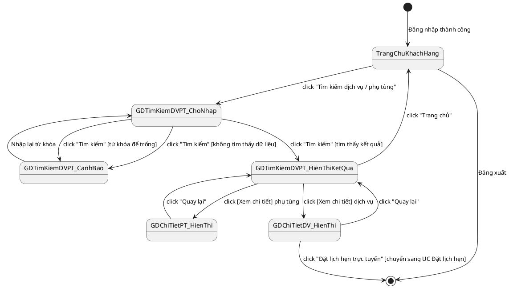
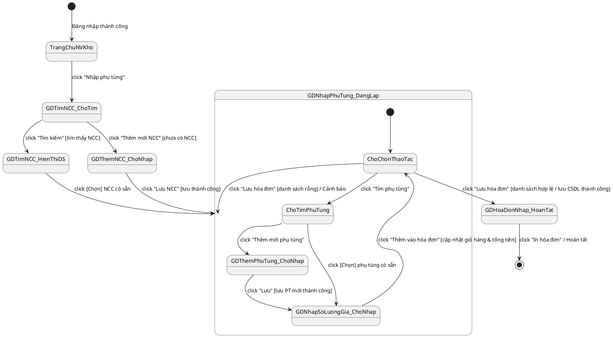
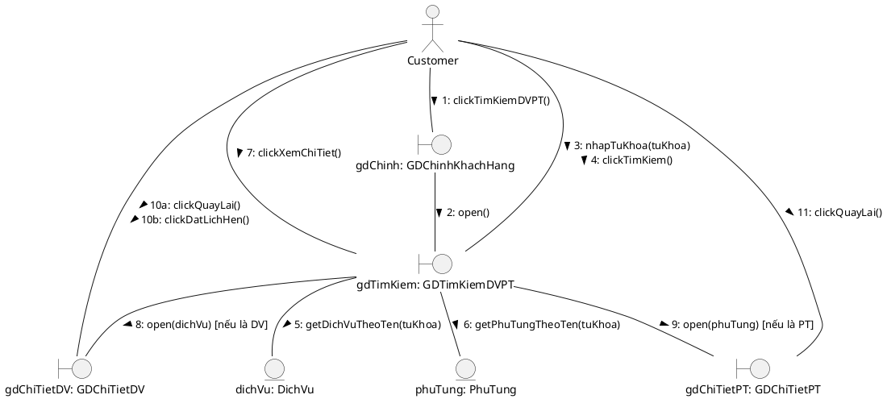
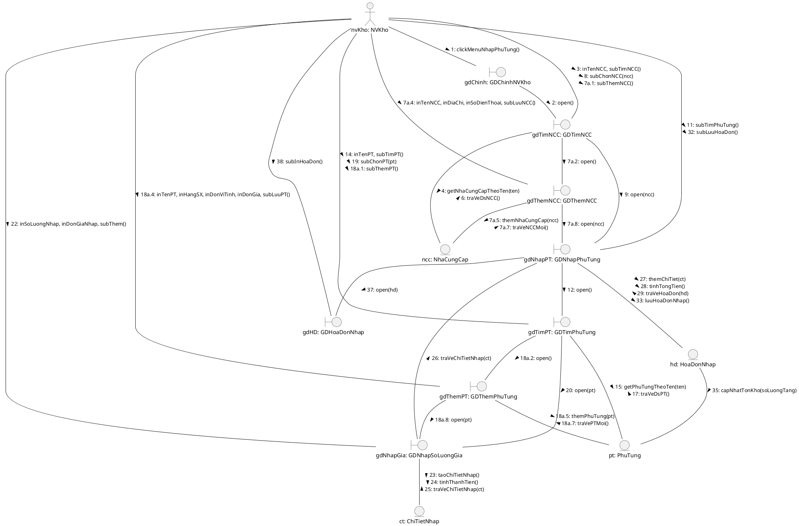

# II. PHÂN TÍCH YÊU CẦU HỆ THỐNG (ANALYSIS PHASE)

Hệ thống Quản lý Gara Ô tô (GaraMan) - Đề bài 26  
Tài liệu tham khảo phương pháp: Bài giảng Thực tập tốt nghiệp 2 - CNPM (2020), Chương 3, Mục 3.2.

---

## 1. KỊCH BẢN CA SỬ DỤNG PHIÊN BẢN 1 (SCENARIO V1.0)
*(Áp dụng cho 2 module trọng tâm theo yêu cầu của đề tài)*

### 1.1 Kịch bản ca sử dụng Module 1: Khách hàng tìm kiếm thông tin dịch vụ / phụ tùng

| Mục | Nội dung chi tiết |
| :--- | :--- |
| **Use Case** | **Tìm kiếm thông tin dịch vụ / phụ tùng** |
| **Actor** | Khách hàng |
| **Tiền điều kiện** | Khách hàng đã đăng nhập thành công vào hệ thống. |
| **Hậu điều kiện** | Khách hàng xem được thông tin chi tiết về dịch vụ hoặc phụ tùng theo nhu cầu. |
| **Kịch bản chính** | **1.** Sau khi đăng nhập thành công, khách hàng chọn chức năng Tìm thông tin dịch vụ / phụ tùng trên menu chính. **2.** Giao diện tìm kiếm hiện lên với ô nhập từ khóa và nút Tìm kiếm, danh sách kết quả đang để trống. **3.** Khách hàng nhập từ khóa là lọc gió và nhấn Tìm kiếm. **4.** Hệ thống kiểm tra từ khóa và hiển thị danh sách các dịch vụ và phụ tùng có thông tin khớp với từ khóa: &nbsp;&nbsp;&nbsp;&nbsp;• Dịch vụ: DV01 - Thay lọc gió (Loại dịch vụ: Bảo dưỡng, Đơn giá: 200.000 VNĐ) &nbsp;&nbsp;&nbsp;&nbsp;• Phụ tùng: PT01 - Lọc gió động cơ (Hãng sản xuất: Denso, Đơn giá: 150.000 VNĐ) **5.** Khách hàng click chọn Thay lọc gió trong danh sách để xem thông tin chi tiết. **6.** Hệ thống hiển thị giao diện toàn bộ thông tin chi tiết của dịch vụ đã chọn: &nbsp;&nbsp;&nbsp;&nbsp;- Mã dịch vụ: DV01 &nbsp;&nbsp;&nbsp;&nbsp;- Tên dịch vụ: Thay lọc gió &nbsp;&nbsp;&nbsp;&nbsp;- Loại dịch vụ: Bảo dưỡng &nbsp;&nbsp;&nbsp;&nbsp;- Đơn giá: 200.000 VNĐ &nbsp;&nbsp;&nbsp;&nbsp;- Thời hạn bảo hành: 3 tháng hoặc 5.000 km &nbsp;&nbsp;&nbsp;&nbsp;- Mô tả: Thay lọc gió xe &nbsp;&nbsp;&nbsp;&nbsp;- Nút: Quay lại danh sách, Đặt lịch hẹn trực tuyến **7.** Khách hàng bấm nút Đặt lịch hẹn hoặc quay lại danh sách. |
| **Kịch bản ngoại lệ** | **3a. Từ khóa tìm kiếm để trống:** - Nếu khách hàng nhấn nút Tìm kiếm mà chưa nhập từ khóa, hệ thống hiển thị thông báo yêu cầu nhập từ khóa tra cứu. **4a. Không tìm thấy kết quả phù hợp:** - Nếu không có dịch vụ hoặc phụ tùng nào khớp với từ khóa đã nhập, hệ thống hiển thị thông báo không tìm thấy kết quả phù hợp và cho phép nhập lại từ khóa khác. |

---

### 1.2 Kịch bản ca sử dụng Module 2: Nhân viên kho nhập phụ tùng từ nhà cung cấp

| Mục | Nội dung chi tiết |
| :--- | :--- |
| **Use Case** | **Nhập phụ tùng từ nhà cung cấp** |
| **Actor** | Nhân viên kho |
| **Tiền điều kiện** | Nhân viên kho đã đăng nhập thành công vào hệ thống. |
| **Hậu điều kiện** | Hóa đơn nhập được lưu thành công vào cơ sở dữ liệu, số lượng tồn kho phụ tùng được tự động cập nhật tăng, chứng từ hóa đơn nhập hiển thị hoàn chỉnh để in và làm thủ tục thanh toán. |
| **Kịch bản chính** | **1.** Sau khi đăng nhập thành công, nhân viên kho chọn chức năng Nhập phụ tùng trên menu chính. **2.** Hệ thống hiển thị giao diện tìm kiếm nhà cung cấp. **3.** Nhân viên kho nhập tên nhà cung cấp Hòa Bình và nhấn Tìm kiếm. **4.** Hệ thống hiển thị danh sách các nhà cung cấp phù hợp gồm Mã nhà cung cấp, Tên nhà cung cấp, Địa chỉ, Số điện thoại. **5.** Nhân viên kho click Chọn tại nhà cung cấp mong muốn. **6.** Giao diện lập hóa đơn nhập phụ tùng hiện ra có thông tin nhà cung cấp đã chọn gồm Mã nhà cung cấp, Tên nhà cung cấp, Địa chỉ nhà cung cấp, Số điện thoại NCC, bảng danh sách phụ tùng nhập (ban đầu rỗng), tổng tiền thanh toán và nút Tìm phụ tùng, Trở về, Lưu hóa đơn. **7.** Nhân viên kho click nút Tìm phụ tùng. **8.** Hệ thống hiển thị giao diện tìm kiếm phụ tùng gồm ô tìm kiếm và nút Tìm kiếm, bảng danh sách phụ tùng (ban đầu rỗng), nút Xong. **9.** Nhân viên kho nhập tên phụ tùng cần tìm và click Tìm. **10.** Bảng danh sách phụ tùng hiển thị dữ liệu phụ tùng phù hợp. **11.** Nhân viên kho click nút Chọn tại phụ tùng cần tìm. **12.** Giao diện nhập số lượng và đơn giá hiện lên gồm thông tin chi tiết phụ tùng (Mã phụ tùng, Tên phụ tùng, Hãng sản xuất, Đơn vị tính, Đơn giá bán niêm yết, Tình trạng còn hàng) và ô nhập số lượng, ô đơn giá và dòng tổng tiền, nút Thêm và Trở lại. **13.** Nhân viên kho điền số lượng nhập, đơn giá nhập thực tế và bấm nút Thêm. **14.** Hệ thống lưu phụ tùng vào danh sách phụ tùng nhập, tính lại tổng tiền thanh toán (Tổng tiền: 200.000) và quay về giao diện tìm phụ tùng. **15.** Nhân viên kho lặp lại bước 9 đến bước 14 cho đến khi hết danh sách phụ tùng nhập. **16.** Nhân viên kho kiểm tra lại toàn bộ danh sách phụ tùng nhập, số lượng, đơn giá, tổng tiền và click nút Lưu hóa đơn. **17.** Hệ thống lưu thông tin hóa đơn nhập, lưu các chi tiết phụ tùng nhập vào cơ sở dữ liệu và tự động cập nhật tăng số lượng tồn kho, sau đó chuyển sang giao diện hiển thị hóa đơn nhập hoàn chỉnh để in gồm: Tên NCC, mã NCC, Địa chỉ, Số điện thoại, bảng danh sách phụ tùng nhập gồm Tên phụ tùng, Đơn vị, Số lượng, Đơn giá, Thành tiền, Tổng tiền và nút In, nút Trở về. **18.** Nhân viên kho click nút In để hoàn tất thanh toán. **19.** Hệ thống báo thành công và quay về Giao diện chính của nhân viên kho. |
| **Kịch bản ngoại lệ** | **4a. Nhà cung cấp chưa tồn tại trong hệ thống:** - Tại bước 4, nhân viên kho click nút Thêm mới NCC, hệ thống hiển thị form nhập thông tin đối tác mới. Nhân viên điền thông tin và bấm Lưu NCC. Hệ thống lưu nhà cung cấp mới vào cơ sở dữ liệu và tự động chọn nhà cung cấp này để tiếp tục lập hóa đơn. **9a. Phụ tùng mới chưa có trong danh mục:** - Tại bước 9, nếu phụ tùng cần nhập chưa có trong danh mục, nhân viên click nút Thêm mới phụ tùng tại thông báo hiện ra. Hệ thống hiển thị form nhập thông tin phụ tùng mới. Nhân viên điền thông tin và bấm Lưu. Hệ thống lưu phụ tùng mới vào cơ sở dữ liệu với số lượng tồn kho ban đầu bằng 0 và tự động chọn phụ tùng này chuyển sang bước nhập số lượng và đơn giá. **13a. Nhập sai định dạng số lượng hoặc đơn giá:** - Tại bước 13, nếu nhân viên nhập số lượng hoặc đơn giá nhỏ hơn hoặc bằng 0, hệ thống hiển thị thông báo lỗi yêu cầu nhập số dương hợp lệ. **16a. Hóa đơn chưa có phụ tùng:** - Tại bước 16, nếu nhân viên bấm Lưu hóa đơn khi danh sách phụ tùng đang trống, hệ thống hiển thị cảnh báo: Chưa có phụ tùng nào được chọn vào hóa đơn! |

---

## 2. TRÍCH XUẤT LỚP THỰC THỂ (ENTITY EXTRACTION)
*(Thực hiện đúng quy trình 5 bước theo phương pháp trích danh từ - Bài giảng mục 3.2.2)*

### Bước 1: Mô tả hệ thống trong một đoạn văn hoàn chỉnh
> Hệ thống quản lý gara ô tô (GaraMan) là một ứng dụng nền tảng web phục vụ công tác quản lý toàn diện các quy trình sửa chữa, bảo dưỡng và kinh doanh linh kiện ô tô. Các người dùng trong hệ thống bao gồm: thành viên đăng nhập bằng tài khoản và mật khẩu cá nhân; khách hàng có thông tin cá nhân và có thể sở hữu một hoặc nhiều xe ô tô mang biển số xe, hãng xe, dòng xe cụ thể. Khách hàng có thể tra cứu thông tin dịch vụ và phụ tùng, xem chi tiết bảng giá và quy trình, đồng thời có thể đặt lịch hẹn trực tuyến gắn với xe và dịch vụ mong muốn trước khi mang xe đến xưởng. Nhân viên gara gồm các nhân sự nội bộ có mã nhân viên, vị trí và hệ số lương. Trong đó, nhân viên bán hàng tiếp nhận xe của khách hàng tại xưởng, tiếp nhận các yêu cầu dịch vụ bảo dưỡng hoặc sửa chữa, phân công nhân viên kỹ thuật phụ trách từng dịch vụ, theo dõi tiến độ và lập hóa đơn thanh toán cho xe của khách hàng. Nhân viên kho phụ trách tìm kiếm đối tác, thêm mới hồ sơ nhà cung cấp, thực hiện lập hóa đơn nhập phụ tùng, cập nhật số lượng và đơn giá nhập của từng phụ tùng trong chuyến hàng để tăng tồn kho. Nhân viên quản lý điều hành danh mục dịch vụ và phụ tùng, đồng thời theo dõi các loại báo cáo thống kê kinh doanh theo dịch vụ, phụ tùng, khách hàng và nhà cung cấp theo thời gian. Mỗi xe thuộc sở hữu của một khách hàng; mỗi lịch hẹn gắn với một khách hàng, một xe và dịch vụ yêu cầu; mỗi hóa đơn nhập liên kết với một nhà cung cấp và một nhân viên kho, chứa nhiều chi tiết phụ tùng nhập; mỗi hóa đơn thanh toán liên kết với một xe, khách hàng và nhân viên bán hàng, bao gồm nhiều chi tiết dịch vụ sử dụng (gắn với kỹ thuật viên phụ trách) và nhiều chi tiết phụ tùng sử dụng.

### Bước 2: Trích danh từ và đề xuất các lớp thực thể
Từ đoạn văn mô tả trên, ta tiến hành trích xuất và phân loại các danh từ:
1. **Nhóm danh từ chỉ người và phân cấp người dùng:**
   - *thành viên* → Đề xuất lớp trừu tượng `ThanhVien` (lớp cha của toàn bộ người dùng hệ thống).
   - *khách hàng* → Đề xuất lớp `KhachHang` (kế thừa `ThanhVien`).
   - *nhân viên* → Đề xuất lớp trừu tượng `NhanVien` (kế thừa `ThanhVien`).
   - *nhân viên bán hàng* → Đề xuất lớp `NVBanHang` (kế thừa `NhanVien`).
   - *nhân viên kho* → Đề xuất lớp `NVKho` (kế thừa `NhanVien`).
   - *nhân viên quản lý* → Đề xuất lớp `NVQuanLy` (kế thừa `NhanVien`).
   - *nhân viên kỹ thuật* → Đề xuất lớp thực thể `NhanVienKyThuat` (thợ máy tại xưởng, đóng vai trò là đối tượng dữ liệu nhân sự để phân công dịch vụ).
2. **Nhóm danh từ chỉ phương tiện, đối tác, hàng hóa và dịch vụ:**
   - *xe ô tô* → Đề xuất lớp thực thể `Xe` (đại diện cho phương tiện sửa chữa, bảo dưỡng).
   - *nhà cung cấp* → Đề xuất lớp `NhaCungCap`.
   - *mặt hàng* (khái niệm chung của dịch vụ và phụ tùng) → Đề xuất lớp trừu tượng `MatHang`.
   - *dịch vụ* → Đề xuất lớp `DichVu` (kế thừa `MatHang`).
   - *phụ tùng* → Đề xuất lớp `PhuTung` (kế thừa `MatHang`).
3. **Nhóm danh từ chỉ chứng từ, giao dịch vận hành:**
   - *lịch hẹn* → Đề xuất lớp `LichHen`.
   - *hóa đơn nhập* → Đề xuất lớp `HoaDonNhap`.
   - *chi tiết phụ tùng nhập* → Đề xuất lớp `ChiTietNhap` (lớp liên kết giữa Hóa đơn nhập và Phụ tùng).
   - *hóa đơn thanh toán* → Đề xuất lớp `HoaDonThanhToan`.
   - *chi tiết dịch vụ sử dụng* → Đề xuất lớp `ChiTietDichVuSuDung` (lớp liên kết giữa Hóa đơn thanh toán, Dịch vụ và Kỹ thuật viên).
   - *chi tiết phụ tùng sử dụng* → Đề xuất lớp `ChiTietPhuTungSuDung` (lớp liên kết giữa Hóa đơn thanh toán và Phụ tùng).
4. **Lọc bỏ các danh từ không đề xuất thành lớp riêng:**
   - *tài khoản, mật khẩu, họ tên, địa chỉ, sđt, email, biển số xe, hãng xe, dòng xe, vị trí, hệ số lương, ngày nhập, tổng tiền, số lượng tồn kho...* → Đây là các thuộc tính thành phần của các lớp tương ứng.
   - *báo cáo thống kê* → Dữ liệu thống kê được tính toán tổng hợp dẫn xuất từ các hóa đơn giao dịch, không phải là thực thể lưu trữ cố định.

### Bước 3: Xác định thuộc tính cho từng lớp thực thể
*(Lưu ý theo giáo trình: Trong pha phân tích, các lớp thực thể tập trung vào thuộc tính nghiệp vụ, tách độc lập Dịch vụ và Phụ tùng, lớp Xe được tách riêng khỏi Khách hàng để đảm bảo chuẩn hóa dữ liệu)*

* `ThanhVien`: tenDangNhap, matKhau, hoTen, ngaySinh, diaChi, soDienThoai, email.
* `KhachHang`: Kế thừa `ThanhVien` (quản lý thông tin định danh cá nhân của khách hàng, sở hữu các xe).
* `Xe`: bienSoXe, hangXe, dongXe, mauSon.
* `NhanVien` (kế thừa `ThanhVien`): maNV, viTri, heSoLuong.
* `NVBanHang`, `NVKho`, `NVQuanLy`: Kế thừa các thuộc tính của `NhanVien`.
* `NhanVienKyThuat`: maKT, hoTen, soDienThoai, chuyenMon, trangThai.
* `NhaCungCap`: maNCC, tenNCC, diaChi, soDienThoai.
* `DichVu`: maDichVu, tenDichVu, loaiDichVu, donGia, thoiGianDuKien, quyTrinh, thoiGianBaoHanh.
* `PhuTung`: maPhuTung, tenPhuTung, hangSanXuat, xuatXu, donViTinh, donGiaNiemYet, soLuongTon.
* `LichHen`: maLichHen, thoiGianHen, trangThai.
* `HoaDonNhap`: maHDN, ngayGioNhap, tongTien, trangThaiThanhToan.
* `ChiTietNhap`: soLuongNhap, donGiaNhap, thanhTien.
* `HoaDonThanhToan`: maHDTT, ngayLap, ngayHoanThanh, tongTien, trangThai.
* `ChiTietDichVuSuDung`: donGiaThucHien, trangThaiHoanThanh.
* `ChiTietPhuTungSuDung`: soLuongXuat, donGiaBan, thanhTien.

### Bước 4: Xác định mối quan hệ giữa các lớp thực thể

1. **Quan hệ kế thừa (Generalization):**
   - `KhachHang` và `NhanVien` kế thừa từ `ThanhVien`.
   - `NVBanHang`, `NVKho`, `NVQuanLy` kế thừa từ `NhanVien`.

2. **Xử lý các quan hệ Nhiều - Nhiều (n - n) qua các thực thể trung gian:**
   *(Theo nguyên tắc thiết kế giáo trình mục 3.2.2: Các quan hệ n - n mang thuộc tính giao dịch phát sinh như số lượng, đơn giá phải được tách thành các quan hệ 1 - n thông qua một thực thể trung gian)*
   - **`HoaDonNhap` và `PhuTung` có quan hệ n - n:** Một hóa đơn nhập nhiều phụ tùng, một phụ tùng có thể được nhập qua nhiều hóa đơn $\rightarrow$ **Tách thành hai quan hệ 1 - n thông qua thực thể trung gian `ChiTietNhap`** (lưu số lượng nhập, đơn giá nhập, thành tiền).
   - **`HoaDonThanhToan` và `DichVu` có quan hệ n - n:** Một hóa đơn sửa chữa có nhiều dịch vụ, một dịch vụ được làm trên nhiều hóa đơn $\rightarrow$ **Tách thành hai quan hệ 1 - n thông qua thực thể trung gian `ChiTietDichVuSuDung`** (lưu đơn giá thực hiện, trạng thái hoàn thành, phân công thợ kỹ thuật phụ trách).
   - **`HoaDonThanhToan` và `PhuTung` có quan hệ n - n:** Một hóa đơn sửa chữa có thể thay thế nhiều phụ tùng, một phụ tùng có thể xuất bán cho nhiều hóa đơn $\rightarrow$ **Tách thành hai quan hệ 1 - n thông qua thực thể trung gian `ChiTietPhuTungSuDung`** (lưu số lượng xuất, đơn giá bán, thành tiền).

3. **Tổng hợp các quan hệ kết hợp (Association) và Bản số (Multiplicity):**
   - `KhachHang` – `Xe`: Một khách hàng có thể sở hữu nhiều xe (1 – n). Mỗi xe thuộc về đúng 1 khách hàng.
   - `KhachHang` – `LichHen`: Một khách hàng có thể đặt nhiều lịch hẹn (1 – n).
   - `Xe` – `LichHen`: Một xe có thể được đặt nhiều lịch hẹn ở các thời điểm khác nhau (1 – n).
   - `DichVu` – `LichHen`: Mỗi lịch hẹn yêu cầu một dịch vụ kỹ thuật cụ thể (1 – n).
   - `NhaCungCap` – `HoaDonNhap`: Một nhà cung cấp có thể xuất hiện trên nhiều hóa đơn nhập (1 – n).
   - `NVKho` – `HoaDonNhap`: Một nhân viên kho lập nhiều hóa đơn nhập (1 – n).
   - `HoaDonNhap` – `ChiTietNhap`: Một hóa đơn nhập gồm một hoặc nhiều chi tiết nhập (1 – n, quan hệ thành phần Composition).
   - `PhuTung` – `ChiTietNhap`: Một phụ tùng có thể xuất hiện trong nhiều chi tiết nhập qua các đợt hàng (1 – n).
   - `KhachHang` – `HoaDonThanhToan`: Một khách hàng có thể có nhiều hóa đơn thanh toán sửa chữa (1 – n).
   - `Xe` – `HoaDonThanhToan`: Mỗi hóa đơn thanh toán lập cho một xe cụ thể tiếp nhận tại xưởng (1 – n).
   - `NVBanHang` – `HoaDonThanhToan`: Một nhân viên bán hàng tiếp nhận xe và lập nhiều hóa đơn thanh toán (1 – n).
   - `HoaDonThanhToan` – `ChiTietDichVuSuDung`: Một hóa đơn thanh toán gồm nhiều chi tiết dịch vụ sử dụng (1 – n, quan hệ thành phần Composition).
   - `DichVu` – `ChiTietDichVuSuDung`: Một dịch vụ có thể được sử dụng trong nhiều lần sửa chữa (1 – n).
   - `NhanVienKyThuat` – `ChiTietDichVuSuDung`: Một kỹ thuật viên có thể được phân công phụ trách nhiều chi tiết dịch vụ (1 – n).
   - `HoaDonThanhToan` – `ChiTietPhuTungSuDung`: Một hóa đơn thanh toán gồm nhiều chi tiết phụ tùng sử dụng (1 – n, quan hệ thành phần Composition).
   - `PhuTung` – `ChiTietPhuTungSuDung`: Một phụ tùng có thể được xuất thay thế trên nhiều hóa đơn khác nhau (1 – n).

### Bước 5: Biểu đồ lớp thực thể pha phân tích toàn hệ thống (Entity Class Diagram)
Biểu đồ thể hiện cấu trúc tĩnh của toàn bộ các lớp thực thể trong hệ thống GaraMan, làm cơ sở dữ liệu chung cho toàn bộ quá trình phân tích và thiết kế.

*(Vị trí chèn ảnh: [Hình 5.1: Biểu đồ lớp thực thể pha phân tích toàn hệ thống GaraMan])*

---

## 3. BIỂU ĐỒ LỚP PHÂN TÍCH CHO 2 MODULE TRỌNG TÂM (ANALYSIS CLASS DIAGRAM)
*(Áp dụng kiến trúc Boundary – Entity, tiền tố thuộc tính in_, out_, sub_ theo đúng Bài giảng mục 3.2.3)*

### 3.1 Biểu đồ lớp phân tích Module 1: Khách hàng tìm kiếm dịch vụ / phụ tùng

#### Các lớp tham gia:
1. **Lớp Giao diện (Boundary Classes):**
   - `GDChinhKhachHang`:
     - `sub_timKiemDVPT`: Sự kiện click chọn menu tra cứu dịch vụ/phụ tùng.
   - `GDTimKiemDVPT`:
     - `in_tuKhoa`: Thuộc tính nhận từ khóa tìm kiếm do khách hàng nhập.
     - `out_dsDichVu: List<DichVu>`: Bảng hiển thị danh sách các dịch vụ tìm được.
     - `out_dsPhuTung: List<PhuTung>`: Bảng hiển thị danh sách các phụ tùng tìm được.
     - `sub_timKiem`: Sự kiện click nút bấm tìm kiếm.
     - `sub_chonDichVu(dv: DichVu)`: Sự kiện chọn xem chi tiết một dịch vụ trong danh sách.
     - `sub_chonPhuTung(pt: PhuTung)`: Sự kiện chọn xem chi tiết một phụ tùng trong danh sách.
   - `GDChiTietDV`:
     - `out_thongTinDichVu: DichVu`: Hiển thị chi tiết thông số của dịch vụ (mã, tên, loại dịch vụ, giá, bảo hành, mô tả).
     - `sub_quayLai`: Sự kiện bấm nút quay lại màn hình tìm kiếm.
     - `sub_datLichHen`: Sự kiện bấm nút đặt lịch hẹn trực tuyến để chuyển sang quy trình đặt lịch.
   - `GDChiTietPT`:
     - `out_thongTinPhuTung: PhuTung`: Hiển thị chi tiết thông số phụ tùng (mã, tên, hãng, xuất xứ, đơn vị, đơn giá niêm yết, tồn kho).
     - `sub_quayLai`: Sự kiện bấm nút quay lại màn hình tìm kiếm.

2. **Lớp Thực thể (Entity Classes) và Phương thức gán hành động:**
   - `DichVu`:
     - `getDichVuTheoTen(tuKhoa: String): List<DichVu>`: Tìm kiếm danh sách các dịch vụ theo từ khóa.
   - `PhuTung`:
     - `getPhuTungTheoTen(tuKhoa: String): List<PhuTung>`: Tìm kiếm danh sách các phụ tùng theo từ khóa.
   *(Lưu ý: Hai lớp `DichVu` và `PhuTung` được quản lý độc lập theo đúng danh sách thuộc tính đã chuẩn hóa, không phụ thuộc vào lớp cha trừu tượng).*

*(Vị trí chèn ảnh: [Hình 5.2: Biểu đồ lớp phân tích Module 1 - Tìm kiếm dịch vụ / phụ tùng])*

---

### 3.2 Biểu đồ lớp phân tích Module 2: Nhân viên kho nhập phụ tùng từ nhà cung cấp

#### Các lớp tham gia:
1. **Lớp Giao diện (Boundary Classes):**
   - `GDChinhNVKho`:
     - `sub_nhapPhuTung`: Sự kiện click menu nhập phụ tùng.
   - `GDTimNCC`:
     - `in_tenNCC`: Từ khóa tìm kiếm tên nhà cung cấp.
     - `out_dsNCC`: Danh sách các nhà cung cấp thỏa mãn.
     - `sub_timNCC`: Sự kiện click tìm kiếm NCC.
     - `sub_themNCC`: Sự kiện click mở giao diện thêm mới NCC khi chưa có.
     - `sub_chonNCC(ncc: NhaCungCap)`: Sự kiện chọn một NCC để lập hóa đơn.
   - `GDThemNCC`:
     - `in_tenNCC`, `in_diaChi`, `in_soDienThoai`, `in_maSoThue`, `in_email`, `in_ghiChu`: Dữ liệu nhập NCC mới.
     - `sub_luuNCC`: Sự kiện click lưu nhà cung cấp mới.
   - `GDNhapPhuTung`:
     - `out_thongTinNCC: NhaCungCap`: Thông tin nhà cung cấp đang làm việc.
     - `out_dsPhuTungNhap: List<ChiTietNhap>`: Bảng danh sách phụ tùng đã đưa vào hóa đơn.
     - `out_tongTien: Double`: Tổng tiền thanh toán của hóa đơn đọc từ thực thể `HoaDonNhap`.
     - `sub_timPhuTung`: Sự kiện click mở màn hình tìm phụ tùng.
     - `sub_luuHoaDon`: Sự kiện click kích hoạt đối tượng hóa đơn nhập tự lưu xuống CSDL.
   - `GDTimPhuTung`:
     - `in_tenPT`: Từ khóa tìm tên phụ tùng.
     - `out_dsPT: List<PhuTung>`: Danh sách phụ tùng khớp từ khóa.
     - `sub_timPT`: Sự kiện click tìm kiếm phụ tùng.
     - `sub_themPT`: Sự kiện click mở giao diện thêm mới phụ tùng vào danh mục.
     - `sub_chonPT(pt: PhuTung)`: Sự kiện click chọn phụ tùng để nhập số lượng và giá.
   - `GDThemPhuTung`:
     - `in_tenPT`, `in_hangSX`, `in_xuatXu`, `in_donViTinh`, `in_donGia`, `in_moTa`: Dữ liệu phụ tùng mới.
     - `sub_luuPT`: Sự kiện click lưu phụ tùng mới vào CSDL.
   - `GDNhapSoLuongGia`:
     - `out_thongTinPTChon: PhuTung`: Hiển thị tên và quy cách phụ tùng đang chọn.
     - `in_soLuongNhap`: Số lượng phụ tùng nhập về.
     - `in_donGiaNhap`: Giá vốn mua từ NCC.
     - `sub_themVaoHD`: Sự kiện click tạo chi tiết nhập và chuyển về hóa đơn.
   - `GDHoaDonNhap`:
     - `out_hoaDonHoanTat: HoaDonNhap`: Hiển thị chứng từ hóa đơn nhập đầy đủ.
     - `sub_inHoaDon`: Sự kiện click in hóa đơn nhập kho.

2. **Lớp Thực thể (Entity Classes) và Phương thức nghiệp vụ (Tuân thủ chuẩn OOP):**
   - `NhaCungCap`:
     - `getNhaCungCapTheoTen(ten: String): List<NhaCungCap>`: Tìm danh sách NCC theo tên.
     - `themNhaCungCap(ncc: NhaCungCap): Boolean`: Lưu mới một nhà cung cấp vào hệ thống.
   - `PhuTung`:
     - `getPhuTungTheoTen(ten: String): List<PhuTung>`: Tìm danh sách phụ tùng theo tên.
     - `themPhuTung(pt: PhuTung): Boolean`: Khai báo loại phụ tùng mới vào danh mục với tồn kho ban đầu = 0.
     - `capNhatTonKho(soLuongTang: Integer): Boolean`: Đối tượng phụ tùng tự cộng dồn số lượng tồn kho của chính nó.
   - `HoaDonNhap`:
     - `themChiTiet(ct: ChiTietNhap)`: Thêm một dòng chi tiết nhập vào danh sách của hóa đơn.
     - `tinhTongTien(): Double`: Tự động cộng dồn thành tiền từ các chi tiết nhập để cập nhật `tongTien`.
     - `luuHoaDonNhap(): Boolean`: Đối tượng hóa đơn tự lưu chính nó vào CSDL, đồng thời ra lệnh lưu danh sách chi tiết phụ tùng nhập.
   - `ChiTietNhap`:
     - `tinhThanhTien(): Double`: Tự tính thành tiền dòng = soLuongNhap * donGiaNhap.
   - `NVKho`: Đại diện cho tác nhân người dùng thực hiện giao dịch nhập hàng.

*(Vị trí chèn ảnh: [Hình 5.3: Biểu đồ lớp phân tích Module 2 - Nhập phụ tùng từ nhà cung cấp])*

---

## 4. BIỂU ĐỒ CHUYỂN TRẠNG THÁI (STATE MACHINE DIAGRAM)
*(Mô tả sự biến đổi trạng thái giao diện hệ thống theo đúng Bài giảng mục 3.2.4: Mỗi trạng thái chờ tương ứng với một lần hệ thống hiển thị một giao diện GD... chờ tương tác)*

### 4.1 Biểu đồ trạng thái Module 1: Tìm kiếm thông tin dịch vụ / phụ tùng
Biểu đồ mô tả chuỗi trạng thái chờ của giao diện theo tương tác của khách hàng:
* `TrangChuKhachHang`: Màn hình chính của khách hàng sau khi đăng nhập thành công.
* Khi khách hàng bấm chọn tra cứu dịch vụ/phụ tùng → Chuyển sang trạng thái `GDTimKiemDVPT_ChoNhap`.
* Khách hàng nhập từ khóa và bấm *"Tìm kiếm"*:
  * Nếu tìm thấy dữ liệu → Chuyển sang trạng thái `GDTimKiemDVPT_HienThiKetQua`.
  * Nếu không tìm thấy hoặc để trống → Chuyển sang trạng thái `GDTimKiemDVPT_CanhBao`, sau đó quay về chờ nhập lại.
* Tại trạng thái `GDTimKiemDVPT_HienThiKetQua`:
  * Khách hàng click xem chi tiết dịch vụ → Chuyển sang trạng thái `GDChiTietDV_HienThi`.
  * Khách hàng click xem chi tiết phụ tùng → Chuyển sang trạng thái `GDChiTietPT_HienThi`.
* Tại màn hình chi tiết dịch vụ (`GDChiTietDV_HienThi`):
  * Khách hàng click *"Đặt lịch hẹn trực tuyến"* → Chuyển sang quy trình Đặt lịch hẹn.
  * Khách hàng click *"Quay lại"* → Quay về `GDTimKiemDVPT_HienThiKetQua`.
* Tại màn hình chi tiết phụ tùng (`GDChiTietPT_HienThi`):
  * Khách hàng click *"Quay lại"* → Quay về `GDTimKiemDVPT_HienThiKetQua`.
* Tại bất kỳ giao diện nào, khách hàng có thể chọn menu để quay về `TrangChuKhachHang` hoặc đăng xuất kết thúc.

*(Vị trí chèn ảnh: [Hình 5.4: Biểu đồ trạng thái Module 1 - Tra cứu dịch vụ / phụ tùng])*

---

### 4.2 Biểu đồ trạng thái Module 2: Nhập phụ tùng từ nhà cung cấp
Đồng bộ theo góc nhìn các trạng thái giao diện `GD...` của phân hệ nhập kho:
* `TrangChuNVKho`: Giao diện chính của nhân viên kho sau khi đăng nhập.
* Khi nhân viên bấm chọn menu "Nhập phụ tùng" → Chuyển sang trạng thái `GDTimNCC_ChoTim`.
* Tại `GDTimNCC_ChoTim`:
  * Nếu nhân viên bấm *"Tìm kiếm"* → Chuyển sang `GDTimNCC_HienThiDS` (hiển thị danh sách NCC).
  * Nếu NCC chưa có và nhân viên bấm *"Thêm mới NCC"* → Chuyển sang trạng thái `GDThemNCC_ChoNhap`. Sau khi lưu thành công → Chuyển thẳng sang `GDNhapPhuTung_DangLap`.
  * Tại `GDTimNCC_HienThiDS`, nhân viên bấm nút *"Chọn"* NCC → Chuyển sang trạng thái `GDNhapPhuTung_DangLap`.
* Tại `GDNhapPhuTung_DangLap` (Giao diện lập hóa đơn):
  * Khi nhân viên bấm *"Tìm phụ tùng"* → Chuyển sang trạng thái `GDTimPhuTung_ChoTim`.
  * Tại `GDTimPhuTung_ChoTim`, nếu phụ tùng mới chưa có, nhân viên bấm *"Thêm mới PT"* → Chuyển sang `GDThemPhuTung_ChoNhap`. Sau khi lưu thành công → Chuyển sang `GDNhapSoLuongGia_ChoNhap`.
  * Tại `GDTimPhuTung_ChoTim`, nhân viên tìm và click nút *"Chọn"* phụ tùng → Chuyển sang `GDNhapSoLuongGia_ChoNhap`.
  * Tại `GDNhapSoLuongGia_ChoNhap`, nhân viên nhập số lượng, đơn giá và bấm *"Thêm vào hóa đơn"* → Chuyển trạng thái quay trở lại `GDNhapPhuTung_DangLap` (đã cập nhật danh sách và tổng tiền).
* Tại `GDNhapPhuTung_DangLap`, sau khi hoàn tất các mặt hàng, nhân viên bấm *"Lưu hóa đơn"*:
  * Hệ thống thực thi giao dịch lưu CSDL và chuyển sang trạng thái `GDHoaDonNhap_HoanTat`.
* Tại `GDHoaDonNhap_HoanTat`, nhân viên bấm *"In hóa đơn"* phục vụ thanh toán và hoàn tất chu trình.

*(Vị trí chèn ảnh: [Hình 5.5: Biểu đồ trạng thái Module 2 - Nhập phụ tùng])*

---

## 5. KỊCH BẢN CHI TIẾT (SCENARIO V2.0) VÀ BIỂU ĐỒ GIAO TIẾP (COMMUNICATION DIAGRAM)
*(Mô tả luồng tương tác message chính xác giữa Actor, Boundary và Entity theo đúng Bài giảng mục 3.2.5; bao quát đầy đủ các luồng mở rộng Thêm NCC và Thêm Phụ tùng)*

### 5.1 Kịch bản chi tiết v2.0 và Biểu đồ giao tiếp: Module 1 (Tìm kiếm dịch vụ / phụ tùng)

#### Kịch bản chi tiết phiên bản 2 (Scenario v2.0):
1. Khách hàng (`Customer`) click chọn menu tra cứu dịch vụ/phụ tùng trên `GDChinhKhachHang`.
2. Lớp `GDChinhKhachHang` gọi mở giao diện tìm kiếm `GDTimKiemDVPT`.
3. Giao diện `GDTimKiemDVPT` hiển thị ô nhập từ khóa và nút tìm kiếm chờ người dùng.
4. Khách hàng nhập từ khóa và bấm nút *"Tìm kiếm"*.
5. `GDTimKiemDVPT` gửi thông điệp yêu cầu tìm kiếm dịch vụ `getDichVuTheoTen(tuKhoa)` tới lớp thực thể `DichVu`.
6. Lớp thực thể `DichVu` thực thi truy vấn cơ sở dữ liệu và trả về danh sách các dịch vụ thỏa mãn cho `GDTimKiemDVPT`.
7. `GDTimKiemDVPT` gửi thông điệp yêu cầu tìm kiếm phụ tùng `getPhuTungTheoTen(tuKhoa)` tới lớp thực thể `PhuTung`.
8. Lớp thực thể `PhuTung` truy vấn cơ sở dữ liệu và trả về danh sách các phụ tùng thỏa mãn cho `GDTimKiemDVPT`.
9. `GDTimKiemDVPT` gán dữ liệu vào 2 thuộc tính `out_dsDichVu` và `out_dsPhuTung`, sau đó hiển thị 2 bảng kết quả cho khách hàng.
10. Khách hàng bấm nút *"Xem chi tiết"* tại một mặt hàng mong muốn:
    * **Nhánh 10a (Xem Dịch vụ):** `GDTimKiemDVPT` gọi mở `GDChiTietDV` kèm đối tượng `DichVu` đã chọn. `GDChiTietDV` hiển thị đầy đủ thông số cho khách hàng. Tại đây, khách hàng có thể bấm *"Đặt lịch hẹn trực tuyến"* để chuyển sang ca sử dụng đặt lịch, hoặc bấm *"Quay lại"* để trở về `GDTimKiemDVPT`.
    * **Nhánh 10b (Xem Phụ tùng):** `GDTimKiemDVPT` gọi mở `GDChiTietPT` kèm đối tượng `PhuTung` đã chọn. `GDChiTietPT` hiển thị đầy đủ thông số cho khách hàng. Khách hàng có thể bấm *"Quay lại"* để trở về `GDTimKiemDVPT`.

*(Vị trí chèn ảnh: [Hình 5.6: Biểu đồ giao tiếp Module 1 - Tìm kiếm dịch vụ / phụ tùng])*

---

### 5.2 Kịch bản chi tiết v2.0 và Biểu đồ giao tiếp: Module 2 (Nhập phụ tùng từ nhà cung cấp)

#### Kịch bản chi tiết phiên bản 2 (Scenario v2.0):
1. Nhân viên kho (`WarehouseStaff`) click menu nhập phụ tùng trên giao diện chính `GDChinhNVKho`.
2. `GDChinhNVKho` gọi mở giao diện tìm kiếm nhà cung cấp `GDTimNCC`.
3. Nhân viên kho nhập tên nhà cung cấp và click nút *"Tìm kiếm"*.
4. `GDTimNCC` gọi phương thức `getNhaCungCapTheoTen(tenNCC)` trên lớp thực thể `NhaCungCap`.
5. Lớp `NhaCungCap` truy vấn CSDL và trả về danh sách các NCC phù hợp cho `GDTimNCC`.
6. `GDTimNCC` hiển thị danh sách NCC lên bảng cho nhân viên.
   * **Nhánh mở rộng 6a (Thêm mới NCC khi chưa có trong danh bạ):**
     * 6a.1: Nhân viên kho bấm nút *"Thêm mới NCC"* trên `GDTimNCC`.
     * 6a.2: `GDTimNCC` gọi mở giao diện thêm NCC `GDThemNCC`.
     * 6a.3: Nhân viên nhập thông tin NCC mới và bấm nút *"Lưu NCC"*.
     * 6a.4: `GDThemNCC` gọi phương thức `themNhaCungCap(ncc)` trên lớp `NhaCungCap` để lưu vào CSDL.
     * 6a.5: `GDThemNCC` tự động chuyển đối tượng `NhaCungCap` mới tạo sang `GDNhapPhuTung` để tiếp tục quy trình lập hóa đơn.
7. Tại luồng chính: Nhân viên kho bấm nút *"Chọn"* một nhà cung cấp trên danh sách của `GDTimNCC`.
8. `GDTimNCC` chuyển thông tin NCC đã chọn sang giao diện lập hóa đơn nhập `GDNhapPhuTung`.
9. `GDNhapPhuTung` khởi tạo một đối tượng hóa đơn nhập `HoaDonNhap` trong phiên làm việc, hiển thị thông tin NCC, bảng mặt hàng rỗng và tổng tiền = 0.
10. Nhân viên kho bấm nút *"Tìm phụ tùng"*.
11. `GDNhapPhuTung` gọi mở giao diện tìm kiếm phụ tùng `GDTimPhuTung`.
12. Nhân viên kho nhập tên phụ tùng và bấm *"Tìm kiếm"*.
13. `GDTimPhuTung` gọi phương thức `getPhuTungTheoTen(tenPT)` trên lớp thực thể `PhuTung`.
14. Lớp `PhuTung` truy vấn CSDL và trả về danh sách phụ tùng phù hợp cho `GDTimPhuTung`.
15. `GDTimPhuTung` hiển thị danh sách phụ tùng lên bảng.
    * **Nhánh mở rộng 15a (Thêm mới Phụ tùng khi chưa có trong danh mục):**
      * 15a.1: Nhân viên kho bấm nút *"Thêm mới phụ tùng"* trên `GDTimPhuTung`.
      * 15a.2: `GDTimPhuTung` gọi mở giao diện thêm phụ tùng `GDThemPhuTung`.
      * 15a.3: Nhân viên nhập thông tin phụ tùng mới và bấm nút *"Lưu"*.
      * 15a.4: `GDThemPhuTung` gọi phương thức `themPhuTung(pt)` trên lớp `PhuTung` để lưu vào CSDL với số lượng tồn kho ban đầu = 0.
      * 15a.5: `GDThemPhuTung` tự động chuyển đối tượng `PhuTung` mới tạo sang `GDNhapSoLuongGia` để nhân viên nhập số lượng và giá mua.
16. Tại luồng chính: Nhân viên kho bấm nút *"Chọn"* một phụ tùng trên danh sách của `GDTimPhuTung`.
17. `GDTimPhuTung` chuyển đối tượng phụ tùng đã chọn sang giao diện nhập số lượng và giá `GDNhapSoLuongGia`.
18. Nhân viên kho nhập Số lượng nhập, Đơn giá nhập và bấm nút *"Thêm vào hóa đơn"*.
19. `GDNhapSoLuongGia` khởi tạo đối tượng `ChiTietNhap`, gọi `ChiTietNhap.tinhThanhTien()` để xác định thành tiền của dòng.
20. `GDNhapSoLuongGia` chuyển đối tượng `ChiTietNhap` về cho `GDNhapPhuTung`. `GDNhapPhuTung` đưa chi tiết vào đối tượng `HoaDonNhap` thông qua phương thức `HoaDonNhap.themChiTiet(ct)`.
21. Đối tượng `HoaDonNhap` tự động gọi phương thức `tinhTongTien()` để cập nhật lại tổng giá trị hóa đơn. `GDNhapPhuTung` đọc dữ liệu cập nhật từ `HoaDonNhap` và hiển thị lại bảng danh sách mặt hàng cùng tổng tiền mới.
22. *(Lặp lại các bước 10 đến 21 cho đến khi nhập xong toàn bộ các mặt hàng trong chuyến hàng)*.
23. Nhân viên kho kiểm tra danh sách và bấm nút *"Lưu hóa đơn"*.
24. `GDNhapPhuTung` gửi thông điệp `luuHoaDonNhap()` tới đối tượng `HoaDonNhap`.
25. Đối tượng `HoaDonNhap` lưu thông tin hóa đơn vào CSDL và tự động ra lệnh lưu danh sách `ChiTietNhap` thuộc về nó.
26. Với từng chi tiết nhập, `HoaDonNhap` gửi thông điệp `capNhatTonKho(soLuongTang)` tới đối tượng `PhuTung` tương ứng để cộng tăng số lượng tồn kho trong CSDL.
27. Sau khi giao dịch CSDL thành công, `GDNhapPhuTung` gọi mở giao diện hiển thị hóa đơn hoàn tất `GDHoaDonNhap`.
28. `GDHoaDonNhap` hiển thị toàn bộ chứng từ hóa đơn nhập hoàn chỉnh cho nhân viên kho in phiếu (`clickInHoaDon()`) và làm thủ tục thanh toán cho nhà cung cấp.

*(Vị trí chèn ảnh: [Hình 5.7: Biểu đồ giao tiếp Module 2 - Nhập phụ tùng])*

---

## 6. TỔNG HỢP MÃ NGUỒN PLANTUML GIAI ĐOẠN 2 (NỘP FORM 2)
*(Bao gồm đầy đủ 7 khối mã nguồn PlantUML chuẩn xác 100% để copy nộp trực tiếp vào Google Form 2: https://forms.gle/ciKQDmZntpPKuH4H7)*

### 6.1 Biểu đồ lớp thực thể pha phân tích toàn hệ thống (Entity Class Diagram)

---

### 6.2 Biểu đồ lớp phân tích Module 1: Tìm kiếm dịch vụ / phụ tùng (Analysis Class)

---

### 6.3 Biểu đồ lớp phân tích Module 2: Nhập phụ tùng từ nhà cung cấp (Analysis Class)

---

### 6.4 Biểu đồ trạng thái Module 1: Tìm kiếm dịch vụ / phụ tùng (State Machine)

---

### 6.5 Biểu đồ trạng thái Module 2: Nhập phụ tùng từ nhà cung cấp (State Machine)

---

### 6.6 Biểu đồ giao tiếp Module 1: Tìm kiếm dịch vụ / phụ tùng (Communication)

---

### 6.7 Biểu đồ giao tiếp Module 2: Nhập phụ tùng từ nhà cung cấp (Communication)

