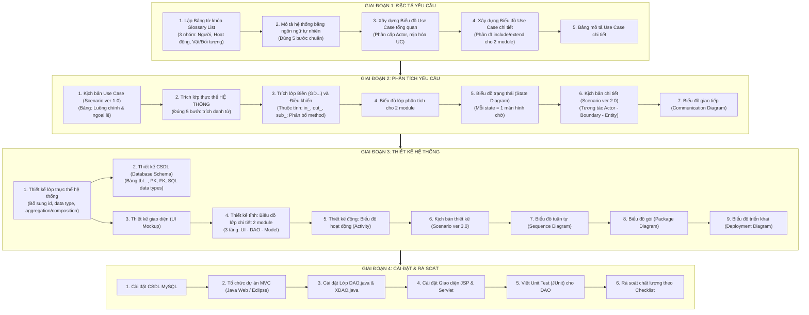
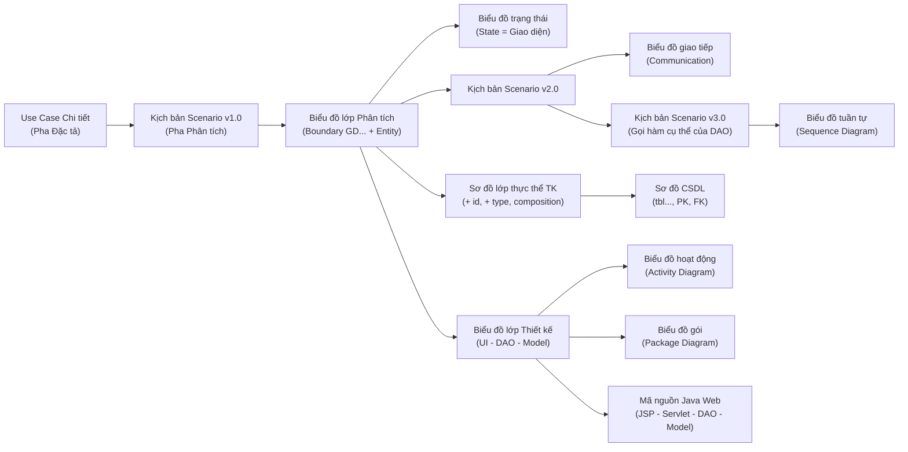
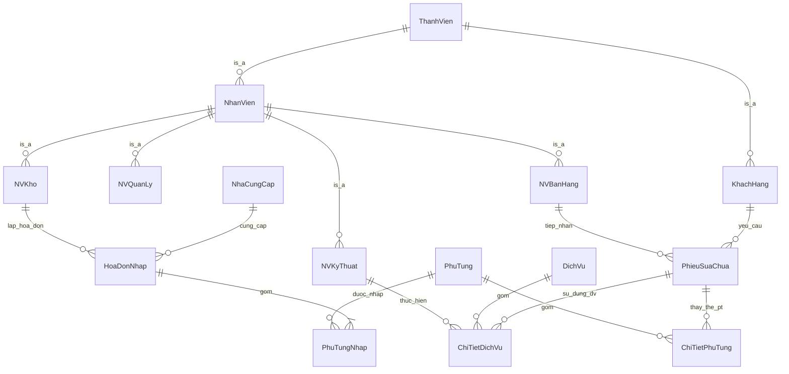

# BẢN ĐỒ TRI THỨC VÀ QUY CHUẨN PHÂN TÍCH THIẾT KẾ HỆ THỐNG (PTTK)
> **Tài liệu nguồn:** `BG HP TTTN 2 CNPM 2020 final.pdf` (Bài giảng Thực tập tốt nghiệp 2 CNPM - Bộ môn CNPM)  
> **Mục đích:** Cung cấp bản đồ quy trình (knowledge map), các bước thực hiện chuẩn chỉ, mẫu biểu (templates), và quy ước bắt buộc để AI và sinh viên bám sát 100% trong suốt quá trình hoàn thành Đề bài 26 (GaraMan).

---

## MỤC LỤC BẢN ĐỒ TRI THỨC

1. [Sơ đồ tổng quan quy trình phát triển phần mềm (Roadmap)](#1-sơ-đồ-tổng-quan-quy-trình-phát-triển-phần-mềm)
2. [Sơ đồ liên kết các artifact qua từng giai đoạn](#2-sơ-đồ-liên-kết-các-artifacts-giữa-các-giai-đoạn)
3. [Giai đoạn 1: Đặc tả yêu cầu (Chương 3 - Mục 3.1)](#3-giai-đoạn-1-đặc-tả-yêu-cầu-mục-31)
4. [Giai đoạn 2: Phân tích yêu cầu (Chương 3 - Mục 3.2)](#4-giai-đoạn-2-phân-tích-yêu-cầu-mục-32)
5. [Giai đoạn 3: Thiết kế hệ thống (Chương 4)](#5-giai-đoạn-3-thiết-kế-hệ-thống-chương-4)
6. [Giai đoạn 4: Cài đặt hệ thống (Chương 5)](#6-giai-đoạn-4-cài-đặt-hệ-thống-chương-5)
7. [Giai đoạn 5: Rà soát & Đảm bảo chất lượng (Chương 6)](#7-giai-đoạn-5-rà-soát-và-đảm-bảo-chất-lượng-chương-6)
8. [Bản đồ áp dụng cho Đề bài 26: GaraMan](#8-bản-đồ-áp-dụng-cho-đề-bài-26-garaman)
9. [Cẩm nang quy ước và cú pháp PlantUML chuẩn](#9-cẩm-nang-quy-ước-và-cú-pháp-plantuml-chuẩn)

---

## 1. SƠ ĐỒ TỔNG QUAN QUY TRÌNH PHÁT TRIỂN PHẦN MỀM



---

## 2. SƠ ĐỒ LIÊN KẾT CÁC ARTIFACTS GIỮA CÁC GIAI ĐOẠN

Bản đồ dưới đây chỉ rõ tính kế thừa và ánh xạ trực tiếp từ pha này sang pha khác:



---

## 3. GIAI ĐOẠN 1: ĐẶC TẢ YÊU CẦU (MỤC 3.1)

### 3.1.1 Bảng từ khóa (Glossary List)
- **Mục tiêu:** Thống nhất ngôn ngữ chuyên ngành của ứng dụng, tránh mơ hồ.
- **Quy trình 3 bước:**
  - **Bước 1:** Động não (Brainstorming) liệt kê toàn bộ các từ khóa chuyên môn.
  - **Bước 2:** Phân loại từ khóa vào **3 nhóm bắt buộc**:
    1. *Nhóm 1: Con người* (Các vai trò, người sử dụng, nhân sự liên quan).
    2. *Nhóm 2: Hoạt động của con người* (Các hành vi, chức năng, tác vụ nghiệp vụ).
    3. *Nhóm 3: Vật, đối tượng xử lý* (Hàng hóa, hóa đơn, báo cáo, thực thể dữ liệu).
  - **Bước 3:** Lập bảng kết quả 4 cột:
    ```markdown
    | TT | Tên Tiếng Việt | Tiếng Anh | Giải thích chi tiết |
    |----|----------------|-----------|----------------------|
    | 1  | ...            | ...       | ...                  |
    ```

---

### 3.1.2 Mô tả hệ thống bằng ngôn ngữ tự nhiên (Đúng 5 bước giáo trình)
Đây là phần cốt lõi bắt buộc phải trình bày rành mạch qua **5 bước**:
- **Bước 1: Giới thiệu mục đích hệ thống:** Hệ thống xây dựng cho ai, nhằm giải quyết bài toán gì, môi trường triển khai nào (web/desktop).
- **Bước 2: Phạm vi hệ thống:**
  - Liệt kê ai được dùng phần mềm (danh sách người dùng/actor).
  - Với mỗi người dùng, liệt kê danh sách các chức năng được phép thực hiện sau khi đăng nhập.
- **Bước 3: Mô tả chi tiết hoạt động nghiệp vụ của từng chức năng:**
  - Đi lần lượt từng chức năng đã nêu ở Bước 2.
  - Mô tả theo luồng tương tác: Người dùng làm gì $\rightarrow$ Hệ thống phản hồi gì $\rightarrow$ Người dùng nhập gì $\rightarrow$ Kết quả ra sao.
- **Bước 4: Các đối tượng được quản lý, xử lý trong hệ thống:**
  - Liệt kê chi tiết các đối tượng dữ liệu (thực thể).
  - Chỉ rõ mỗi đối tượng bao gồm những thông tin (thuộc tính) gì.
- **Bước 5: Mối quan hệ giữa các đối tượng quản lý:**
  - Nêu rõ mối quan hệ logic giữa các đối tượng ở Bước 4 (ví dụ: Một nhà cung cấp cung cấp nhiều phụ tùng; Một hóa đơn nhập gồm nhiều chi tiết nhập...).

---

### 3.1.3 Biểu đồ Use Case tổng quan và chi tiết
- **Biểu đồ Use Case tổng quan (3 bước):**
  - *Bước 1: Đề xuất Actor:* Xác định actor tương ứng người dùng ở Bước 2 (mục 3.1.2). Xây dựng phân cấp thừa kế: ví dụ `ThanhVien` $\rightarrow$ `NhanVien` $\rightarrow$ `NVQuanLi`, `NVKho`, `NVBanHang`; và `KhachHang`.
  - *Bước 2: Đề xuất Use Case:* Tương ứng mỗi chức năng nghiệp vụ là 1 Use Case.
  - *Bước 3: Mịn hóa Use Case:* Gộp các use case giống nhau hoặc thiết lập quan hệ kế thừa (generalization).
- **Biểu đồ Use Case chi tiết (2 bước):**
  - *Bước 1:* Trích use case của module từ biểu đồ tổng quan.
  - *Bước 2:* Phân rã use case bằng quan hệ `<<include>>` (bắt buộc phải thực hiện) và `<<extend>>` (tùy chọn / rẽ nhánh khi thỏa điều kiện).
- **Mẫu mô tả Use Case chi tiết:**
  ```markdown
  - Tên Use Case: ...
  - Actor chính: ...
  - Tiền điều kiện: ...
  - Hậu điều kiện: ...
  - Luồng sự kiện chính (Main Flow):
    1. Người dùng...
    2. Hệ thống...
  - Luồng ngoại lệ (Alternative / Exception Flow):
    2a. Nếu... thì...
  ```

---

## 4. GIAI ĐOẠN 2: PHÂN TÍCH YÊU CẦU (MỤC 3.2)

### 4.2.1 Viết kịch bản Use Case (Scenario ver 1.0)
Áp dụng cho 2 module trọng tâm. Mỗi kịch bản có định dạng chuẩn theo case study trong sách:

| Mục | Nội dung |
| :--- | :--- |
| **Use case** | *Tên use case* |
| **Actor** | *Tác nhân tham gia* |
| **Tiền điều kiện** | *Trạng thái hệ thống trước khi thực hiện* |
| **Hậu điều kiện** | *Kết quả sau khi hoàn thành nghiệp vụ* |
| **Kịch bản chính** | Đánh số 1, 2, 3... mô tả chi tiết: người dùng bấm gì, giao diện hiện ra gồm những bảng/cột/nút nào, người dùng chọn gì, hệ thống phản hồi gì. |
| **Ngoại lệ** | Đánh số ứng với bước xảy ra ngoại lệ (ví dụ: `4a. Không tìm thấy dữ liệu...`) |

---

### 4.2.2 Trích lớp thực thể toàn hệ thống (5 bước chuẩn trích danh từ)
- **Bước 1: Mô tả ngắn gọn nhưng đầy đủ hệ thống trong 1 đoạn văn:** (Có thể tổng hợp từ kịch bản các use case).
- **Bước 2: Trích danh từ xuất hiện trong đoạn văn:** Liệt kê toàn bộ danh từ, phân loại: Danh từ người, Danh từ vật, Danh từ thông tin/khái niệm.
- **Bước 3: Đánh giá danh từ (3 khả năng):**
  1. *Đề xuất thành lớp thực thể:* Đại diện cho đối tượng cần lưu trữ dữ liệu độc lập.
  2. *Đề xuất thành thuộc tính của lớp khác:* Là thông tin đơn lẻ, bổ trợ.
  3. *Loại bỏ:* Do quá trừu tượng, chung chung, hoặc ngoài phạm vi hệ thống.
- **Bước 4: Xác định quan hệ số lượng (Multiplicity):**
  - $1-1$: Cân nhắc gộp hoặc giữ nguyên nếu có lý do riêng biệt.
  - $1-n$: Giữ nguyên (ví dụ: 1 Nhà cung cấp - $n$ Phụ tùng nhập).
  - $n-n$: **Bắt buộc** đề xuất lớp thực thể trung gian để tách thành ít nhất hai quan hệ $1-n$ (ví dụ: `HoaDonNhap` và `PhuTung` có quan hệ $n-n \rightarrow$ tách qua `PhuTungNhap` / `ChiTietNhap`).
- **Bước 5: Xác định quan hệ đối tượng:**
  - Kế thừa (Inheritance/Generalization)
  - Hợp thành (Aggregation $\diamond$) / Gắn chặt (Composition $\blacklozenge$)
  - Liên kết (Association)
- *Lưu ý phân tích:* Chưa cần thuộc tính `id`, chưa cần kiểu dữ liệu, quan hệ thống nhất toàn hệ thống.

---

### 4.2.3 Trích lớp biên và điều khiển (Biểu đồ lớp phân tích cho Module)
- **Bước 1:** Mỗi màn hình giao diện $\rightarrow$ 1 lớp biên (đặt tên `GD...`, stereotype `<<boundary>>`).
- **Bước 2: Xác định thuộc tính lớp biên với tiền tố chuẩn:**
  - `in...`: Nhận dữ liệu vào (ô text, combobox, datepicker...).
  - `out...`: Hiển thị dữ liệu ra (bảng table, danh sách, nhãn thông báo...).
  - `sub...`: Submit dữ liệu hoặc chuyển hướng (nút button, liên kết link...).
- **Bước 3: Đề xuất phương thức (Method) cho tầng nghiệp vụ/thực thể:**
  - Xác định tên hàm, tham số vào, tham số ra.
  - *Quy tắc phân bổ phương thức vào lớp:*
    - Nếu tham số ra liên quan thực thể nào $\rightarrow$ gán cho thực thể đó.
    - Nếu không, xét tham số vào: nếu thuộc 1 thực thể $\rightarrow$ gán cho thực thể đó; nếu liên quan nhiều thực thể $\rightarrow$ gán cho thực thể "nhỏ nhất" chứa được nhiều tham số vào nhất.

---

### 4.2.4 Phân tích hoạt động (Behavioral Analysis)
1. **Biểu đồ chuyển trạng thái (State Diagram):**
   - *Quy tắc:* Mỗi trạng thái chờ = 1 lần hệ thống hiển thị 1 giao diện (`GD...`) để chờ người dùng tương tác.
   - *Điều kiện chuyển trạng thái:* Hành động tương tác của người dùng trên giao diện đó (click nút tìm kiếm, click chọn dòng, click lưu...).
2. **Kịch bản chi tiết phiên bản 2 (Scenario ver 2.0):**
   - Viết từng bước đánh số: Mỗi bước là một hành động cụ thể của một lớp (`GD...`, Entity) hoặc tác nhân.
   - *Ví dụ mẫu:*
     1. Khách hàng click vào tìm kiếm trên `GDChinh`.
     2. Lớp `GDChinh` gọi lớp `GDTimKiemDichVu`.
     3. Khách hàng nhập từ khóa và bấm tìm kiếm.
     4. `GDTimKiemDichVu` gọi lớp `DichVu` yêu cầu tìm theo tên.
     5. Lớp `DichVu` tìm kiếm và trả kết quả về cho `GDTimKiemDichVu`.
     6. `GDTimKiemDichVu` hiển thị kết quả cho khách hàng...
3. **Biểu đồ giao tiếp (Communication Diagram):**
   - Vẽ các đối tượng Actor, Boundary, Entity.
   - Đánh số thứ tự các thông điệp ($1, 2, 3...$) khớp 100% với Kịch bản ver 2.0.

---

## 5. GIAI ĐOẠN 3: THIẾT KẾ HỆ THỐNG (CHƯƠNG 4)

### 5.1 Thiết kế lớp thực thể hệ thống (Mục 4.1)
- **Bước 1:** Bổ sung thuộc tính `id: int` cho các lớp không kế thừa từ lớp khác. Lớp con kế thừa dùng lại `id` từ lớp cha.
- **Bước 2:** Bổ sung kiểu dữ liệu ngôn ngữ lập trình (Java: `String`, `float`, `double`, `Date`, `boolean`...).
- **Bước 3:** Chuyển đổi toàn bộ quan hệ association thành aggregation / composition:
  - Nếu lớp $C$ sinh ra từ liên kết $A$ và $B \rightarrow C$ chứa đối tượng $A$ và đối tượng $B$.
- **Bước 4:** Bổ sung thuộc tính đối tượng tường minh:
  - Quan hệ $1-n$: Lớp $1$ chứa danh sách `List<ClassN>` hoặc Lớp $n$ chứa đối tượng `Class1`.

---

### 5.2 Thiết kế Cơ sở dữ liệu (Mục 4.2)
- **Bước 1:** Mỗi lớp thực thể $\rightarrow$ 1 bảng trong CSDL với tiền tố `tbl` (ví dụ: `tblKhachHang`, `tblPhuTung`, `tblHoaDonNhap`).
- **Bước 2:** Thuộc tính kiểu cơ bản của lớp $\rightarrow$ Cột của bảng, chọn kiểu SQL tương ứng (`INT AUTO_INCREMENT`, `VARCHAR`, `FLOAT`, `DATETIME`...).
- **Bước 3: Chuyển quan hệ số lượng thành Khóa chính (PK) và Khóa ngoại (FK):**
  - Quan hệ $1-n$: Đưa khóa chính của bảng 1 sang làm khóa ngoại ở bảng $n$.
  - Quan hệ $n-n$: Bắt buộc có bảng trung gian chứa 2 khóa ngoại trỏ tới 2 bảng gốc.

---

### 5.3 Thiết kế chi tiết cho Module (Mục 4.3)
Gồm 2 khía cạnh: **Tĩnh** và **Động**:

#### A. Thiết kế tĩnh:
1. **Thiết kế giao diện (UI Mockup):**
   - Thiết kế wireframe chi tiết từng màn hình JSP (`gdChinh.jsp`, `gdTimKiem.jsp`, `gdChiTiet.jsp`...).
2. **Thiết kế lớp DAO (Data Access Object):**
   - Đề xuất lớp `DAO.java` dùng chung (quản lý kết nối JDBC MySQL).
   - Đề xuất các lớp DAO chuyên biệt: `PhuTungDAO`, `NhaCungCapDAO`, `HoaDonNhapDAO`... kế thừa `DAO`.
   - Khai báo tường minh phương thức DAO: tên hàm, tham số truyền vào, kiểu trả về (`List<T>`, `boolean`, `T`).
3. **Biểu đồ lớp thiết kế chi tiết (3 tầng kiến trúc):**
   - **Tầng Giao diện (Presentation Layer):** Các trang JSP / Servlet.
   - **Tầng Truy cập dữ liệu (Data Access Layer):** Các lớp DAO kế thừa `DAO.java`.
   - **Tầng Thực thể (Model Layer):** Các Entity Class đã hoàn thiện thuộc tính đối tượng và getter/setter.

#### B. Thiết kế động:
1. **Biểu đồ hoạt động (Activity Diagram):**
   - Mô tả luồng xử lý nghiệp vụ với các action tương ứng các method trong biểu đồ lớp thiết kế.
2. **Kịch bản thiết kế chi tiết (Scenario ver 3.0):**
   - Nâng cấp từ ver 2.0: Tên hành động được thay bằng **tên phương thức cụ thể** được gọi trên lớp DAO và Model.
   - *Ví dụ:* `gdNhapPhuTung.jsp` gọi `nccDAO.searchNhaCungCap(name)`.
3. **Biểu đồ tuần tự (Sequence Diagram):**
   - Lifeline đại diện cho: Actor, Trang JSP, Servlet/Controller (nếu có), DAO, Entity, và Database.
   - Gọi chính xác tên hàm với tham số; thể hiện đường kích hoạt (activation box) và thông điệp trả lời (return message nét đứt).

---

### 5.4 Thiết kế triển khai (Mục 4.3.3)
1. **Biểu đồ gói (Package Diagram):**
   - Gói `model`: Chứa tất cả Entity classes.
   - Gói `dao`: Chứa `DAO.java` và các lớp con `XDAO.java`.
   - Gói `view`: Chứa các trang JSP, phân thư mục con theo tác nhân/module: `view/khachhang`, `view/nvkho`, `view/chung`...
2. **Biểu đồ triển khai (Deployment Diagram):**
   - Node 1: `Client Device` (Web Browser - Chrome/Edge). Giao tiếp qua `HTTP/HTTPS`.
   - Node 2: `Web Application Server` (Apache Tomcat / Eclipse WTP). Chứa Servlet/JSP Container và Java Runtime. Giao tiếp qua `JDBC Driver`.
   - Node 3: `Database Server` (MySQL Server / MariaDB trên cổng 3306).

---

## 6. GIAI ĐOẠN 4: CÀI ĐẶT HỆ THỐNG (CHƯƠNG 5)

### 6.1 Cấu trúc thư mục dự án chuẩn (Eclipse Java Web Dynamic Project)
```text
GaraMan/
├── Java Resources/
│   └── src/
│       ├── model/             # Chứa các Entity (ThanhVien, PhuTung, NhaCungCap, HoaDonNhap...)
│       ├── dao/               # Chứa DAO.java, PhuTungDAO.java, NhaCungCapDAO.java...
│       └── test/              # Chứa các bộ kiểm thử đơn vị JUnit cho DAO
├── WebContent/ (hoặc src/main/webapp/)
│   ├── META-INF/
│   ├── WEB-INF/
│   │   ├── lib/               # mysql-connector-j.jar, jstl.jar...
│   │   └── web.xml
│   ├── css/
│   ├── js/
│   ├── khachhang/             # JSP cho Module Tìm kiếm dịch vụ/phụ tùng
│   ├── nvkho/                 # JSP cho Module Nhập phụ tùng
│   ├── index.jsp              # Trang đăng nhập / điều hướng chính
│   └── header.jsp, footer.jsp
```

### 6.2 Mẫu lớp DAO.java chuẩn giáo trình
```java
package dao;

import java.sql.Connection;
import java.sql.DriverManager;
import java.sql.SQLException;

public class DAO {
    public static Connection con;
    
    public DAO() {
        if (con == null) {
            String dbUrl = "jdbc:mysql://localhost:3306/garaman_db?useSSL=false&allowPublicKeyRetrieval=true&serverTimezone=UTC";
            String dbClass = "com.mysql.cj.jdbc.Driver";
            try {
                Class.forName(dbClass);
                con = DriverManager.getConnection(dbUrl, "root", "password");
            } catch (ClassNotFoundException | SQLException e) {
                e.printStackTrace();
            }
        }
    }
}
```

---

## 7. GIAI ĐOẠN 5: RÀ SOÁT VÀ ĐẢM BẢO CHẤT LƯỢNG (CHƯƠNG 6)

### Checklist rà soát nhanh 4 cấp độ:
- [ ] **Rà soát Đặc tả:** Bảng từ khóa đủ 3 nhóm? 5 bước mô tả tự nhiên có bị nhảy cóc? Actor tổng quan có phân cấp cha-con hợp lý? Use case chi tiết có include/extend đúng chuẩn?
- [ ] **Rà soát Phân tích:** Đủ 5 bước trích danh từ? Có còn quan hệ $n-n$ chưa tách không? Biểu đồ trạng thái các state có đúng là màn hình chờ? Kịch bản v2.0 và biểu đồ giao tiếp có khớp số thứ tự 1-1?
- [ ] **Rà soát Thiết kế:** Lớp thực thể đã có `id` và kiểu dữ liệu? Quan hệ aggregation/composition đã thể hiện bằng thuộc tính danh sách? Bảng CSDL có tiền tố `tbl` và đủ khóa ngoại? Biểu đồ lớp 3 tầng đã có DAO kế thừa `DAO`? Biểu đồ tuần tự gọi đúng tên hàm của DAO?
- [ ] **Rà soát Mã nguồn & Test:** Các câu lệnh SQL trong DAO dùng `PreparedStatement` chống SQL Injection? Đã có bộ test case JUnit kiểm thử DAO với dữ liệu biên?

---

## 8. BẢN ĐỒ ÁP DỤNG CHO ĐỀ BÀI 26: GARAMAN

### 8.1 Ma trận Ánh xạ Thực thể GaraMan
Dưới đây là ma trận ánh xạ các thực thể cốt lõi xác định từ đề bài:



### 8.2 Ánh xạ 2 Module trọng tâm:

| Thành phần | Module 1: Khách hàng tìm kiếm dịch vụ / phụ tùng | Module 2: Nhân viên kho nhập phụ tùng |
| :--- | :--- | :--- |
| **Actor chính** | `KhachHang` | `NVKho` |
| **Lớp Biên (Boundary)** | `GDChinhKH`, `GDTimKiemDVPT`, `GDChiTietDV`, `GDChiTietPT` | `GDChinhNVKho`, `GDNhapPhuTung`, `GDThemNCC`, `GDThemPhuTung`, `GDHoaDonNhap` |
| **Thuộc tính tiền tố** | `inTenTuKhoa`, `outDanhSachDVPT`, `subXemChiTiet` | `inTenNCC`, `inTenPhuTung`, `inSoLuong`, `inDonGia`, `subXacNhan`, `subInHoaDon` |
| **Lớp DAO** | `DichVuDAO`, `PhuTungDAO` | `NhaCungCapDAO`, `PhuTungDAO`, `HoaDonNhapDAO` |
| **Phương thức tiêu biểu** | `searchDichVu(keyword)`, `getDichVuById(id)`, `searchPhuTung(keyword)` | `searchNhaCungCap(name)`, `addNhaCungCap(ncc)`, `searchPhuTung(name)`, `addPhuTung(pt)`, `luuHoaDonNhap(hd)` |
| **Lớp Thực thể** | `DichVu`, `PhuTung` | `HoaDonNhap`, `PhuTungNhap`, `PhuTung`, `NhaCungCap`, `NVKho` |
| **Bảng CSDL liên quan** | `tblDichVu`, `tblPhuTung` | `tblNhaCungCap`, `tblPhuTung`, `tblHoaDonNhap`, `tblPhuTungNhap`, `tblNhanVien` |

---

## 9. CẨM NANG QUY ƯỚC VÀ CÚ PHÁP PLANTUML CHUẨN

Để nộp bài vào các link Google Form không bị lỗi hiển thị, mã PlantUML cần tuân thủ các quy tắc sau:

### 9.1 Quy ước đặt tên
- **Lớp thực thể (Entity):** Viết hoa chữ cái đầu (PascalCase), danh từ số ít: `KhachHang`, `DichVu`, `PhuTung`, `HoaDonNhap`.
- **Lớp biên (Boundary):** Tiền tố `GD` + PascalCase: `GDChinh`, `GDTimKiemDichVu`, `GDNhapPhuTung`.
- **Lớp DAO:** Tên thực thể + `DAO`: `PhuTungDAO`, `DichVuDAO`.
- **Bảng CSDL:** Tiền tố `tbl` + PascalCase: `tblPhuTung`, `tblHoaDonNhap`.
- **Thuộc tính lớp biên:**
  - Nhập liệu: `in...` (ví dụ `inTuKhoa`, `inSoLuong`)
  - Hiển thị: `out...` (ví dụ `outDanhSach`, `outThongBao`)
  - Nút bấm/Submit: `sub...` (ví dụ `subTimKiem`, `subLuuHoaDon`)
- **Thuộc tính & phương thức thực thể/DAO:** camelCase (ví dụ `soLuong`, `donGiaNhap`, `searchByName()`).

### 9.2 Khung cú pháp PlantUML tiêu biểu
```plantuml
@startuml
skinparam handwritten false
skinparam monochrome false
skinparam packageStyle rectangle
skinparam shadowing false

' Định nghĩa style rõ ràng, font dễ đọc
skinparam class {
    BackgroundColor LightYellow
    ArrowColor DarkSlateGray
    BorderColor DarkSlateGray
}

' Mã sơ đồ cụ thể ở đây...
@enduml
```

---
*Bản đồ tri thức này được thiết lập làm kim chỉ nam chuẩn xác cho toàn bộ các bước thực hiện tiếp theo của đồ án GaraMan.*
